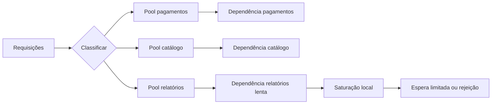

No corredor de manutenção de uma balsa, uma passageira vê, através de uma janela de vidro reforçado, água invadindo uma sala de máquinas e pergunta por que o tripulante está apertando a roda de uma porta pesada já fechada em vez de tentar entrar; ele termina de vedar a porta e explica que a ideia é perder aquele compartimento para manter o restante do navio seco. Ela observa o corredor ainda seguro e entende a troca: sacrificar uma parte para preservar o conjunto. Em software, Bulkhead aplica a mesma lógica ao separar recursos e capacidade em compartimentos independentes, para que lentidão, exaustão ou falha em um deles não consuma tudo o que os outros precisam para continuar funcionando.

<strong>Ideia central:</strong> um bulkhead não impede a falha original. Ele limita o raio de impacto ao decidir antecipadamente quais recursos uma classe de trabalho, dependência, cliente ou célula pode consumir.

<nav aria-label="Neste artigo"><strong>Neste guia</strong><ul><li><a href="#bh-problema">Quando recursos compartilhados viram propagadores de falha</a></li><li><a href="#bh-origem">Origem e definição do padrão</a></li><li><a href="#bh-mecanismo">Como o isolamento funciona</a></li><li><a href="#bh-matematica">Orçamento de capacidade e matemática útil</a></li><li><a href="#bh-formas">Semáforos, pools, filas, processos e células</a></li><li><a href="#bh-combinacoes">Relação com timeout, circuit breaker e load shedding</a></li><li><a href="#bh-operacao">Observabilidade e operação</a></li><li><a href="#bh-adocao">Adoção incremental</a></li><li><a href="#bh-fontes">Fontes</a></li></ul></nav>

## 1. Quando recursos compartilhados viram propagadores de falha

Imagine uma API que atende pagamentos, catálogo e relatórios. As três rotas usam o mesmo conjunto de 100 workers e o mesmo pool de conexões. Em situação normal, essa simplicidade parece eficiente: qualquer recurso livre pode servir qualquer requisição. O problema aparece quando uma classe deixa de se comportar como as outras.

Suponha que o serviço de relatórios fique lento e cada consulta passe a ocupar um worker por vários segundos. Se o pool for totalmente compartilhado, relatórios podem reter dezenas de workers e conexões. Pagamentos e catálogo continuam saudáveis em si, mas começam a esperar pelo mesmo recurso esgotado. O defeito atravessa uma fronteira que não precisava atravessar.

O [Azure Architecture Center](<https://learn.microsoft.com/en-us/azure/architecture/patterns/bulkhead>) descreve exatamente essa força arquitetural: um consumidor ou serviço lento pode reter conexões, threads ou outras unidades de capacidade até impedir chamadas a dependências que não estão com problema. O padrão Bulkhead introduz partições para conter essa propagação.

O ponto sutil é que a causa inicial pode ser externa. Uma API de terceiros pode congelar, um banco pode aumentar a latência, um cliente pode gerar carga anormal ou um lote pode executar uma consulta cara. O bulkhead atua no efeito local: ele evita que uma classe de trabalho transforme lentidão ou falha parcial em exaustão global.

<h3>Falha funcional e falha de capacidade são coisas diferentes</h3>

Se uma dependência retorna erro rapidamente, o chamador perde aquela função, mas pode liberar seus recursos quase de imediato. Uma dependência que responde em 30 segundos pode ser mais perigosa: cada chamada ocupa memória, sockets, conexões, workers ou permissões de concorrência por muito tempo. A fila cresce, os tempos limite disparam e clientes podem repetir requisições.

Por isso, o padrão não deve ser reduzido a uma separação visual de serviços. A pergunta útil é: **qual recurso pode ser monopolizado quando esta parte degrada?** A fronteira deve existir justamente onde há risco de uma classe consumir capacidade necessária a outras.

## 2. De compartimentos estanques a fronteiras de falha

O nome vem dos compartimentos estanques de embarcações. Uma antepara fechada limita o alagamento a uma seção do casco. Na literatura de software, Michael Nygard consolidou o padrão entre os mecanismos de estabilidade de [<em lang="en-US">Release It!</em>](<https://www.oreilly.com/library/view/release-it/9781680500264/f_0044.xhtml>), usando a mesma ideia de contenção de dano: particionar capacidade para que uma falha não destrua o sistema inteiro.

Em termos arquiteturais, um bulkhead é uma **fronteira de isolamento de recursos ou de falha**. Ela pode existir dentro de um processo, entre processos ou em uma topologia distribuída inteira. O padrão é mais amplo que separar threads.

<table><thead><tr><th scope="col">Fronteira</th><th scope="col">Recurso isolado</th><th scope="col">Falha que ajuda a conter</th></tr></thead><tbody><tr><td>Semáforo por dependência</td><td>Concorrência em andamento</td><td>Uma integração lenta ocupa todas as execuções disponíveis.</td></tr><tr><td>Pool de conexões dedicado</td><td>Conexões de banco ou rede</td><td>Uma dependência esgota conexões usadas por outras.</td></tr><tr><td>Fila e workers dedicados</td><td>Buffer e capacidade de processamento</td><td>Um tipo de tarefa cria backlog que atrasa tarefas críticas.</td></tr><tr><td>Processo ou contêiner separado</td><td>CPU, memória, descritores e ciclo de vida</td><td>Vazamento, travamento ou pressão de memória atinge apenas uma unidade.</td></tr><tr><td>Célula ou grupo de instâncias</td><td>Capacidade de serviço e estado associado</td><td>Uma implantação, cliente ou poison pill afeta apenas parte do tráfego.</td></tr></tbody></table>

A documentação da [AWS Well-Architected](<https://docs.aws.amazon.com/wellarchitected/2023-04-10/framework/rel_fault_isolation_use_bulkhead.html>) estende a ideia a arquiteturas celulares: cada célula atende um subconjunto do trabalho e deve compartilhar o mínimo possível com outras células. Isso reduz o raio de impacto de falhas que seriam difíceis de conter apenas com controles dentro de um processo.

## 3. O mecanismo: reservar capacidade e impedir transbordamento

O padrão começa por classificar trabalho em grupos que merecem destinos de falha diferentes. A chave pode ser uma dependência, uma funcionalidade, criticidade, tenant, região, tipo de tarefa ou outra dimensão que represente um risco real.

Depois, cada grupo recebe uma fronteira de capacidade. O princípio é simples: quando o compartimento A chega ao limite, ele deve esperar, rejeitar, degradar ou falhar **dentro de A**. Não pode pegar silenciosamente toda a capacidade reservada para B e C.

<!-- tech-topics:mermaid {"label":"Fluxo de uma API que classifica requisições em três pools isolados. O pool de relatórios pode saturar sem ocupar os pools de pagamentos e catálogo."} -->

<figcaption>Fluxo conceitual. A saturação em relatórios termina na própria fronteira; pagamentos e catálogo mantêm seus orçamentos de concorrência. A separação só funciona se não houver outro recurso crítico compartilhado fora do desenho.</figcaption>

Ver o código Mermaid
<pre class="code-block">flowchart LR
  R[Requisições] --&gt; C{Classificar}
  C --&gt; P[Pool pagamentos]
  C --&gt; K[Pool catálogo]
  C --&gt; B[Pool relatórios]
  P --&gt; DP[Dependência pagamentos]
  K --&gt; DK[Dependência catálogo]
  B --&gt; DR[Dependência relatórios lenta]
  DR --&gt; S[Saturação local]
  S --&gt; X[Espera limitada ou rejeição]</pre>

<h3>Execução normal</h3>

Com todos os destinos saudáveis, cada partição consome apenas a capacidade de que precisa. Se pagamentos usam 8 de 20 permissões, catálogo 18 de 35 e relatórios 10 de 25, há folga dentro de cada fronteira. A desvantagem aparece aqui: 12 permissões ociosas em pagamentos não são automaticamente emprestadas a relatórios.

<h3>Execução durante falha</h3>

Se relatórios ficam dez vezes mais lentos, suas 25 permissões são ocupadas e novas tarefas atingem a política local: uma fila curta, um erro de saturação ou um caminho degradado. O sistema perde parte da função de relatórios, mas continua com 20 permissões reservadas para pagamentos e 35 para catálogo. Esse comportamento parcial é a consequência desejada do padrão.

<h3>Fronteiras precisam ser completas o suficiente</h3>

Separar workers e manter um único pool de 40 conexões de banco pode criar uma falsa sensação de isolamento. Se relatórios consomem as 40 conexões, os três pools de workers continuam distintos no diagrama e igualmente bloqueados na prática. A fronteira precisa cobrir os recursos que realmente propagam a falha.

CPU, memória, descritores de arquivo, filas de execução, conexões, limites de API, locks, cache, banco e até componentes de roteamento podem continuar compartilhados. O padrão não exige duplicar tudo; exige saber o que continua comum e aceitar conscientemente esse domínio de falha.

## 4. Orçamento de capacidade: quanto reservar em cada compartimento?

Não existe um número universal. A divisão nasce de carga observada, tempos de serviço, criticidade e custo de ficar sem capacidade. Ainda assim, três relações simples ajudam a raciocinar.

<h3>4.1 A soma dos orçamentos</h3>

Se um processo pode sustentar aproximadamente `C` operações concorrentes, uma configuração rígida pode reservar:

<pre><code>C = B_pagamentos + B_catalogo + B_relatorios + H</code></pre>

em que cada `B` é o limite de concorrência de uma partição e `H` é uma margem de segurança ou capacidade deliberadamente não comprometida. Essa equação é um orçamento, não uma lei física: o verdadeiro limite pode variar com CPU, memória, latência das dependências e distribuição de custos por requisição.

<h3>4.2 Concorrência necessária cresce com taxa e duração</h3>

Pela Lei de Little, em regime estável, a concorrência média pode ser aproximada por `L = λ × W`, em que `λ` é a taxa de conclusões e `W` é o tempo médio dentro da fronteira. Se pagamentos processam 120 requisições por segundo em 80 ms, a concorrência média é aproximadamente:

<pre><code>L ≈ 120 × 0,080 = 9,6 operações</code></pre>

Reservar exatamente 10 seria frágil porque a média esconde picos e caudas. Testes de carga e distribuições de latência precisam definir margem. O cálculo serve para detectar ordens de grandeza absurdas, não para produzir o número final sozinho.

<h3>4.3 Um exemplo com três classes</h3>

Considere um serviço com 80 slots sustentáveis. Em operação saudável:

- pagamentos: 120 req/s a 80 ms → cerca de 10 operações em voo;
- catálogo: 250 req/s a 120 ms → cerca de 30 operações em voo;
- relatórios: 20 req/s a 2 s → cerca de 40 operações em voo.

Um pool compartilhado de 80 parece caber exatamente no valor médio. Mas se relatórios passam de 2 s para 10 s, a concorrência que tentariam ocupar sobe para aproximadamente 200. Sem fronteira, esse crescimento disputa todos os 80 slots.

Uma configuração ilustrativa poderia reservar 20 para pagamentos, 35 para catálogo e 25 para relatórios. Relatórios começariam a rejeitar ou enfileirar cedo, porém pagamentos e catálogo manteriam capacidade própria. Não há almoço grátis: relatórios também passam a saturar antes, e slots ociosos de pagamentos podem ficar parados.

<strong>Trade-off estrutural:</strong> isolamento troca eficiência média por previsibilidade durante degradação. Quanto mais rígida a partição, menor a chance de uma classe roubar capacidade das outras — e maior a chance de existir capacidade ociosa em um compartimento enquanto outro rejeita trabalho.

<h3>Reserva rígida, reserva mínima e empréstimo controlado</h3>

Nem todo bulkhead precisa ser completamente rígido. Alguns sistemas usam capacidade mínima garantida por classe e permitem empréstimo de excedente quando existe folga. Isso melhora utilização, mas torna a contenção mais complexa: o empréstimo precisa ser revogável e não pode deixar a classe crítica sem seu piso quando a carga muda.

Antes de criar um algoritmo sofisticado, valide se pools fixos resolvem o problema. Complexidade dinâmica só se justifica quando o desperdício de capacidade é material e mensurável.

## 5. Formas de implementação e o que cada uma realmente isola

<h3>Semáforo: limitar concorrência sem trocar de executor</h3>

Um semáforo mantém no máximo `N` chamadas simultâneas para uma dependência. É uma forma leve de proteger concorrência e combina bem com modelos assíncronos. A biblioteca [Resilience4j](<https://resilience4j.readme.io/v1.0.0/docs/bulkhead>) documenta um `SemaphoreBulkhead` e um `FixedThreadPoolBulkhead` como duas implementações distintas.

O semáforo não cria CPU, memória ou conexões separadas. Se todas as classes continuam usando o mesmo executor saturado ou o mesmo pool de banco, o isolamento cobre apenas o número de execuções simultâneas naquela entrada.

<h3>Pool de threads ou workers dedicado</h3>

Uma fila limitada e um conjunto dedicado de workers criam uma fronteira mais explícita. Trabalho lento em A ocupa workers de A. B continua tendo seu executor. Essa abordagem ajuda quando operações são bloqueantes, mas aumenta custo de threads, filas, dimensionamento e mudança de contexto.

Fila ilimitada destrói boa parte do benefício. Se a partição tem 20 workers, porém aceita 100 mil itens pendentes, a falha foi convertida de exaustão de workers em backlog, memória e latência. O limite de fila faz parte do contrato do bulkhead.

<h3>Pool de conexões por dependência</h3>

Separar conexões costuma ser uma fronteira importante para bancos, caches e APIs. Se a integração A tem 15 conexões e B tem 10, uma explosão de A não consegue ocupar as dez de B. Ainda assim, ambos podem compartilhar o mesmo banco ou proxy abaixo dos pools; nesse nível, a falha pode voltar a se encontrar.

<h3>Fila assíncrona por classe</h3>

Trabalho em segundo plano pode ser particionado por filas e consumidores dedicados: notificações críticas em uma fila, geração de relatórios em outra, por exemplo. A fronteira torna backlog e capacidade visíveis por classe. Isso também permite políticas diferentes de retry, prioridade e retenção.

<h3>Processos, contêineres e limites de recursos</h3>

Quando o risco inclui vazamento de memória, CPU ou falha de processo, uma partição interna pode ser insuficiente. Processos ou contêineres separados adicionam fronteiras de ciclo de vida e podem receber limites próprios. O Azure cita processos, containers e grupos separados de instâncias como níveis possíveis de isolamento no padrão.

<h3>Células: bulkhead em escala de arquitetura</h3>

Uma arquitetura celular replica um conjunto completo de componentes e roteia subconjuntos do tráfego para células independentes. A AWS recomenda escolher uma chave de partição alinhada ao domínio do serviço, minimizar interações entre células, evitar estado compartilhado e manter o roteador simples. A ideia é que uma implantação ruim, poison pill ou saturação fique restrita a uma célula.

Esse desenho tem custo maior: dados podem precisar de mapeamento persistente por célula, migrações ficam mais trabalhosas, capacidade precisa ser planejada por unidade e componentes realmente globais viram pontos críticos de projeto. Use células quando o raio de impacto justificá-las, não como padrão automático para qualquer serviço.

## 6. Bulkhead não substitui timeout, circuit breaker, backpressure nem load shedding

Esses mecanismos resolvem perguntas diferentes e costumam funcionar em conjunto.

<table><thead><tr><th scope="col">Mecanismo</th><th scope="col">Pergunta que responde</th><th scope="col">O que acontece durante a falha</th></tr></thead><tbody><tr><td>Bulkhead</td><td>Quanto desta capacidade uma classe pode consumir?</td><td>Contém o consumo na partição.</td></tr><tr><td>Timeout</td><td>Quanto tempo uma operação pode ocupar recursos?</td><td>Encerra espera após um prazo.</td></tr><tr><td>Circuit breaker</td><td>Devemos continuar chamando uma dependência que parece falhar?</td><td>Falha rapidamente enquanto o circuito está aberto.</td></tr><tr><td>Load shedding</td><td>O sistema ainda deve admitir este trabalho?</td><td>Rejeita cedo quando capacidade está comprometida.</td></tr><tr><td>Backpressure</td><td>O produtor consegue reduzir o ritmo?</td><td>Propaga pressão para trás em vez de acumular sem limite.</td></tr></tbody></table>

Considere uma API de frete que chama três transportadoras. Um timeout impede esperar indefinidamente pela transportadora A. Um circuit breaker reduz chamadas quando A apresenta falhas repetidas. Um bulkhead garante que, mesmo antes de o circuito abrir ou durante respostas apenas lentas, A não ocupe todas as permissões usadas para B e C.

Retries merecem atenção especial. Se cada partição tem limite 20, mas toda rejeição gera três novas tentativas imediatas fora da mesma política, o sistema pode deslocar pressão para outra camada e ampliar o incidente. Retry precisa respeitar tempo limite, orçamento e a mesma fronteira de capacidade.

<h3>Bulkhead e load shedding são parceiros naturais</h3>

Quando um compartimento chega ao limite, alguma coisa precisa acontecer com a próxima chegada. Em sistemas síncronos, frequentemente a resposta correta é rejeitar cedo. Em sistemas assíncronos, pode ser usar fila limitada e aplicar backpressure. O bulkhead define *onde* a capacidade acaba; a política de admissão define *o que fazer* quando ela acaba.

## 7. Operação: um bulkhead invisível é difícil de dimensionar

Particionar capacidade sem medir saturação cria dois riscos simétricos: acreditar que existe proteção quando uma fronteira vive em 100% de uso, ou desperdiçar recursos durante meses porque o limite foi superdimensionado.

<h3>Métricas por partição</h3>

- **uso atual e limite:** concorrência ativa, workers ocupados, conexões em uso;
- **saturação:** fração do tempo próxima ou no limite;
- **fila:** tamanho, idade do item mais antigo e tempo de espera;
- **rejeições:** contagem e taxa por motivo;
- **latência:** dentro e antes da fronteira;
- **erros da dependência:** para separar saturação local de falha remota;
- **capacidade ociosa:** para detectar fragmentação excessiva;
- **uso do recurso compartilhado abaixo da fronteira:** CPU, memória, banco ou quota comum.

O alerta mais útil nem sempre é o limite absoluto. Uma partição que passa de 20% para 95% em cinco minutos pode exigir atenção antes de começar a rejeitar. Da mesma forma, rejeições podem ser comportamento esperado sob sobrecarga; o problema é quando atingem tráfego crítico ou permanecem altas fora de cenários previstos.

<h3>Logs e tracing precisam carregar a identidade da partição</h3>

Inclua no contexto operacional a classe, dependência ou célula responsável. Em tracing distribuído, registre qual bulkhead foi adquirido, quanto tempo a chamada esperou e se houve rejeição. Sem isso, todos os erros parecem vir do mesmo serviço e a fronteira arquitetural desaparece na observabilidade.

<h3>Teste o comportamento degradado, não apenas o caminho feliz</h3>

Um teste relevante deixa uma dependência lenta, não apenas indisponível. Verifique se a partição satura, se novas chamadas falham no tempo esperado, se as outras classes mantêm throughput e latência aceitáveis e se filas permanecem limitadas.

Para células, teste falhas de implantação e tráfego anormal por partição. A AWS alerta contra atualizar todas as células ao mesmo tempo: se o mesmo defeito entra simultaneamente em todas, a arquitetura perde o benefício de limitar o raio de impacto.

<h2>8. Onde o padrão falha ou vira custo sem benefício</h2>

<h3>Partição por organograma, não por risco</h3>

Criar um pool por microserviço só porque existem microserviços pode não isolar o recurso que realmente causa a falha. Uma fronteira útil começa pelo modo de falha: quem pode bloquear quem, e por qual recurso?

<h3>Granularidade fina demais</h3>

Um pool por endpoint, cliente e dependência pode gerar centenas de limites difíceis de operar. A capacidade se fragmenta, configuração fica instável e incidentes viram um quebra-cabeça de orçamentos. Agrupe trabalhos com perfil de custo e criticidade semelhantes quando o risco permitir.

<h3>Granularidade grossa demais</h3>

No extremo oposto, colocar tudo em um único compartimento mantém simplicidade e também mantém o domínio de falha global. Se uma classe conhecida como lenta ou imprevisível divide recursos críticos com caminhos de alta prioridade, o isolamento provavelmente está ausente justamente onde é necessário.

<h3>Compartilhamento escondido</h3>

Dois containers com CPU separada podem compartilhar o mesmo banco sem quota, a mesma fila, o mesmo cache ou um roteador central frágil. O diagrama de deployment mostra dois blocos; o domínio de falha real continua único.

<h3>Limite sem política de excesso</h3>

Quando o pool está cheio, enfileirar indefinidamente apenas muda o lugar da exaustão. Defina espera máxima, capacidade de fila, rejeição e semântica de retry.

<h3>Isolamento como desculpa para ignorar capacidade total</h3>

Bulkheads limitam propagação; não criam capacidade. Se todos os compartimentos estão saturados pela demanda legítima, o sistema ainda precisa de escala, otimização, cache, mudanças de produto ou limitação de carga.

## 9. Uma sequência incremental de adoção

1. **Mapeie recursos compartilhados.** Liste pools, filas, dependências, quotas, CPU, memória e bancos usados pelos caminhos críticos.
2. **Escolha um modo de falha concreto.** Por exemplo: relatórios lentos esgotam conexões usadas por pagamentos.
3. **Crie a menor fronteira que interrompe esse caminho.** Pode ser um semáforo, pool dedicado ou fila separada.
4. **Defina o comportamento de saturação.** Tempo máximo de espera, rejeição, degradação ou backpressure.
5. **Instrumente antes de otimizar.** Uso, fila, rejeição, latência e capacidade ociosa por partição.
6. **Teste degradação.** Injete lentidão e confirme que outras classes mantêm o contrato.
7. **Ajuste limites com dados.** Use carga real, testes e margens explícitas; não deixe valores iniciais virarem constantes sagradas.
8. **Expanda o domínio de isolamento somente se necessário.** Passe de concorrência para conexões, processos ou células quando a falha atravessar a camada atual.

<h3>Exemplo de política conceitual</h3>

O pseudocódigo abaixo mostra uma decisão simples. A fronteira de relatórios oferece no máximo 25 permissões e não espera indefinidamente. A implementação real deve tratar cancelamento, métricas e propagação do prazo restante.

<pre class="code-block"><code>permit = reportsBulkhead.tryAcquire(wait = 20ms)&#10;&#10;if permit is absent:&#10;    reject request as saturated&#10;&#10;try:&#10;    call reports service with timeout = remainingDeadline&#10;finally:&#10;    release permit</code></pre>

O comportamento importante não é a sintaxe. É que o caminho não pega uma permissão de pagamentos quando as 25 de relatórios estão ocupadas.

<h2>10. Como decidir se Bulkhead vale a pena</h2>

O padrão costuma ser apropriado quando existe pelo menos uma destas condições:

- uma dependência lenta pode consumir recursos usados por dependências saudáveis;
- tráfego crítico e não crítico disputa o mesmo pool;
- um tenant ou cliente pode monopolizar capacidade compartilhada;
- tarefas com custos muito diferentes usam a mesma fila;
- você precisa limitar explicitamente o raio de impacto de deploys ou poison pills;
- a arquitetura já sofreu falhas em cascata por exaustão de recursos.

Ele pode ser prematuro quando a aplicação é pequena, a capacidade é abundante, não há classes com perfis diferentes e a complexidade de operar múltiplos pools supera o risco. O próprio Azure ressalta o custo de performance, gerenciamento e menor eficiência de recursos como considerações do padrão.

A decisão correta não é maximizar a quantidade de compartimentos. É escolher fronteiras que representem diferenças reais de criticidade e comportamento sob falha.

<h2>11. Resumo mental</h2>

- **Bulkhead contém, não cura.** A falha continua existindo, mas perde alcance.
- **A unidade de isolamento é um recurso escasso.** Concorrência, threads, conexões, filas, processos ou células.
- **Limite local exige comportamento de saturação.** Espera limitada, rejeição, degradação ou backpressure.
- **Isolamento custa utilização e operação.** Capacidade ociosa e mais configuração são parte do trade-off.
- **Fronteira incompleta vaza falhas.** Recursos críticos ainda compartilhados podem reconectar os compartimentos.
- **Observabilidade é parte do desenho.** Meça saturação, fila, rejeição, latência e recurso comum abaixo da fronteira.
- **Combine padrões.** Timeout limita duração, circuit breaker reduz chamadas ruins, load shedding controla admissão e bulkhead limita quanto uma classe pode consumir.

<h2>12. Perguntas de revisão</h2>

1. Por que uma dependência lenta pode ser mais perigosa para a capacidade local do que uma dependência que falha rapidamente?
2. Qual a diferença entre isolar concorrência com um semáforo e isolar CPU ou memória com processos separados?
3. Por que uma fila ilimitada enfraquece um bulkhead?
4. O que a Lei de Little ajuda a estimar ao dimensionar um limite de concorrência?
5. Que recurso compartilhado poderia invalidar uma separação perfeita de pools de threads?
6. Quando uma arquitetura celular oferece um domínio de falha diferente de um simples pool local?

<h2>13. Exercícios</h2>

1. **Orçamento de concorrência.** Escolha três rotas de uma API real ou hipotética. Estime taxa e duração média de cada uma, calcule `L = λ × W` e proponha limites com margem. Depois descreva qual tráfego seria rejeitado primeiro.
2. **Caça ao compartilhamento escondido.** Pegue um diagrama de arquitetura e marque em uma lista tudo que duas funções aparentemente isoladas ainda compartilham: banco, cache, pool de conexões, cluster, fila, quota, DNS, roteador ou processo.
3. **Teste mental de falha.** Multiplique por dez a latência de uma dependência. Percorra o caminho de request e anote onde cada recurso fica retido. A primeira fronteira capaz de impedir propagação é um candidato a bulkhead.

## 14. Fontes e leituras recomendadas

- [Microsoft Azure Architecture Center — Bulkhead pattern](<https://learn.microsoft.com/en-us/azure/architecture/patterns/bulkhead>): definição, níveis de isolamento, trade-offs e combinações com outros padrões.
- [AWS Well-Architected Framework — Use bulkhead architectures to limit scope of impact](<https://docs.aws.amazon.com/wellarchitected/2023-04-10/framework/rel_fault_isolation_use_bulkhead.html>): fault isolation, células, chaves de partição, componentes compartilhados e deploy escalonado.
- [Resilience4j — Bulkhead](<https://resilience4j.readme.io/v1.0.0/docs/bulkhead>): implementações com semáforo e pool fixo de threads.
- [Michael T. Nygard — Release It!, Bulkheads](<https://www.oreilly.com/library/view/release-it/9781680500264/f_0044.xhtml>): formulação clássica do padrão como contenção de dano.
- [Google SRE Book — Addressing Cascading Failures](<https://sre.google/sre-book/addressing-cascading-failures/>): contexto para exaustão de recursos, overload, timeouts e propagação de falhas.
