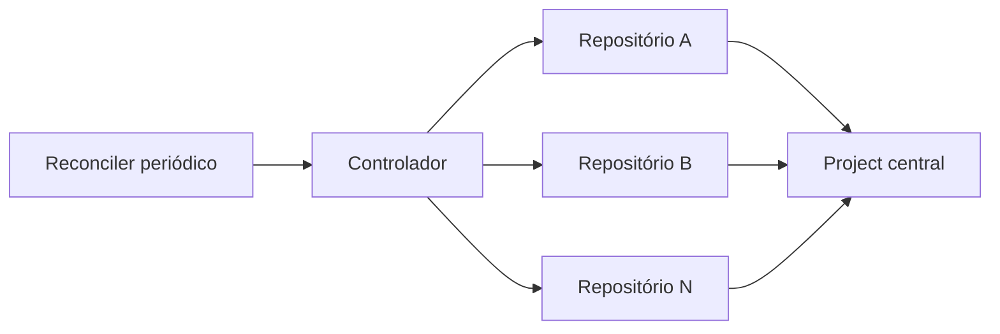
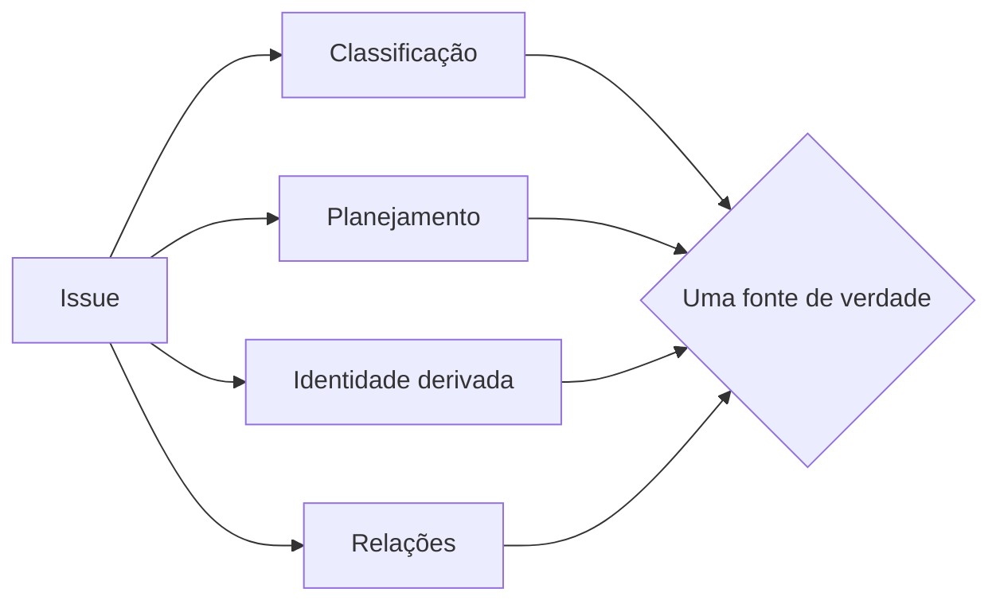
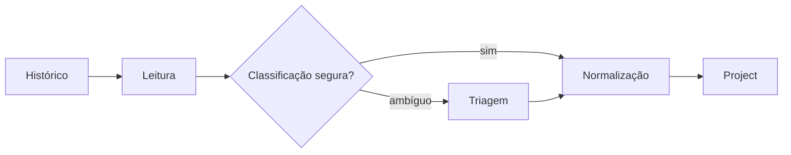

Imagine uma rede de restaurantes com várias unidades, cada uma usando um cardápio, um sistema de pedidos e regras diferentes. Mesmo que todas pertençam à mesma empresa, fica difícil comparar resultados e manter uma operação coerente. No GitHub, Projects, Issues, templates, labels e Actions cumprem esse papel: são os mecanismos que organizam o trabalho. Tratar essa estrutura como código é como manter um manual operacional versionado, capaz de orientar todas as unidades e corrigir automaticamente quando alguma começa a se afastar do padrão.

Uma saída é tratar gerenciamento de trabalho como um problema de arquitetura: definir um desired state, separar fontes de verdade por dimensão, reagir a eventos quando possível e usar um reconciler periódico para corrigir drift. O resultado é uma forma de **governança como código**: padrões versionados, automação idempotente e intervenção humana concentrada apenas onde há ambiguidade ou decisão de negócio.

<nav class='fgs-toc' aria-label='Neste artigo'><strong>Neste guia</strong><ul><li><a href='#gh-problema'>Do quadro ao sistema de gestão</a></li><li><a href='#gh-modelo'>Control plane e desired state</a></li><li><a href='#gh-taxonomia'>Taxonomia e fontes de verdade</a></li><li><a href='#gh-captura'>Issue Forms e captura estruturada</a></li><li><a href='#gh-reuso'>.github e reusable workflows</a></li><li><a href='#gh-reconciler'>Eventos, reconciler e idempotência</a></li><li><a href='#gh-project'>Project como visão materializada</a></li><li><a href='#gh-relacoes'>Dependências e hierarquia</a></li><li><a href='#gh-retrofit'>Retrofit do histórico</a></li><li><a href='#gh-enforcement'>Enforcement progressivo</a></li><li><a href='#gh-operacao'>Operação, segurança e anti-padrões</a></li><li><a href='#gh-revisao'>Resumo e exercícios</a></li><li><a href='#gh-fontes'>Fontes</a></li></ul></nav>

<h2 id='gh-problema'>1. O problema: um Project não é, sozinho, um sistema de gestão</h2>

GitHub Projects é flexível: permite múltiplas views, layouts de tabela, board e roadmap, filtros e campos customizados. A [documentação de views](https://docs.github.com/en/issues/planning-and-tracking-with-projects/customizing-views-in-your-project) descreve justamente essa ideia de observar o mesmo conjunto de itens por ângulos diferentes. Mas flexibilidade cria uma pergunta de governança: **quem garante que os itens chegam com metadados comparáveis?**

Se cada repositório inventa labels, templates e estados por conta própria, um Project central apenas concentra inconsistências. “Bug” pode ser `bug`, `type:bug`, `defect` ou não existir. “Backend” pode aparecer como label, texto livre ou nome de componente. Prioridade pode estar no título de uma issue e, em outra, em um campo do Project.

<section class='signal-card'>

<h3>Captura</h3>

Como o trabalho entra? Issue Form, CLI, API, automação ou issue antiga.

</section>

<section class='signal-card'>

<h3>Classificação</h3>

Como diferentes repositórios usam o mesmo vocabulário sem copiar regras manualmente.

</section>

<section class='signal-card'>

<h3>Planejamento</h3>

Como Status e Priority permanecem úteis sem duplicar a mesma verdade em labels.

</section>

<section class='signal-card'>

<h3>Convergência</h3>

Como o sistema volta ao padrão depois de edição manual, falha de automação ou legado.

</section>

A arquitetura adequada precisa resolver os quatro problemas. O quadro é apenas uma das interfaces.

<h2 id='gh-modelo'>2. O modelo mental: control plane, data plane e desired state</h2>

Um desenho útil é importar uma distinção comum de sistemas distribuídos. O control plane contém a política e decide o estado desejado. Os repositórios e o Project são o plano onde o trabalho real acontece. Um reconciler compara os dois e corrige diferenças.

<!-- tech-topics:mermaid {"label":"Arquitetura de governança como código: controlador, repositórios e Project central."} -->

<figcaption>Arquitetura conceitual: lógica centralizada, gatilhos pequenos nos repositórios e um Project que agrega o estado de planejamento.</figcaption>

Ver o código Mermaid
<pre class="code-block">flowchart LR
  C[Controlador] --&gt; A[Repositório A]
  C --&gt; B[Repositório B]
  C --&gt; N[Repositório N]
  A --&gt; P[Project central]
  B --&gt; P
  N --&gt; P
  R[Reconciler periódico] --&gt; C</pre>

O repositório controlador pode versionar uma política como:

<pre><code>{
  "type": ["Epic", "Feature", "Bug", "Task", "Tech Debt", "Research"],
  "area": ["Frontend", "Backend", "Design System", "Mobile", "Infra", "Docs", "Security"],
  "priority": ["P0", "P1", "P2", "P3"],
  "status": ["Inbox", "Ready", "In Progress", "Review", "Blocked", "Done"]
}</code></pre>

A vantagem não é o JSON em si. É a propriedade de **declarar intenção antes de declarar procedimento**. Scripts deixam de dizer “crie esta label neste repositório específico” e passam a dizer “todo repositório governado deve convergir para esta taxonomia”. Isso elimina cadastro manual e transforma novos repositórios em um caso normal de descoberta.

<strong>Regra arquitetural:</strong> a política deve responder “qual estado queremos?”. A automação responde “como convergir o estado atual para ele?”. Misturar essas duas perguntas produz scripts difíceis de auditar e de migrar.

<h2 id='gh-taxonomia'>3. Separe classificação, planejamento, identidade e relações</h2>

Um dos maiores ganhos vem de não usar labels para tudo. Labels são excelentes para classificação local e busca dentro do repositório. Campos de Project são melhores para planejamento transversal. Metadados derivados não precisam ser perguntados ao usuário. E relações entre issues devem usar recursos nativos quando existem.

<!-- tech-topics:mermaid {"label":"Separação entre classificação, planejamento, identidade derivada e relações."} -->

<figcaption>Uma taxonomia sustentável minimiza duplicação: cada dimensão tem uma fonte de verdade clara.</figcaption>

Ver o código Mermaid
<pre class="code-block">flowchart LR
  I[Issue] --&gt; C[Classificação]
  I --&gt; P[Planejamento]
  I --&gt; D[Identidade derivada]
  I --&gt; R[Relações]
  C --&gt; Q{Uma fonte de verdade}
  P --&gt; Q
  D --&gt; Q
  R --&gt; Q</pre>

<table><thead><tr><th>Dimensão</th><th>Fonte de verdade sugerida</th><th>Exemplo</th></tr></thead><tbody>
<tr><td>Type</td><td>Issue Form → label gerenciada → espelho no Project</td><td><code>type:bug</code></td></tr>
<tr><td>Area</td><td>Issue Form multi-select → uma ou mais labels → espelho no Project</td><td><code>area:backend</code>, <code>area:security</code></td></tr>
<tr><td>Priority</td><td>Campo do Project</td><td>P0, P1, P2, P3</td></tr>
<tr><td>Status</td><td>Campo do Project</td><td>Inbox, Ready, In Progress, Review, Blocked, Done</td></tr>
<tr><td>Organization</td><td>Derivada do owner do repositório</td><td><code>acme</code></td></tr>
<tr><td>Product</td><td>Derivada do repositório</td><td><code>acme/payments</code></td></tr>
<tr><td>Repository</td><td>Campo nativo</td><td><code>acme/payments</code></td></tr>
<tr><td>Dependência</td><td>Relação nativa de issue</td><td>blocked by / blocking</td></tr>
</tbody></table>

GitHub Projects suporta campos customizados; a referência GraphQL atual inclui single select e multi-select, inclusive criação e atualização de opções. Isso permite modelar Type como seleção única e Area como seleção múltipla sem transformar o Project em uma cópia literal das labels. Veja a [referência GraphQL de Projects](https://docs.github.com/en/graphql/reference/projects).

Priority é um bom exemplo do que **não** deve ser inferido por automação. Um repositório pode indicar produto, organização e área técnica; não pode deduzir valor de negócio com segurança. Automatizar Priority cria uma falsa aparência de objetividade.

<h2 id='gh-captura'>4. Capture estrutura na origem com Issue Forms</h2>

O melhor momento para obter Type e Area é a criação da issue. GitHub Issue Forms usa YAML em `.github/ISSUE_TEMPLATE` e oferece campos como dropdown, textarea, checkboxes e upload. As respostas são convertidas em Markdown no corpo da issue. A [documentação de Issue Forms](https://docs.github.com/en/communities/using-templates-to-encourage-useful-issues-and-pull-requests/syntax-for-issue-forms) também permite labels padrão, assignees, tipo nativo e Projects.

<pre><code>name: Work item
description: Create a standardized work item
body:
  - type: dropdown
    id: type
    attributes:
      label: Type
      options:
        - Epic
        - Feature
        - Bug
        - Task
        - Tech Debt
        - Research
&#10;  - type: dropdown
    id: areas
    attributes:
      label: Areas
      multiple: true
      options:
        - Frontend
        - Backend
        - Design System
        - Mobile
        - Infra
        - Docs
        - Security</code></pre>

Há duas sutilezas importantes. Primeiro: labels configuradas no formulário só são aplicadas se já existirem no repositório; a própria documentação registra essa condição. Segundo: o schema de forms continua documentado como public preview, e certas validações `required` são documentadas como restritas a repositórios públicos. Portanto, o formulário é uma excelente camada de orientação, mas não deve ser a única camada de enforcement para ambientes privados.

O reconciler resolve isso: ele lê o corpo gerado pelo formulário, normaliza labels e marca `policy:needs-triage` quando o metadado está ausente ou ambíguo. Assim, uma criação por CLI ou API não quebra o modelo.

<h2 id='gh-reuso'>5. Reuse o padrão sem copiar a lógica</h2>

<h3>Defaults por owner com o repositório .github</h3>

GitHub possui um mecanismo nativo para arquivos comunitários padrão. Um repositório público chamado `.github` no owner pode fornecer templates para repositórios desse mesmo owner que não possuam sua própria versão. A [documentação de default community health files](https://docs.github.com/en/communities/setting-up-your-project-for-healthy-contributions/creating-a-default-community-health-file) esclarece também a precedência: templates locais sobrescrevem defaults do owner.

Isso é útil como fallback, mas não é enforcement total. Se um repositório cria seu próprio template, ele deixa de usar o default. Em uma governança mais rígida, o controlador pode distribuir arquivos gerenciados diretamente para cada repositório e preservar o `.github` do owner como bootstrap para repos novos.

<h3>Reusable workflows: lógica central, gatilho local</h3>

Eventos de Issue acontecem no repositório onde a Issue existe. Portanto, um repositório central não recebe automaticamente o evento `issues` dos demais. A solução é instalar um caller mínimo em cada repositório:

<pre><code>name: Governance
&#10;on:
  issues:
    types: [opened, edited, reopened, labeled, unlabeled]
&#10;jobs:
  reconcile:
    uses: owner/controller/.github/workflows/governance-event.yml@main</code></pre>

A lógica fica em um reusable workflow. A [documentação de reuso de workflows](https://docs.github.com/en/actions/reference/workflows-and-actions/reusing-workflow-configurations) descreve esse modelo e suas regras de acesso. Um detalhe de segurança importante: permissões não podem ser elevadas ao longo da cadeia; um workflow chamado não consegue obter mais permissões do que foram concedidas pelo caller.

Para ambientes mais críticos, prefira referenciar uma versão ou SHA estável em vez de `@main`. Isso troca atualização instantânea por reprodutibilidade e reduz o risco de uma mudança central afetar todos os repositórios de uma vez.

<h2 id='gh-reconciler'>6. Eventos para velocidade; reconciler para convergência</h2>

Uma governança robusta usa os dois mecanismos.

<section class='signal-card'>

<h3>Event-driven</h3>

Issue criada ou editada dispara correção quase imediata do metadado.

</section>

<section class='signal-card'>

<h3>Reconciler</h3>

Executa periodicamente, descobre repos e corrige drift, falhas anteriores e objetos antigos.

</section>

<section class='signal-card'>

<h3>Dry run</h3>

Compara estado sem escrever. É a fronteira segura antes de expandir escopo.

</section>

O reconciler deve ser **idempotente**: executar duas vezes produz o mesmo estado final. Isso implica comparar antes de escrever, não depender de erro de “já existe” como mecanismo de controle e limitar a propriedade da automação a namespaces claramente gerenciados.

Por exemplo, a automação pode ser dona de `type:*`, `area:*` e `policy:*`, mas não deve apagar labels específicas como `customer-x` ou `release-2026-09`. A política precisa declarar quais partes do repositório pertencem ao controlador.

<h3>Qual a frequência do scheduler?</h3>

Se o reconciler roda a cada `T` horas e um drift pode acontecer uniformemente entre duas execuções, a latência de detecção `L` fica, em um modelo ideal, entre zero e `T`:

<pre><code>0 ≤ L ≤ T
E[L] = T / 2</code></pre>

Com `T = 2h`, a detecção média seria aproximadamente 1 hora, assumindo execução pontual e drift uniforme. Isso parece lento se o scheduler for o mecanismo principal; é perfeitamente aceitável quando eventos já fazem o caminho rápido e o scheduler existe como rede de segurança.

<strong>Princípio:</strong> o scheduler não precisa ser frequente o bastante para dar sensação de tempo real. Ele precisa ser frequente o bastante para limitar a duração do drift que escapou do caminho orientado a eventos.

<h2 id='gh-project'>7. Trate o Project como uma visão materializada do trabalho</h2>

O Project não precisa duplicar tudo que existe na Issue. Ele pode funcionar como uma **visão materializada de planejamento**: agrega itens de muitos repositórios e adiciona campos que só fazem sentido no nível transversal.

A API oficial permite administrar Projects via GraphQL, inclusive descobrir projeto e campos, adicionar itens e atualizar valores. A [documentação de automação de Projects pela API](https://docs.github.com/en/issues/planning-and-tracking-with-projects/automating-your-project/using-the-api-to-manage-projects) registra os escopos de autenticação necessários para leitura e escrita.

Uma reconciliação típica pode aplicar:

<pre><code>Organization = repository.owner
Product      = repository.nameWithOwner
Type         = label type:*
Area         = labels area:*
Priority     = decisão humana
Status       = decisão humana + transições objetivas</code></pre>

Transições automáticas de Status devem ser conservadoras. Fechar uma Issue ou fazer merge de um PR é uma evidência objetiva de conclusão; o próprio GitHub Projects possui automações embutidas que podem mover itens fechados ou merged para Done, e algumas vêm habilitadas por padrão. Veja [Using the built-in automations](https://docs.github.com/en/issues/planning-and-tracking-with-projects/automating-your-project/using-the-built-in-automations).

Já mover automaticamente uma issue para “In Progress” porque recebeu um comentário é uma inferência frágil. Um modelo saudável automatiza fatos e deixa intenção de planejamento para humanos.

<h3>Views como consultas salvas</h3>

Uma única coleção pode produzir várias interfaces:

<table><thead><tr><th>View</th><th>Estrutura</th><th>Pergunta respondida</th></tr></thead><tbody>
<tr><td>Command Center</td><td>Board por Status, agrupado por Organization</td><td>Onde está o trabalho ativo?</td></tr>
<tr><td>By Repository</td><td>Table agrupada por Repository</td><td>Qual repo concentra demanda?</td></tr>
<tr><td>Now</td><td>Ready + In Progress + Review + Blocked</td><td>O que merece atenção agora?</td></tr>
<tr><td>Triage</td><td><code>policy:needs-triage</code></td><td>O que a automação não conseguiu decidir?</td></tr>
<tr><td>Pull Requests</td><td>PRs abertos</td><td>Onde há trabalho aguardando integração?</td></tr>
<tr><td>Recently Done</td><td>Done, ordenado por atualização</td><td>O que terminou recentemente?</td></tr>
</tbody></table>

<h2 id='gh-relacoes'>8. Dependência não é hierarquia</h2>

GitHub hoje oferece dois relacionamentos úteis que resolvem problemas diferentes.

**Issue dependencies** representam ordem lógica: uma Issue está blocked by outra ou está blocking trabalho posterior. A [documentação de dependências](https://docs.github.com/en/issues/tracking-your-work-with-issues/using-issues/creating-issue-dependencies) mostra suporte pela interface e pelo GitHub CLI, inclusive na criação da Issue.

**Sub-issues** representam decomposição. Uma Epic pode conter features ou tasks mesmo quando elas podem avançar em paralelo. A [documentação de sub-issues](https://docs.github.com/en/issues/tracking-your-work-with-issues/using-issues/adding-sub-issues) permite hierarquias aninhadas e relacionamentos entre repositórios.

<strong>Teste mental:</strong> se B não pode começar antes de A terminar, a relação é dependência. Se B é uma parte de A, a relação é hierarquia. Uma mesma issue pode participar dos dois modelos.

Evite inventar labels como `depends-on-123`. Elas não têm integridade referencial e exigem manter manualmente os dois lados da relação.

<h2 id='gh-retrofit'>9. O padrão futuro deve conseguir reorganizar o passado</h2>

Governança só funciona de verdade quando o histórico deixa de ser uma exceção permanente. Um retrofit deve varrer Issues e PRs abertos e fechados, interpretar o que já existe e convergir para a taxonomia atual.

<!-- tech-topics:mermaid {"label":"Retrofit histórico: leitura, classificação segura, triagem, normalização e Project."} -->

<figcaption>Retrofit seguro: o objetivo é convergir o histórico sem inventar intenção que não está documentada.</figcaption>

Ver o código Mermaid
<pre class="code-block">flowchart LR
  H[Histórico] --&gt; L[Leitura]
  L --&gt; K{Classificação segura?}
  K --&gt;|sim| N[Normalização]
  K --&gt;|ambíguo| T[Triagem]
  T --&gt; N
  N --&gt; P[Project]</pre>

A migração pode usar evidências em ordem de confiança:

1.  labels já equivalentes ao padrão atual;
2.  campos estruturados de um Issue Form antigo;
3.  tipo nativo ou metadado explícito;
4.  referências canônicas de dependência no body;
5.  heurísticas de texto apenas quando há confiança muito alta e a regra é auditável.

Quando não houver evidência suficiente, a resposta correta é `policy:needs-triage`. Não classificar é melhor que classificar errado com aparência de certeza.

<h3>Closed também importa</h3>

Itens fechados são parte do histórico arquitetural: explicam por que uma decisão existe, alimentam busca, métricas e relações entre trabalho antigo e novo. Um retrofit que só trata open mantém dois dialetos de metadados para sempre.

A escrita do body, porém, merece uma política separada. Reformatar metadados é reversível e estruturado; reescrever prosa histórica pode apagar contexto. Uma estratégia prudente normaliza labels, relações e campos primeiro e só depois define uma migração textual explícita.

<h2 id='gh-enforcement'>10. Enforcement progressivo: guiar, corrigir, observar, bloquear</h2>

O erro comum é começar pelo bloqueio. Isso transforma governança em obstáculo antes de provar que as regras representam o trabalho real.

<table><thead><tr><th>Nível</th><th>Mecanismo</th><th>Exemplo</th></tr></thead><tbody>
<tr><td>Guide</td><td>Issue Form, PR template</td><td>Pedir Type e Areas na criação</td></tr>
<tr><td>Auto-fix</td><td>Workflow/reconciler</td><td>Criar label ausente, preencher Organization</td></tr>
<tr><td>Report</td><td>Triage e métricas de drift</td><td>Marcar metadata ambígua</td></tr>
<tr><td>Enforce</td><td>Ruleset / required check</td><td>Impedir merge quando política crítica falha</td></tr>
</tbody></table>

GitHub rulesets podem exigir status checks antes do merge. A [documentação de regras disponíveis](https://docs.github.com/en/repositories/configuring-branches-and-merges-in-your-repository/managing-rulesets/available-rules-for-rulesets) explica que todos os checks exigidos precisam passar antes da integração.

Um check de governança pode validar, por exemplo, que o PR referencia uma Issue, que essa Issue pertence ao Project, que não há múltiplos Types e que metadata obrigatória não está em estado ambíguo. Mas isso só deve se tornar obrigatório depois que o check demonstrar baixa taxa de falso positivo.

Priority não é um bom requisito de criação: trabalho pode entrar no Inbox sem prioridade e ser classificado depois. O ponto de enforcement deve refletir risco. Para metadados administrativos, triagem é suficiente; para merge em branch protegida, um check pode ser apropriado.

<h2 id='gh-operacao'>11. Operação: logs agregados, permissões mínimas e escopo seguro</h2>

Automação transversal tem alcance grande. Isso torna segurança operacional parte da arquitetura.

- **Descoberta dinâmica:** liste repositórios acessíveis e filtre por owner e permissão, em vez de manter uma lista manual.
- **Escopo de escrita menor que escopo de leitura:** ler um repositório como colaborador não implica que a governança deva instalar arquivos nele.
- **Logs sanitizados:** em um controlador público, evite nomes de repositórios privados, títulos e bodies de Issues e respostas brutas da API.
- **Secrets centralizados:** use o token cross-repo apenas no controlador. Workflows locais podem operar com o `GITHUB_TOKEN` do próprio repositório quando a ação é local.
- **Dry run por padrão em mudanças de política:** primeiro conte o que mudaria; depois aplique.

Em escala maior, um GitHub App é normalmente mais apropriado que um PAT clássico porque permissões e instalações podem ser delimitadas por organização e repositório. Para um protótipo pessoal, um token pode ser suficiente, desde que o escopo e a exposição de logs sejam controlados.

<h3>O que medir no próprio sistema de governança</h3>

<table><thead><tr><th>Contador</th><th>Por que importa</th></tr></thead><tbody>
<tr><td>repos discovered / governed</td><td>Mostra expansão ou redução inesperada de escopo.</td></tr>
<tr><td>labels created / updated</td><td>Quantifica drift de taxonomia.</td></tr>
<tr><td>callers/templates installed</td><td>Revela cobertura do enforcement.</td></tr>
<tr><td>issues normalized</td><td>Mostra volume real de correção.</td></tr>
<tr><td>needs-triage</td><td>Mede a parcela que exige decisão humana.</td></tr>
<tr><td>errors</td><td>Detecta perda de permissão, SSO, rate limit ou mudança de API.</td></tr>
</tbody></table>

<h2>12. Anti-padrões</h2>

<table><thead><tr><th>Anti-padrão</th><th>Consequência</th></tr></thead><tbody>
<tr><td>Uma Action completa copiada em cada repo</td><td>Drift de versões e correções repetidas.</td></tr>
<tr><td>Lista manual de repositórios</td><td>Novo repo nasce fora da governança.</td></tr>
<tr><td>Labels para Status, Priority, Organization e Product ao mesmo tempo</td><td>Duplicação e conflitos entre fontes de verdade.</td></tr>
<tr><td>Scheduler como única automação</td><td>Latência desnecessária e mais chamadas à API.</td></tr>
<tr><td>Evento sem reconciler</td><td>Falhas transitórias e edições manuais podem deixar drift permanente.</td></tr>
<tr><td>Automação que “adivinha” prioridade</td><td>Decisão de negócio disfarçada de regra técnica.</td></tr>
<tr><td>Apagar labels que não pertencem à governança</td><td>O controlador invade vocabulário local legítimo.</td></tr>
<tr><td>Retrofit somente de issues abertas</td><td>O histórico continua em outro dialeto.</td></tr>
<tr><td>Hard enforcement desde o primeiro dia</td><td>Falso positivo vira bloqueio de entrega.</td></tr>
</tbody></table>

<h2>13. Quando esse modelo é exagero</h2>

Um único repositório pequeno, com uma equipe estável e poucas Issues, talvez não precise de reconciler, Project central ou taxonomia multi-repo. Um Issue Form simples e algumas labels podem ser suficientes.

O modelo começa a pagar seu custo quando existem vários repositórios, múltiplos owners, necessidade de visão agregada, automações compartilhadas ou histórico relevante. O objetivo não é “automatizar porque é possível”; é reduzir o custo marginal de manter consistência.

Também há um ponto de transição organizacional. Se a governança passar a decidir permissões, compliance e controles de produção em muitas organizações, vale separar o controlador pessoal em um repositório administrado institucionalmente e substituir credenciais pessoais por GitHub Apps e políticas de organização.

<h2 id='gh-revisao'>14. Resumo mental</h2>

<strong>Modelo em uma frase:</strong> capture metadados estruturados na origem, derive o que for determinístico, mantenha planejamento no Project, reaja a eventos, reconcilie drift e só bloqueie quando a regra já estiver madura.

<pre><code>POLÍTICA
  ↓
Issue Form / template
  ↓
evento local ───────────────┐
  ↓                         │
normalização                │
  ↓                         │
Issue + labels              │
  ↓                         │
Project central             │
                            │
reconciler periódico ───────┘
  ↓
corrige drift + retrofit + triage</code></pre>

<h2>Perguntas de revisão</h2>

1.  Por que um Project central não resolve sozinho divergência de taxonomia entre repositórios?
2.  Qual a diferença entre fonte de verdade e espelho de um metadado?
3.  Por que Organization e Product são bons candidatos a derivação automática?
4.  Quando uma relação deve ser blocked by e quando deve ser uma sub-issue?
5.  Qual problema o reconciler resolve que um workflow orientado a evento não resolve?
6.  Por que Priority deveria permanecer manual em muitos sistemas?
7.  Qual o risco de fazer retrofit reescrevendo o body das issues antigas?
8.  Em que momento um check de governança deve virar requisito de merge?

<h2>Experimentos</h2>

<h3>1. Modele sua taxonomia</h3>

Escolha cinco dimensões usadas hoje em seus repositórios. Para cada uma, escreva uma única fonte de verdade e marque se ela é fornecida por humano, derivada ou observada de um evento. Se uma dimensão tiver duas fontes de verdade, explique como conflitos são resolvidos.

<h3>2. Calcule a janela de drift</h3>

Considere um reconciler a cada 3 horas. Sob a hipótese simplificada de drift uniforme, calcule a latência média de detecção. Depois adicione um caminho orientado a evento com 95% de sucesso e discuta por que o scheduler ainda é necessário.

<h3>3. Faça um retrofit em dry run</h3>

Em um repositório de teste, liste Issues abertas e fechadas, classifique quais poderiam ser migradas com regra determinística e quais exigiriam `needs-triage`. Compare o resultado com uma abordagem que tenta inferir tudo a partir do título.

<h2 id='gh-fontes'>15. Fontes e leituras</h2>

Fontes consultadas em 18 de setembro de 2026. Diagramas e exemplos de taxonomia são materiais didáticos próprios; adapte nomes, campos e enforcement ao risco do seu ambiente.

<ol class='fgs-references'>
<li>GitHub Docs — <a href='https://docs.github.com/en/issues/planning-and-tracking-with-projects/learning-about-projects'>Learning about Projects</a>. Visão geral do modelo de planejamento e acompanhamento.</li>
<li>GitHub Docs — <a href='https://docs.github.com/en/issues/planning-and-tracking-with-projects/customizing-views-in-your-project'>Customizing views in your project</a>. Layouts, filtros e múltiplas views sobre os mesmos itens.</li>
<li>GitHub Docs — <a href='https://docs.github.com/en/issues/planning-and-tracking-with-projects/understanding-fields'>Understanding fields</a>. Campos customizados e metadados de Projects.</li>
<li>GitHub GraphQL Reference — <a href='https://docs.github.com/en/graphql/reference/projects'>Projects</a>. Tipos ProjectV2, campos single-select e multi-select e inputs de mutação.</li>
<li>GitHub Docs — <a href='https://docs.github.com/en/issues/planning-and-tracking-with-projects/automating-your-project/using-the-api-to-manage-projects'>Using the API to manage Projects</a>. Autenticação e automação por GraphQL.</li>
<li>GitHub Docs — <a href='https://docs.github.com/en/issues/planning-and-tracking-with-projects/automating-your-project/using-the-built-in-automations'>Using the built-in automations</a>. Transições automáticas e auto-add/archive.</li>
<li>GitHub Docs — <a href='https://docs.github.com/en/communities/using-templates-to-encourage-useful-issues-and-pull-requests/syntax-for-issue-forms'>Syntax for issue forms</a> e <a href='https://docs.github.com/en/communities/using-templates-to-encourage-useful-issues-and-pull-requests/syntax-for-githubs-form-schema'>form schema</a>. Estrutura YAML, labels e validações.</li>
<li>GitHub Docs — <a href='https://docs.github.com/en/communities/setting-up-your-project-for-healthy-contributions/creating-a-default-community-health-file'>Creating a default community health file</a>. Repositório <code>.github</code>, escopo por owner e precedência dos arquivos locais.</li>
<li>GitHub Docs — <a href='https://docs.github.com/en/actions/reference/workflows-and-actions/reusing-workflow-configurations'>Reusing workflow configurations</a>. Reusable workflows, regras de acesso e permissões.</li>
<li>GitHub Docs — <a href='https://docs.github.com/en/issues/tracking-your-work-with-issues/using-issues/creating-issue-dependencies'>Creating issue dependencies</a>. Relações blocking e blocked by.</li>
<li>GitHub Docs — <a href='https://docs.github.com/en/issues/tracking-your-work-with-issues/using-issues/adding-sub-issues'>Adding sub-issues</a>. Hierarquia e decomposição de trabalho.</li>
<li>GitHub Docs — <a href='https://docs.github.com/en/repositories/configuring-branches-and-merges-in-your-repository/managing-rulesets/available-rules-for-rulesets'>Available rules for rulesets</a>. Required status checks e enforcement antes do merge.</li>
</ol>

<a href="index.html#recent-posts" class="article-back">← Todos os artigos</a>

