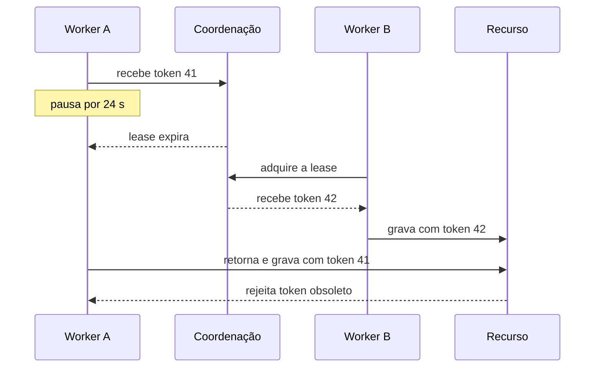
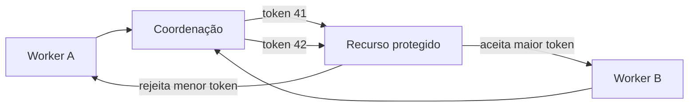
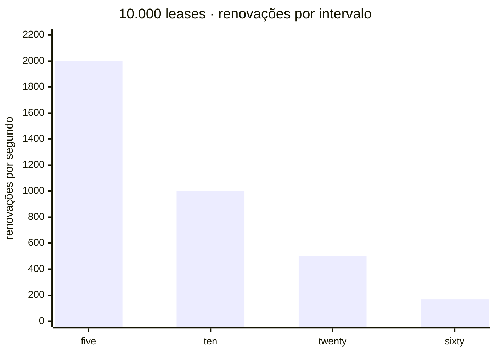

Imagine uma oficina em que um mecânico recebe autorização temporária para trabalhar em uma máquina. Se ele demora demais, a autorização expira e o encarregado entrega o serviço a outro mecânico, mas o primeiro continua trabalhando sem perceber que perdeu a posse. Como impedir que esse trabalho antigo ainda altere a máquina? É aí que entra o **fencing token**: cada nova autorização recebe um número maior, e a própria máquina aceita apenas operações da geração mais recente. Assim, mesmo que o mecânico antigo tente fazer uma alteração depois, a ordem antiga é rejeitada.

Essa é a armadilha que separa um mutex local de uma coordenação distribuída. Uma **lease** limita no tempo a posse de um recurso, ajudando o sistema a recuperar progresso quando o dono desaparece. Mas o vencimento não apaga o processo antigo nem recolhe os pacotes que ele já enviou. Um **fencing token** acrescenta uma geração crescente, que o próprio recurso usa para rejeitar operações obsoletas.

**Modelo mental:** a lease responde “até quando o coordenador considera esta posse válida?”. O fencing token responde “esta operação pertence à geração mais nova que o recurso já viu?”. São controles complementares, não sinônimos.

<nav class="fgs-toc" aria-label="Neste artigo"><strong>Neste guia</strong><ul><li><a href="#lft-problema">A falha do dono antigo</a></li><li><a href="#lft-historia">Origem e conceitos</a></li><li><a href="#lft-fencing">Como fencing funciona</a></li><li><a href="#lft-implementacao">Implementação</a></li><li><a href="#lft-tempo">Tempo e capacidade</a></li><li><a href="#lft-falhas">Cenários de falha</a></li><li><a href="#lft-operacao">Operação e alternativas</a></li><li><a href="#lft-exercicios">Revisão e experimentos</a></li><li><a href="#lft-fontes">Fontes</a></li></ul></nav>

## 1. O problema: perder a posse não interrompe o antigo dono

Considere uma lease de 20 segundos. O worker A recebe a geração 41 no instante zero e pausa aos 8 segundos. Sem renovações, o coordenador declara a posse expirada aos 20. B adquire a geração 42 aos 22 e grava aos 26. A volta aos 32 e ainda carrega código, memória e uma intenção de escrita produzida antes da pausa.

<!-- tech-topics:mermaid {"label":"Worker A pausa, perde a lease, B recebe token 42 e a escrita antiga de A é rejeitada."} -->

<figcaption>Sequência temporal ilustrativa, com tempos escolhidos para o exemplo. O coordenador pode expirar A corretamente e, mesmo assim, o recurso receber depois uma operação antiga.</figcaption>

Ver o código Mermaid
<pre class="code-block">sequenceDiagram
  participant A as Worker A
  participant C as Coordenação
  participant B as Worker B
  participant R as Recurso
  A-&gt;&gt;C: recebe token 41
  Note over A: pausa por 24 s
  C--&gt;&gt;A: lease expira
  B-&gt;&gt;C: adquire a lease
  C--&gt;&gt;B: recebe token 42
  B-&gt;&gt;R: grava com token 42
  A-&gt;&gt;R: retorna e grava com token 41
  R--&gt;&gt;A: rejeita token obsoleto</pre>

Há duas histórias simultâneas. Para o **coordenador**, apenas B é o dono depois de 22 segundos. Para A, o mundo ficou congelado durante a pausa; quando volta, a próxima instrução pode ser justamente a escrita. A pausa pode vir de garbage collection, suspensão da máquina virtual, falta de CPU, page fault, depuração, hibernação ou um processo parado por sinal. Também basta que a requisição saia de A no prazo e permaneça atrasada na rede.

Mike Burrows descreveu essa classe de falha no paper do [Chubby](<https://research.google/pubs/the-chubby-lock-service-for-loosely-coupled-distributed-systems/>): um detentor pode emitir uma requisição, falhar, e outro adquirir o lock e agir antes que a requisição anterior chegue. Martin Kleppmann popularizou a explicação moderna com o exemplo de uma pausa de GC em <a lang="en-US" href="https://martin.kleppmann.com/2016/02/08/how-to-do-distributed-locking.html">How to do distributed locking</a>.

<h3>Por que verificar a validade antes de gravar não basta</h3>

<pre class="code-block"><code>if lease.ainda_valida():
    recurso.gravar(resultado)  # ainda existe uma janela aqui</code></pre>

O processo pode pausar entre a verificação e a escrita. Esse é um caso de *time-of-check to time-of-use*: a resposta era verdadeira quando consultada, mas deixou de ser válida antes do efeito. Diminuir esse intervalo reduz a probabilidade; não elimina a possibilidade. A verificação precisa ser inseparável do efeito no componente que controla o recurso.

<section class="signal-card">

<h3>Segurança</h3>

Uma operação de geração antiga não deve corromper o estado depois que uma geração nova passou a valer.

</section>

<section class="signal-card">

<h3>Vivacidade</h3>

Se o dono falhar, outro participante deve conseguir assumir em tempo finito quando o sistema recuperar condições de progresso.

</section>

Uma lease finita favorece vivacidade: o crash de A não bloqueia para sempre. Um prazo infinito favorece a exclusão enquanto o estado não se perde, mas pode impedir qualquer sucessor. Fencing preserva a segurança dos efeitos sem exigir que o sistema espere indefinidamente pelo antigo dono.

## 2. Lease, lock e a origem do conceito

**Fato histórico:** Cary G. Gray e David R. Cheriton apresentaram leases como mecanismo para consistência de caches distribuídos no SOSP de 1989. O paper [*Leases: An Efficient Fault-Tolerant Mechanism for Distributed File Cache Consistency*](<https://doi.org/10.1145/74850.74870>) analisa autorizações com duração limitada, renováveis, e o equilíbrio entre tráfego de validação e atraso na recuperação após falhas. Isso não significa que todo uso moderno de TTL em um lock tenha automaticamente as propriedades do protocolo do paper.

Um **lock** expressa exclusão lógica: determinado dono possui a permissão. Uma **lease** é uma concessão limitada no tempo: se não for renovada, o coordenador pode transferi-la sem receber um release. Na prática, muitos “distributed locks com TTL” são leases, mesmo quando a API os chama apenas de lock.

<table><caption>Propriedades diferentes que costumam ser confundidas</caption><thead><tr><th scope="col">Mecanismo</th><th scope="col">O que oferece</th><th scope="col">O que não oferece sozinho</th></tr></thead><tbody><tr><td>Mutex local</td><td>Exclusão entre threads sob um runtime e memória compartilhada</td><td>Tolerância a crash, partição ou mensagens atrasadas entre máquinas</td></tr><tr><td>Lease</td><td>Posse renovável com expiração e recuperação de progresso</td><td>Interromper o cliente expirado ou invalidar efeitos em sistemas externos</td></tr><tr><td>Fencing token</td><td>Ordem de gerações que um recurso pode comparar</td><td>Atomicidade entre vários recursos nem deduplicação de retries</td></tr><tr><td>Idempotency key</td><td>Reconhecer a repetição de uma mesma operação</td><td>Ordenar donos diferentes ou determinar qual geração é mais nova</td></tr></tbody></table>

Em 2006, o Chubby do Google descreveu *sequencers*: valores opacos que incluem o nome, o modo e a geração do lock. O cliente os encaminha ao servidor protegido, que valida sua vigência ou os compara à geração mais recente observada. Essa é uma fonte histórica primária para a técnica hoje chamada de fencing. O Chubby foi desenhado para locks de granularidade grossa e armazenamento confiável de baixo volume, não como banco geral nem caminho de dados de alta vazão. [Paper completo, OSDI 2006](<https://www.usenix.org/legacy/event/osdi06/tech/full_papers/burrows/burrows.pdf>).

**Interpretação moderna:** implementações como o [Hazelcast FencedLock](<https://docs.hazelcast.com/hazelcast/5.7/data-structures/fencedlock>) expõem explicitamente um número monotônico por novo dono e documentam a mesma falha de pausa. O nome do recurso e a semântica exata variam entre produtos; “token único” não é suficiente se o destino precisa decidir qual token é mais recente.

## 3. Fencing: mover a decisão para o recurso

Ao adquirir a posse, cada novo dono recebe um token estritamente crescente: 41, 42, 43… Toda operação protegida leva esse token. O recurso mantém o maior valor aceito, `max_token`, e faz a comparação **atomicamente com o efeito**.

<code>aceitar(t) ⇔ t ≥ max_token_atual após aceitar: max_token ← max(max_token, t)</code>

Se B já gravou com 42, a tentativa posterior de A com 41 é rejeitada. O relógio de A não participa dessa decisão. O recurso também não precisa perguntar se A está vivo; basta comparar uma ordem. Igualdade é permitida no modelo acima para várias operações legítimas na mesma geração. Se repetir uma operação causar efeito duplicado, acrescente uma identidade de operação ou uma sequência dentro da geração.

<!-- tech-topics:mermaid {"label":"Workers recebem tokens crescentes e o recurso protegido aceita apenas o maior token."} -->

<figcaption>Arquitetura conceitual. O estado de coordenação deve atribuir gerações com uma ordem confiável; o recurso deve participar do protocolo. Um token ignorado pelo destino é apenas metadado.</figcaption>

Ver o código Mermaid
<pre class="code-block">flowchart LR
  A[Worker A] --&gt; C[Coordenação]
  B[Worker B] --&gt; C
  C --&gt;|token 41| R[Recurso protegido]
  C --&gt;|token 42| R
  R --&gt;|aceita maior token| B
  R --&gt;|rejeita menor token| A</pre>

<h3>O invariante útil</h3>

Se `g₂ > g₁` e o recurso já aceitou uma operação da geração `g₂`, ele nunca mais aceita uma operação de `g₁`. Essa propriedade é local ao recurso e à identidade protegida. Um contador global pode ordenar tudo, mas costuma criar contenção desnecessária; normalmente basta uma sequência por lock, shard ou objeto.

O coordenador precisa atribuir tokens sem retroceder mesmo após failover. Sistemas baseados em uma máquina de estados replicada usam consenso para ordenar aquisições confirmadas. O site do [Raft](<https://raft.github.io/>) explica que servidores aplicam a mesma série de comandos em posições de log acordadas por maioria; isso fornece uma base para estado linearizável. Ainda assim, não transforme automaticamente qualquer índice, versão ou timestamp de um produto em token: confirme na documentação se a ordem é estável, qual é seu escopo e o que ocorre após restauração de backup.

<h3>Token aleatório, timestamp e versão não são equivalentes</h3>

- **UUID aleatório:** identifica aquisições, mas não informa qual é mais nova. Pode ajudar no release condicional e na deduplicação, não no fencing por ordem.
- **Timestamp do cliente:** depende de relógios comparáveis e pode retroceder ou divergir. Use apenas se o sistema oferecer explicitamente a garantia de ordenação necessária.
- **Versão do recurso:** pode proteger um read-modify-write por compare-and-set, mas normalmente descreve o estado do recurso, não a geração da lease.
- **Contador monotônico confirmado:** oferece a relação de ordem necessária, desde que não reinicie nem seja duplicado no escopo protegido.

## 4. Implementação passo a passo

1. **Defina a chave de coordenação.** Por exemplo, `relatorio/2026-08`. Granularidade grossa reduz estado; granularidade fina permite paralelismo e aumenta cardinalidade e operação.
2. **Adquira a lease num coordenador consistente.** Receba uma identidade de sessão, prazo e geração monotônica.
3. **Renove enquanto houver progresso.** Pare de iniciar trabalho novo se a renovação ficar incerta. Isso melhora comportamento, mas não substitui fencing.
4. **Envie a geração em cada efeito.** Inclua-a no protocolo de escrita, no comando ou na transação.
5. **Compare e aplique no recurso.** A checagem de `max_token` e a alteração protegida devem compartilhar a mesma operação atômica.
6. **Trate a rejeição como perda de posse.** Cancele o restante, descarte resultados locais e não tente “forçar” o token antigo.

<h3>Exemplo SQL de uma operação por geração</h3>

<pre class="code-block"><code>UPDATE guarded_report
SET content = :content,
    last_fence = :fence
WHERE report_id = :report_id
  AND last_fence &lt; :fence
RETURNING report_id, last_fence;</code></pre>

A ausência de linha em `RETURNING` significa “geração já vista ou obsoleta”. Esse desenho aceita uma única alteração por geração. Para várias alterações legítimas sob a mesma lease, modele a posição como o par ordenado `(fence, operation_seq)` ou permita `fence = last_fence` e deduplique cada `operation_id` em uma tabela com restrição única. O fencing impede o dono antigo; a idempotência impede que o mesmo dono repita um débito, incremento ou envio.

Compare-and-set nativo pode ser melhor do que construir um lock externo. O Google Cloud Storage, por exemplo, permite precondições de geração; uma mutação falha com `412 Precondition Failed` se o objeto não estiver na geração esperada. A [documentação de precondições](<https://docs.cloud.google.com/storage/docs/request-preconditions>) mostra como isso evita que uma requisição atrasada atue sobre outra geração do objeto. Esse mecanismo não é idêntico a uma lease com fencing, mas ilustra a regra arquitetural: o destino valida a condição junto da mutação.

<h3>API conceitual</h3>

<pre class="code-block"><code>lease = coordinator.acquire("relatorio/2026-08")
# lease.fence == 42

result = build_report()
response = storage.put(
    key="relatorio/2026-08",
    value=result,
    fencing_token=lease.fence,
    operation_id="job-8f1..."
)

if response.status == STALE_GENERATION:
    discard(result)  # outro dono já avançou</code></pre>

É pseudocódigo: não corresponde à API universal de um produto. Em particular, storage comum talvez não aceite um `fencing_token`. Nesse caso, adicione uma camada que controla o recurso com transação forte, use uma precondição nativa ou escolha outra estratégia. Não existe benefício de segurança se o token for apenas registrado em log.

## 5. Escolher prazo e renovação

Defina `L` como duração da lease no coordenador e `r` como intervalo planejado entre renovações, com `r < L`. Se a última renovação bem-sucedida ocorreu agora e o cliente morre, o sucessor pode ter de esperar aproximadamente até `L` para assumir. Um prazo curto reduz esse tempo, mas torna pausas e atrasos transitórios mais propensos a causar troca de dono.

<code>carga média de renovação: R = N / r</code>

Com 10.000 leases e renovação a cada 10 segundos, o coordenador recebe em média 1.000 renovações/s, desconsiderando rajadas e retries. A cada 5 segundos, 2.000/s. Distribua renovações no tempo com jitter controlado para não criar um pico periódico; ainda preserve margem antes do vencimento.

<!-- tech-topics:mermaid {"label":"Renovações por segundo para dez mil leases em diferentes intervalos."} -->

<figcaption>Dados calculados por <code>R = N/r</code>, não medições. Eixo horizontal: intervalo de renovação em segundos. Eixo vertical: renovações por segundo para 10.000 leases.</figcaption>

Ver o código Mermaid
<pre class="code-block">xychart-beta
  title "10.000 leases · renovações por intervalo"
  x-axis [5s, 10s, 20s, 60s]
  y-axis "renovações por segundo" 0 --&gt; 2200
  bar [2000, 1000, 500, 167]</pre>

Um orçamento local aproximado pode ser escrito como `B = L − e − m`, onde `e` é o tempo decorrido observado desde a confirmação e `m` é uma margem para comunicação e incerteza. Se `B ≤ 0`, o cliente não deve iniciar novo efeito. Isso é uma defesa operacional, não prova de segurança: o processo ainda pode pausar depois do cálculo. A barreira definitiva continua no recurso.

Meça duração com relógio monotônico no processo, não com horário civil sujeito a ajustes. O coordenador continua sendo a autoridade sobre sua própria expiração. Sincronização NTP melhora operação e diagnóstico, mas não transforma uma rede comum em sistema de tempo real com limites garantidos.

<h3>O triângulo de escolha</h3>

<section class="signal-card">

<h3>Lease curta</h3>

Failover rápido, mais renovações, maior sensibilidade a pausas e latência.

</section>

<section class="signal-card">

<h3>Lease longa</h3>

Menos churn e mais tolerância a atraso, porém recuperação mais lenta após crash.

</section>

<section class="signal-card">

<h3>Margem maior</h3>

Cliente para de agir cedo; reduz trabalho útil, mas evita começar perto do limite.

</section>

<section class="signal-card">

<h3>Fencing no destino</h3>

Protege o efeito contra gerações antigas; exige suporte e estado comparável no recurso.

</section>

## 6. Cenários de falha e o que cada controle faz

<table><caption>Comportamentos esperados; valide-os na implementação concreta</caption><thead><tr><th scope="col">Falha</th><th scope="col">Lease</th><th scope="col">Fencing</th></tr></thead><tbody><tr><td>Cliente cai definitivamente</td><td>Libera progresso após expirar</td><td>Futuras gerações tornam operações antigas inválidas</td></tr><tr><td>Cliente pausa e retorna</td><td>Pode já ter transferido a posse</td><td>Recurso rejeita o token antigo depois de ver o novo</td></tr><tr><td>Pacote antigo chega atrasado</td><td>Não recolhe o pacote</td><td>Comparação no destino rejeita a geração velha</td></tr><tr><td>Partição isola o antigo dono</td><td>Coordenador pode expirar a sessão</td><td>Protege quando o lado com nova geração alcança o recurso</td></tr><tr><td>Coordenador perde quórum</td><td>Deve preferir parar novas aquisições/renovações à duplicar autoridade</td><td>Tokens existentes ainda precisam ser comparados no recurso</td></tr><tr><td>Recurso restaura backup antigo</td><td>Não percebe a regressão do destino</td><td>Falha se <code>max_token</code> também retroceder; exige recuperação que preserve a barreira</td></tr></tbody></table>

<h3>Uma limitação sutil: o novo dono precisa chegar primeiro</h3>

Suponha que A envia token 41 antes de pausar, mas a mensagem fica atrasada. B recebe 42, porém ainda não escreveu no recurso. Se a mensagem 41 chegar primeiro, o recurso pode aceitá-la porque não viu geração maior. Fencing garante que, **depois de observar 42**, o recurso rejeitará 41; ele não faz o recurso adivinhar uma aquisição que ainda não lhe foi comunicada.

Quando a segurança exige impedir qualquer efeito de A desde o instante em que B adquire, o destino precisa validar a geração atual junto ao coordenador, receber uma barreira de B antes de aceitar seu trabalho, ou participar de um protocolo mais forte. O sequencer do Chubby previa tanto validação de vigência quanto comparação com o mais recente observado. A escolha depende do contrato e do custo de colocar o recurso no caminho de coordenação.

<h3>Vários recursos não viram uma transação</h3>

Se o worker escreve banco, objeto e API de pagamento, cada destino pode aceitar ou rejeitar em momentos diferentes. Mesmo que todos implementem fencing, isso não cria atomicidade entre eles. Use transação local onde couber, idempotência no provedor, outbox para transportar obrigações e reconciliação para efeitos parciais. O artigo de [Transactional Outbox](<article.html?slug=transactional-outbox>) detalha essa outra fronteira.

## 7. Operação, observabilidade e quando não usar

Uma coordenação correta e invisível ainda pode ficar indisponível ou operar no limite. Observe tanto o plano de coordenação quanto as rejeições no recurso.

<table><caption>Métricas recomendadas e a pergunta que respondem</caption><thead><tr><th scope="col">Métrica</th><th scope="col">Unidade</th><th scope="col">Pergunta</th></tr></thead><tbody><tr><td>acquisition latency</td><td>ms, distribuição</td><td>Quanto se espera para obter posse?</td></tr><tr><td>renewal latency / failures</td><td>ms e eventos/s</td><td>Há margem antes de expirar?</td></tr><tr><td>lease expirations</td><td>eventos/s</td><td>Clientes estão morrendo ou apenas pausando?</td></tr><tr><td>contention / waiters</td><td>contagem</td><td>A chave ficou quente?</td></tr><tr><td>stale token rejections</td><td>eventos/s</td><td>O fencing está barrando donos antigos?</td></tr><tr><td>fence gap</td><td>diferença de gerações</td><td>Há churn ou reaquisição anormal?</td></tr><tr><td>quorum health</td><td>estado e membros</td><td>O coordenador consegue confirmar novas decisões?</td></tr></tbody></table>

Registre chave normalizada, geração, identidade da sessão, duração da aquisição e motivo da perda. Evite usar IDs ilimitados como labels de métricas. Uma rejeição de token antigo não deve ser automaticamente tratada como falha do recurso: pode ser o mecanismo protegendo a integridade. Mas crescimento repentino exige investigar pausas, renovação, partições e duração do trabalho.

<h3>Anti-padrões</h3>

- **`SET NX PX` e assumir mutex perfeito:** um TTL ajuda a liberar, mas não impede o cliente expirado de agir.
- **Usar UUID como fence:** unicidade não fornece ordem.
- **Checar o lock e depois gravar:** deixa uma janela entre verificação e efeito.
- **Confiar no relógio do cliente:** a decisão pode ficar vulnerável a pausa, drift e salto de horário.
- **Gerar token crescente em nó volátil:** restart ou failover pode repetir ou retroceder valores.
- **Aceitar o token sem persistir o maior valor:** o recurso esquece a barreira após reinício.
- **Tratar fencing como idempotência:** o mesmo token ainda pode repetir uma operação não idempotente.
- **Um lock por item sem ciclo de vida:** cardinalidade e lixo podem crescer indefinidamente.

<h3>Quando outra solução é mais simples</h3>

- Se a alteração está em um único banco, use restrição única, transação, bloqueio de linha ou compare-and-set.
- Se duplicar o trabalho é apenas desperdício pequeno e o resultado é idempotente, uma coordenação aproximada pode ser suficiente; documente essa escolha.
- Se a tarefa vem de uma fila, a reserva/visibility timeout combinada a idempotência pode representar melhor a posse.
- Se cada item tem um dono natural, particionamento determinístico pode eliminar a disputa normal e reservar eleição para mudanças de topologia.
- Se o destino externo não pode validar uma geração, projete idempotência, confirmação condicional ou reconciliação em vez de fingir que o lock o controla.

O primeiro passo é perguntar se o lock protege **eficiência** ou **correção**. Kleppmann usa essa distinção para calibrar o rigor: trabalho duplicado tolerável admite soluções mais simples; corrupção ou efeito irreversível exige que o recurso participe da garantia.

<h3>Relações com conceitos vizinhos</h3>

<section class="signal-card">

<h3>Leader election</h3>

A eleição escolhe o dono lógico; fencing impede que um líder antigo continue produzindo efeitos após a troca.

</section>

<section class="signal-card">

<h3>Consenso</h3>

Ordena aquisições confirmadas e preserva o estado do coordenador diante de falhas toleradas.

</section>

<section class="signal-card">

<h3>OCC / CAS</h3>

Valida uma versão esperada junto da mutação. Pode remover a necessidade de lock em um único recurso.

</section>

<section class="signal-card">

<h3>Idempotência</h3>

Controla repetição da mesma intenção; complementa a ordem entre gerações.

</section>

## 8. Resumo mental, revisão e experimentos

**Resumo mental:** a lease permite que o sistema pare de esperar por um dono silencioso. O fencing token transforma cada nova posse em uma geração ordenada. O recurso guarda a maior geração observada e rejeita o passado. Se o recurso não compara o token junto do efeito, a proteção está incompleta.

1. Por que expirar a lease de A não impede A de executar sua próxima instrução?
2. Qual diferença prática existe entre um UUID único e um contador monotônico?
3. Por que `if lease.is_valid(): write()` contém uma corrida?
4. Fencing evita a repetição da mesma cobrança com o mesmo token? O que falta?
5. O que acontece se o recurso restaurar um backup no qual `max_token` é menor?
6. Por que fencing em banco e storage não cria commit atômico entre os dois?

<h3>Experimento 1 — reproduzir a escrita obsoleta</h3>

<a href="../../assets/leases-e-fencing-tokens/leases-e-fencing-tokens-experimento.py" download="">Baixe o experimento Python</a> e execute com Python 3, sem dependências:

<pre class="code-block"><code>python3 leases-e-fencing-tokens-experimento.py</code></pre>

O programa é uma simulação determinística, não uma implementação de rede, relógio ou consenso. Primeiro, um recurso ingênuo aceita a escrita atrasada de A. Depois, o recurso com fencing preserva o resultado de B e rejeita o token 41. Modifique a comparação de `<` para `<=` e observe como isso também bloqueia uma segunda operação legítima da mesma geração.

<h3>Experimento 2 — dimensionar renovações</h3>

Você mantém 48.000 leases, renova a cada 12 segundos e usa prazo de 36 segundos. Calcule a carga média sem retries e a espera máxima aproximada após a última renovação de um cliente que caiu. Depois reduza o intervalo para 6 segundos sem mudar o prazo.

Conferir o cálculo

`R = 48.000/12 = 4.000 renovações/s`. A expiração pode exigir até aproximadamente 36 segundos desde a última renovação confirmada. Com intervalo de 6 segundos, a média sobe para 8.000/s; o prazo de expiração continua 36 segundos, mas há mais oportunidades de renovar antes dele.

<h3>Experimento 3 — projetar uma API protegida</h3>

Escolha um job que possa produzir várias escritas por lease. Defina: chave de coordenação, escopo do token, representação de `max_token`, sequência de operações, chave de idempotência e resposta para geração obsoleta. Em seguida, teste mentalmente pausa antes da escrita, pausa entre duas escritas, timeout da resposta e restauração de backup.

## 9. Fontes e leituras

Fontes consultadas em 13 de setembro de 2026. As linhas do tempo, os números do gráfico, o SQL e o programa Python são exemplos didáticos próprios. Documentações em caminhos versionados podem evoluir; valide a versão usada em produção.

<ol class="fgs-references"><li>Cary G. Gray e David R. Cheriton — <a href="https://doi.org/10.1145/74850.74870"><em>Leases: An Efficient Fault-Tolerant Mechanism for Distributed File Cache Consistency</em></a>, SOSP 1989. Fonte histórica para leases e seus trade-offs.</li><li>Mike Burrows — <a href="https://research.google/pubs/the-chubby-lock-service-for-loosely-coupled-distributed-systems/"><em>The Chubby lock service for loosely-coupled distributed systems</em></a>, OSDI 2006; <a href="https://www.usenix.org/legacy/event/osdi06/tech/full_papers/burrows/burrows.pdf">PDF na USENIX</a>. Locks grossos, sessões, sequencers e requisições atrasadas.</li><li>Martin Kleppmann — <a lang="en-US" href="https://martin.kleppmann.com/2016/02/08/how-to-do-distributed-locking.html">How to do distributed locking</a>, 2016. Explicação da pausa de processo, distinção entre eficiência e correção e uso de fencing tokens.</li><li>Hazelcast — <a lang="en-US" href="https://docs.hazelcast.com/hazelcast/5.7/data-structures/fencedlock">FencedLock documentation</a>. Implementação atual baseada no subsistema CP, sessões e tokens monotônicos.</li><li>Diego Ongaro e John Ousterhout — <a lang="en-US" href="https://raft.github.io/">The Raft Consensus Algorithm</a> e paper estendido. Base para compreender estado replicado, maioria e ordem de comandos.</li><li>Google Cloud Storage — <a lang="en-US" href="https://docs.cloud.google.com/storage/docs/request-preconditions">Request preconditions</a>. Gerações e mutações condicionais aplicadas pelo recurso.</li><li>Apache ZooKeeper — <a lang="en-US" href="https://zookeeper.apache.org/doc/current/recipes.html">Recipes and Solutions</a>. Receitas oficiais para locks e ordenação com znodes sequenciais; confirme as garantias da versão utilizada.</li></ol>

<a class="article-back" href="index.html#recent-posts">← Todos os artigos</a>

