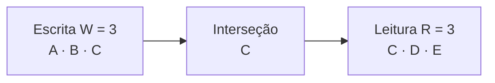
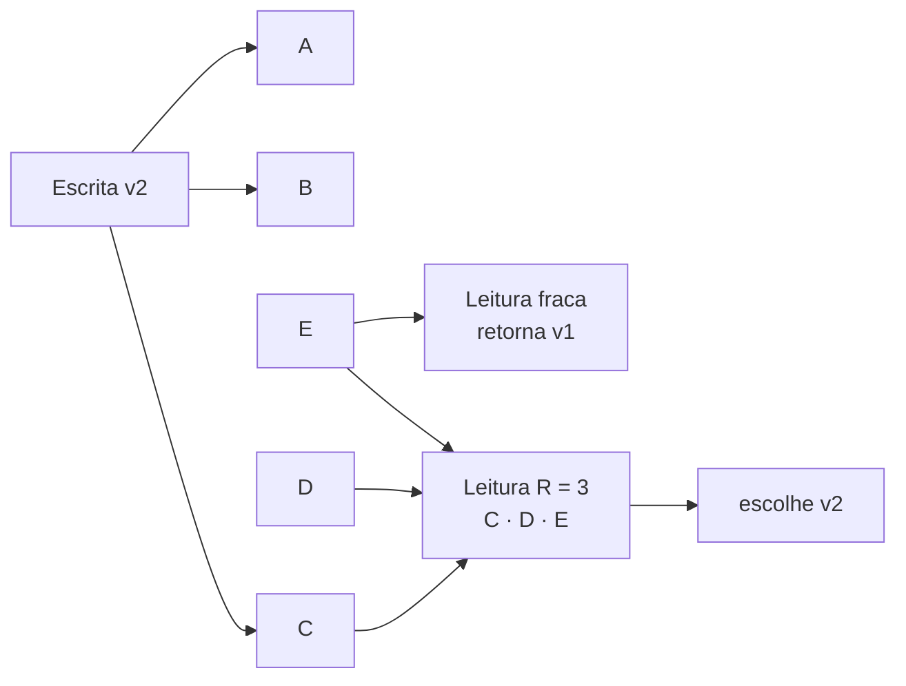
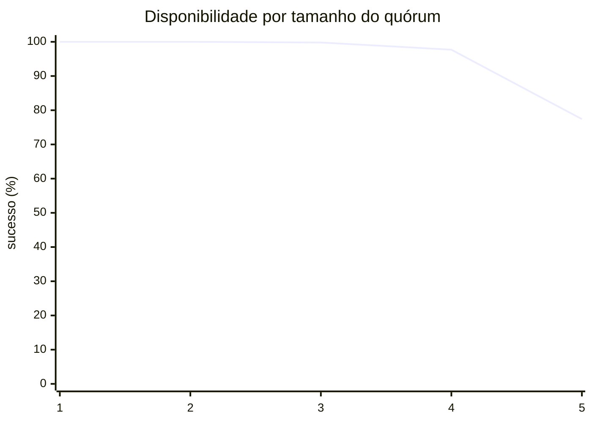

Cinco pessoas mantêm cópias do mesmo caderno de pedidos. Quantas precisam confirmar uma alteração e quantas devem ser consultadas antes de responder ao cliente? Esse é o problema dos quóruns de leitura e escrita. `N` representa o número de cópias, `W` quantas precisam confirmar uma escrita e `R` quantas devem ser consultadas em uma leitura. A escolha desses números determina se as operações terão maior disponibilidade, menor latência ou mais chances de encontrar a versão mais recente; por isso, uma maioria nem sempre significa consistência forte.

**Quóruns de leitura e escrita** permitem escolher quantas réplicas precisam responder para uma operação ser considerada bem-sucedida. A aritmética é curta; o significado operacional não. Este guia separa a interseção matemática, as garantias do protocolo e as escolhas concretas de um produto.

<nav class="fgs-toc" aria-label="Neste artigo"><strong>Neste guia</strong><ul><li><a href="#qrw-problema">Problema e vocabulário</a></li><li><a href="#qrw-intersecao">Matemática da interseção</a></li><li><a href="#qrw-fluxo">Fluxo passo a passo</a></li><li><a href="#qrw-garantias">O que a maioria não garante</a></li><li><a href="#qrw-disponibilidade">Disponibilidade e latência</a></li><li><a href="#qrw-produtos">Dynamo e Cassandra</a></li><li><a href="#qrw-operacao">Falhas, operação e anti-padrões</a></li><li><a href="#qrw-exercicios">Revisão e experimentos</a></li><li><a href="#qrw-fontes">Fontes</a></li></ul></nav>

## 1. O problema: várias cópias, respostas diferentes

Replicar um item aumenta tolerância a falhas e distribui leituras, mas cria versões que podem divergir. Considere cinco réplicas de uma chave. A, B e C já guardam `v2`; D e E ainda têm `v1`. Ler apenas E retorna um valor válido no disco e obsoleto para o cliente.

<section class="signal-card">

<h3>N</h3>

Número de réplicas pertencentes ao conjunto considerado para aquela chave. Em produtos, costuma ser chamado de fator de replicação, mas o escopo pode ser global ou por datacenter.

</section>

<section class="signal-card">

<h3>W</h3>

Número mínimo de confirmações de réplica exigidas para a escrita responder sucesso. Não é necessariamente o número total de destinos aos quais a escrita é enviada.

</section>

<section class="signal-card">

<h3>R</h3>

Número mínimo de respostas de réplica combinadas por uma leitura. A regra de escolher ou reconciliar versões também faz parte do protocolo.

</section>

<section class="signal-card">

<h3>q</h3>

Notação genérica para o tamanho exigido de um quórum. É útil ao calcular a disponibilidade de uma operação, seja ela leitura ou escrita.

</section>

A palavra *quórum* às vezes significa qualquer subconjunto suficiente para prosseguir; em outros textos, significa especificamente uma maioria. Aqui, **quórum de tamanho q** é um conjunto aceito pelo protocolo. Quando todos têm um voto, maioria é `⌊N/2⌋ + 1`. Sistemas de votação ponderada atribuem pesos diferentes e comparam a soma a limites.

<h3>Origem histórica</h3>

Em 1979, David K. Gifford publicou [*Weighted Voting for Replicated Data*](<https://doi.org/10.1145/800215.806583>). Cada cópia recebia votos; uma operação reunia um quórum de leitura ou escrita. O trabalho formalizou condições de interseção para controle de réplicas em bancos distribuídos. Isso é história do mecanismo, não afirmação de que todos os bancos modernos implementam o protocolo original.

Em 2007, Giuseppe DeCandia e coautores descreveram o Dynamo da Amazon, um armazenamento altamente disponível que expunha `N`, `R` e `W` como parâmetros. O paper relata `(3,2,2)` como configuração comum e também explica *sloppy quorum*, versionamento e reconciliação — detalhes que mudam o sentido da conta simples. [Paper e versão HTML do Dynamo](<https://www.allthingsdistributed.com/2007/10/amazons_dynamo.html>).

## 2. A matemática da interseção

Se um conjunto de escrita contém W réplicas e um conjunto de leitura contém R réplicas, ambos escolhidos dentro do mesmo universo de N réplicas, o menor cruzamento possível é:

<code>|W ∩ R| ≥ max(0, W + R − N)</code>

Logo, a condição clássica para forçar pelo menos uma réplica em comum é:

<code>R + W &gt; N</code>

Com `N=5`, `W=3` e `R=3`, a soma é 6 e a interseção mínima é 1. Não importa quais três réplicas confirmaram a escrita nem quais três responderam à leitura: ao menos uma aparece nos dois grupos.

<!-- tech-topics:mermaid {"label":"Quórum de escrita W igual a A, B e C cruza o quórum de leitura R em C."} -->

<figcaption>Exemplo calculado. A cor ajuda a distinguir os conjuntos, mas os rótulos mostram a participação: C é a interseção e contém <code>v2</code>.</figcaption>

Ver o código Mermaid
<pre class="code-block">flowchart LR
  W[Escrita W = 3&lt;br/&gt;A · B · C] --&gt; I[Interseção&lt;br/&gt;C]
  I --&gt; R[Leitura R = 3&lt;br/&gt;C · D · E]</pre>

A prova por contagem cabe em uma frase: dois subconjuntos de tamanhos R e W ocupariam `R+W` posições; como o universo só tem N posições, todo excedente precisa ser compartilhado. Se `R+W=N`, ainda podem ser disjuntos: com N=5, uma escrita em A, B e C e uma leitura em D e E não se cruzam.

<h3>Por que aparece também W &gt; N/2?</h3>

Em protocolos clássicos de votação, dois quóruns de escrita também precisam se cruzar. Isso exige `2W > N`, ou `W > N/2`. A intenção é impedir que duas atualizações independentes obtenham conjuntos totalmente separados. O paper de Gifford combina as condições de leitura–escrita e escrita–escrita para oferecer controle de réplica com serialização.

Mas a interseção é apenas uma propriedade de conjuntos. Ela não diz quem vence duas escritas concorrentes, como detectar causalidade, se o coordenador perdeu a resposta depois de persistir nem como uma leitura escolhe a maior versão. Essas decisões pertencem ao protocolo.

**Regra de bolso:** `R+W>N` garante que os conjuntos se cruzem, sob as mesmas réplicas elegíveis. Para transformar o cruzamento em leitura da versão esperada, ainda são necessários versionamento, comparação e comportamento de falha corretos.

## 3. Uma escrita e duas leituras, passo a passo

1. O cliente envia `PUT v2` a um coordenador.
2. O coordenador encaminha a mutação às cinco réplicas.
3. A, B e C persistem ou registram a mutação e respondem. Ao receber W=3 confirmações, o coordenador devolve sucesso.
4. D e E estão lentas; naquele instante ainda conservam `v1`.
5. Uma leitura R=1 que consulta E pode devolver `v1`.
6. Uma leitura R=3 sobre C, D e E inclui ao menos uma réplica do quórum de escrita. Se a reconciliação reconhece `v2` como sucessora, devolve `v2`.

<!-- tech-topics:mermaid {"label":"Uma leitura fraca pode retornar v1, enquanto uma leitura que inclui C encontra v2."} -->

<figcaption>Sequência ilustrativa, não medição. O diagrama explicita a condição frequentemente omitida: a leitura precisa comparar versões e selecionar a vencedora.</figcaption>

Ver o código Mermaid
<pre class="code-block">flowchart LR
  W[Escrita v2] --&gt; A[A]
  W --&gt; B[B]
  W --&gt; C[C]
  E[E] --&gt; F[Leitura fraca&lt;br/&gt;retorna v1]
  C --&gt; S[Leitura R = 3&lt;br/&gt;C · D · E]
  D[D] --&gt; S
  E --&gt; S
  S --&gt; V[escolhe v2]</pre>

<h3>Uma réplica em comum é suficiente?</h3>

É suficiente para *transportar evidência* da escrita reconhecida até a leitura, se a réplica comum realmente armazenou a versão antes de confirmar e se ela responde com essa versão. Não basta para resolver todos os casos:

- duas escritas podem ser concorrentes, sem relação causal;
- o critério *last write wins* pode escolher um timestamp maior de um relógio incorreto;
- uma exclusão pode ressurgir se tombstones e reparos forem mal operados;
- o coordenador pode responder timeout embora W réplicas tenham gravado, deixando o resultado indeterminado para o cliente;
- um quórum flexível ou sloppy pode usar participantes diferentes do conjunto nominal;
- uma leitura pode terminar nas primeiras R respostas, e a implementação concreta define quais versões são comparadas.

Por isso, o contrato deve ser expresso como comportamento observável: *read-your-writes*, leitura monotônica, consistência causal, linearizabilidade ou apenas convergência eventual. “Usamos QUORUM” descreve um mecanismo, não o contrato completo.

## 4. Interseção não é sinônimo de linearizabilidade

**Linearizabilidade** exige que cada operação pareça ocorrer atomicamente entre sua invocação e resposta, respeitando a ordem real entre operações não sobrepostas. Uma leitura iniciada depois que uma escrita terminou deve observar essa escrita ou uma posterior. Apenas contar respostas majoritárias não prova essa propriedade.

O algoritmo conhecido como ABD, de Hagit Attiya, Amotz Bar-Noy e Danny Dolev, mostra como emular um registrador atômico sobre passagem de mensagens com maiorias. Escritas usam versões ordenadas; leituras primeiro consultam réplicas e depois propagam a maior versão encontrada antes de terminar. Essa fase de *write-back* é parte da prova, não decoração. Veja o artigo [*Sharing Memory Robustly in Message-Passing Systems*](<https://doi.org/10.1145/200836.200869>), publicado no JACM em 1995 a partir do trabalho apresentado em 1990.

<table><caption>Propriedades diferentes que costumam ser agrupadas sob “consistência”</caption><thead><tr><th scope="col">Propriedade</th><th scope="col">Pergunta</th><th scope="col">Quórum sozinho?</th></tr></thead><tbody><tr><td>Interseção</td><td>Os dois conjuntos compartilham ao menos uma réplica?</td><td>Sim, pela aritmética e pelo universo comum.</td></tr><tr><td>Read-your-writes</td><td>O mesmo cliente vê sua escrita concluída?</td><td>Depende de níveis, sessão e roteamento.</td></tr><tr><td>Leitura monotônica</td><td>Após ver v2, o cliente pode voltar a ver v1?</td><td>Requer regra adicional ou sessão.</td></tr><tr><td>Consistência causal</td><td>Efeitos respeitam relações de causa?</td><td>Requer metadados/protocolo causal.</td></tr><tr><td>Linearizabilidade</td><td>Há uma única ordem compatível com o tempo real?</td><td>Não; exige protocolo com prova mais forte.</td></tr><tr><td>Durabilidade</td><td>Quantas falhas podem apagar a escrita reconhecida?</td><td>W influencia, mas persistência e domínios de falha importam.</td></tr></tbody></table>

<h3>Maioria e consenso não são a mesma coisa</h3>

Raft e Paxos usam maiorias porque quaisquer duas maiorias se cruzam. Porém a segurança nasce também de termos ou ballots, regras de votação, restrições de log, líderes e persistência. Remover essas regras e manter apenas “dois de três responderam” não produz consenso. Quórum é uma peça geométrica da prova; o algoritmo define o que os participantes podem afirmar.

Da mesma forma, uma escrita de banco que recebe três ACKs pode significar “três réplicas registraram a mutação”, enquanto uma confirmação de log consensual significa que uma entrada ocupa posição protegida por invariantes adicionais. São contratos diferentes apesar da mesma contagem.

## 5. O custo: disponibilidade e latência

Quanto maior q, mais réplicas precisam estar alcançáveis. Sob uma hipótese simplificadora — N réplicas com disponibilidade independente e idêntica p — a probabilidade de obter pelo menos q respostas é a cauda de uma distribuição binomial:

<code>P(sucesso) = Σ[k=q..N] C(N,k) · p^k · (1−p)^(N−k)</code>

Com N=5 e p=95%, exigir uma resposta dá aproximadamente 99,99997%; exigir três, 99,88419%; exigir todas, 77,37809%. Esses números são cálculos do modelo, não SLOs observados.

<!-- tech-topics:mermaid {"label":"Disponibilidade calculada por tamanho do quórum em cinco réplicas com disponibilidade individual de 95%."} -->

<figcaption>Eixo horizontal: tamanho q do quórum em réplicas. Eixo vertical: probabilidade de sucesso em porcentagem. Valores calculados com falhas independentes; racks, zonas, energia, rede e software criam correlação em sistemas reais.</figcaption>

Ver o código Mermaid
<pre class="code-block">xychart-beta
  title "Disponibilidade por tamanho do quórum"
  x-axis [1, 2, 3, 4, 5]
  y-axis "sucesso (%)" 0 --&gt; 100
  line [100, 100, 99.8, 97.7, 77.4]</pre>

A independência é uma hipótese forte. Cinco processos no mesmo host não oferecem cinco domínios de falha. Réplicas em zonas diferentes podem compartilhar rede, controle ou configuração. Para capacidade real, meça disponibilidade conjunta e modele falhas correlacionadas.

<h3>Latência é uma estatística de ordem</h3>

Se a operação termina após q respostas, sua duração tende a acompanhar a q-ésima resposta mais rápida — mais o custo do coordenador, persistência e processamento. W=1 pode responder ao primeiro ACK; W=N espera o mais lento. Isso não significa que aumentar q sempre adiciona uma constante: a cauda depende da distribuição e da correlação entre réplicas.

No Dynamo, o paper observa que a duração de um `get` ou `put` é determinada pela mais lenta entre as R ou W réplicas necessárias, razão pela qual os valores costumavam ser menores que N. Há, porém, uma troca: reduzir W aumenta a janela em que poucas cópias sustentam a durabilidade; reduzir R aumenta a chance de leitura obsoleta quando não há interseção.

<table><caption>Exemplos para N=3; resultados pressupõem o mesmo conjunto nominal de réplicas</caption><thead><tr><th scope="col">R</th><th scope="col">W</th><th scope="col">Interseção R/W</th><th scope="col">Perfil</th></tr></thead><tbody><tr><td>1</td><td>1</td><td>Não garantida</td><td>Baixa espera e alta tolerância, com maior risco de obsolescência e vulnerabilidade.</td></tr><tr><td>1</td><td>3</td><td>Sim</td><td>Leituras baratas; escrita espera todas e perde disponibilidade.</td></tr><tr><td>2</td><td>2</td><td>Sim</td><td>Maioria nos dois caminhos; configuração clássica equilibrada.</td></tr><tr><td>3</td><td>1</td><td>Sim</td><td>Escrita barata; toda leitura espera todas as réplicas.</td></tr><tr><td>3</td><td>3</td><td>Sim</td><td>Coordenação máxima, indisponível com uma única réplica inacessível.</td></tr></tbody></table>

## 6. Dynamo, sloppy quorum e Cassandra

<h3>Dynamo: N saudáveis, não necessariamente os N originais</h3>

O Dynamo enviava operações aos primeiros N nós saudáveis da lista de preferência. Durante falhas, podia pular uma réplica nominal e gravar temporariamente em outra usando *hinted handoff*. Esse **sloppy quorum** melhora disponibilidade e durabilidade temporária, mas os conjuntos usados por escrita e leitura podem não pertencer ao mesmo universo fixo que sustenta a prova escolar.

O próprio paper chama o resultado de sistema *quorum-like*. Versões eram representadas com vector clocks; leituras podiam receber versões causalmente não relacionadas para reconciliação. Portanto, `R+W>N` não convertia Dynamo em registrador linearizável. O objetivo declarado era um armazenamento eventualmente consistente e altamente disponível.

<h3>Cassandra: níveis de consistência por operação</h3>

O Apache Cassandra oferece níveis como `ONE`, `QUORUM`, `LOCAL_QUORUM`, `EACH_QUORUM`, `ALL` e `LOCAL_ONE`. A [documentação oficial de consistência ajustável](<https://cassandra.apache.org/doc/latest/cassandra/architecture/dynamo.html#tunable-consistency>) explica que escritas são enviadas a todas as réplicas; o nível controla quantas respostas o coordenador espera. Em leituras, normalmente são consultadas réplicas suficientes para satisfazer o nível, com possíveis requisições especulativas.

Para um fator de replicação `RF=3`, `QUORUM` exige duas respostas. Usar QUORUM em escrita e leitura força sobreposição e torna uma escrita reconhecida visível a uma leitura subsequente conforme o protocolo e as premissas documentadas. Isso não elimina todas as anomalias de concorrência nem transforma operações CQL comuns em transações lineares entre várias partições.

Em vários datacenters, a palavra “quórum” precisa de escopo. `LOCAL_QUORUM` reúne maioria das réplicas do datacenter do coordenador; `EACH_QUORUM` exige maioria em cada datacenter. Uma escrita local seguida de leitura local em outro datacenter pode não ter a relação que a soma global sugere. Modele o conjunto por datacenter, estratégia de replicação e roteamento de clientes.

<h3>Reconciliação e convergência</h3>

Cassandra usa timestamps de mutação e last-write-wins para resolver versões; a documentação alerta que sua correção depende de relógios adequadamente sincronizados. Read repair, hinted handoff e reparo anti-entropia ajudam réplicas a convergir. Nenhum deles torna aceitável ignorar o ciclo operacional: hints expiram, tombstones têm janelas e reparos precisam completar. Veja [versionamento e sincronização de réplicas](<https://cassandra.apache.org/doc/latest/cassandra/architecture/dynamo.html#data-versioning>) e a [documentação de repair](<https://cassandra.apache.org/doc/latest/cassandra/managing/operating/repair.html>).

**Não transfira fórmulas sem o manual do produto.** Descubra quem conta como réplica, quando um ACK é emitido, se hints contam, quais datacenters participam, como versões são ordenadas e que garantias existem para leituras concorrentes.

## 7. Falhas, observabilidade e escolhas ruins

<h3>Cenários de falha</h3>

<table><caption>O que investigar além da contagem de respostas</caption><thead><tr><th scope="col">Cenário</th><th scope="col">Efeito possível</th><th scope="col">Controle</th></tr></thead><tbody><tr><td>Uma réplica fica lenta</td><td>Quórum ainda conclui, mas a cauda cresce ou surge requisição especulativa.</td><td>Latência por réplica, timeouts e hedge limitado.</td></tr><tr><td>Partição separa 2 e 3 réplicas</td><td>Apenas o lado que reúne q pode concluir; com q baixo, ambos podem aceitar.</td><td>Definir contrato, reconciliação e lado autorizado.</td></tr><tr><td>Cliente recebe timeout de escrita</td><td>Resultado pode ser desconhecido: zero, algumas ou W réplicas gravaram.</td><td>Idempotência, leitura de confirmação e reconciliação.</td></tr><tr><td>Relógios divergem em LWW</td><td>Uma escrita cronologicamente antiga pode vencer por timestamp.</td><td>Sincronização, timestamps do servidor e teste do contrato.</td></tr><tr><td>Reparo fica atrasado</td><td>Réplicas obsoletas persistem além da janela esperada.</td><td>Repair regular, métricas de progresso e capacidade reservada.</td></tr><tr><td>Quórum cruza regiões</td><td>Latência e disponibilidade passam a depender do enlace remoto.</td><td>Níveis locais quando compatíveis com o requisito.</td></tr></tbody></table>

<h3>O que observar</h3>

- **latência por nível de consistência**, incluindo p95 e p99;
- **unavailable, timeout e retry** por leitura e escrita;
- **réplicas contatadas, respostas úteis e requisições especulativas**;
- **hints criados, pendentes, entregues e expirados**;
- **repair pendente, duração, bytes divergentes e falhas**;
- **diferença de relógio** quando a resolução depende de timestamps;
- **latência e perda entre zonas/datacenters**;
- **leituras que reconciliam versões** e conflitos expostos à aplicação.

Separe demanda original de tentativas. Um timeout que dispara retry pode multiplicar tráfego justamente quando uma réplica está lenta. Se o cliente tenta três vezes e cada coordenador contata cinco réplicas, uma intenção pode gerar até quinze contatos, antes de speculative retry. Combine orçamento de tempo, backoff, jitter e idempotência.

<h3>Anti-padrões</h3>

- **“Dois de três significa consistência forte”:** a frase omite versionamento, concorrência, read-back e escopo.
- **Somar R e W de conjuntos diferentes:** quóruns globais, locais e sloppy não compartilham necessariamente o mesmo universo.
- **Confundir ACK com cópia durável:** descubra se a confirmação ocorre em memória, log local, fsync ou outro estágio.
- **Usar ALL para “ficar seguro”:** uma réplica lenta derruba a disponibilidade e amplia a cauda.
- **Baixar consistência durante incidente sem contrato:** recupera respostas enquanto pode introduzir dados obsoletos e decisões irreversíveis.
- **Confiar em repair como caminho síncrono:** convergência posterior não muda o que o usuário acabou de ler.
- **Ignorar relógios em last-write-wins:** o maior timestamp não é automaticamente a intenção mais recente.
- **Tratar retry de timeout como nova operação:** resultados indeterminados exigem chave idempotente ou confirmação.

<h3>Quando talvez não usar quóruns ajustáveis</h3>

Se toda alteração cabe numa transação de um banco que já oferece o contrato necessário, não replique seu protocolo no cliente. Se uma chave tem dono único estável, leader replication pode oferecer um modelo mais simples. Dados imutáveis podem usar endereçamento por conteúdo e verificação, sem votação por atualização. E, se a regra de negócio exige transação serializável entre várias chaves, escolha uma abstração que a ofereça; aumentar R e W de operações independentes não cria atomicidade entre elas.

Quóruns flexíveis são valiosos quando latência, tolerância a falhas e frescor variam por operação. Um catálogo pode aceitar leitura ocasionalmente antiga; reservar estoque talvez exija compare-and-set, lightweight transaction ou outro caminho forte. O nível deve nascer do invariante do negócio, não de um padrão universal.

<h3>Relações com conceitos vizinhos</h3>

<section class="signal-card">

<h3>CAP</h3>

Durante uma partição, exigir conjuntos que se intersectam pode tornar um lado indisponível. Aceitar em lados separados exige resolver divergência.

</section>

<section class="signal-card">

<h3>Consenso</h3>

Usa quóruns com ballots, termos e regras de segurança para acordar uma ordem; não é mera contagem de ACKs.

</section>

<section class="signal-card">

<h3>Anti-entropia</h3>

Compara e repara réplicas em segundo plano. Reduz divergência acumulada, mas não substitui o contrato da leitura atual.

</section>

<section class="signal-card">

<h3>Fencing</h3>

Impede gerações antigas de atuar sobre um recurso. O artigo de [leases e fencing tokens](<article.html?slug=leases-e-fencing-tokens>) cobre essa outra garantia.

</section>

## 8. Resumo mental, revisão e experimentos

**Resumo mental:** N define o universo nominal de cópias; W define quantas confirmações encerram a escrita; R define quantas respostas alimentam a leitura. `R+W>N` força um ponto de contato e `W>N/2` força escritas a se cruzarem. O contato só vira garantia útil quando participantes, versões, persistência, reconciliação e falhas obedecem ao protocolo.

<h3>Perguntas de revisão</h3>

1. Com N=7 e W=4, qual é o menor R que força interseção?
2. Por que R+W=N não basta?
3. O que sloppy quorum muda no universo usado pela prova?
4. Por que duas maiorias que se cruzam não implementam consenso sozinhas?
5. Qual a diferença entre versão mais nova, maior timestamp e escrita linearizável?
6. Um timeout de escrita significa que nada foi gravado?
7. Por que LOCAL\_QUORUM precisa ser analisado por datacenter?

<h3>Experimento 1 — enumerar os conjuntos</h3>

<a href="../../assets/quoruns-de-leitura-e-escrita/quoruns-de-leitura-e-escrita-experimento.py" download="">Baixe o experimento Python</a> e execute sem dependências externas:

<pre class="code-block"><code>python3 quoruns-de-leitura-e-escrita-experimento.py</code></pre>

O programa enumera todos os pares de quóruns para `(N,R,W)=(5,3,3)`, `(5,2,3)` e `(5,2,2)`, informa a menor interseção e calcula o gráfico binomial. Troque para N=7 e procure o menor par R, W sem conjuntos disjuntos.

<h3>Experimento 2 — falha correlacionada</h3>

No modelo do gráfico, cinco réplicas têm p=95% independente. Agora agrupe três na zona A e duas na zona B. Suponha que cada processo nunca falhe isoladamente, mas cada zona tenha 95% de disponibilidade e suas falhas sejam independentes. Calcule a disponibilidade de q=3: ela deixa de ser a binomial por réplica. Compare a resposta com o desenho de distribuição entre domínios de falha.

Conferir a intuição

Se A está disponível, suas três réplicas já formam q=3. Se A falha, as duas de B não bastam. Assim, a disponibilidade da operação é 95%, apesar de haver cinco processos. A topologia domina a contagem.

<h3>Experimento 3 — desenhar um contrato</h3>

Escolha uma operação real, como atualizar endereço, exibir catálogo ou reservar uma unidade. Escreva o invariante, a tolerância a leitura antiga, o comportamento após timeout e os níveis de leitura/escrita. Depois injete mentalmente: uma réplica lenta, partição por zona, duas escritas concorrentes, relógio adiantado e repair atrasado. Se o desenho depende apenas da frase “usamos maioria”, o contrato ainda está incompleto.

## 9. Fontes e leituras

Fontes consultadas em 14 de setembro de 2026. Diagramas, exemplos numéricos e programa são materiais didáticos próprios. O gráfico de disponibilidade é calculado sob a hipótese explicitada de falhas independentes, não representa telemetria real.

<ol class="fgs-references"><li>David K. Gifford — <a href="https://doi.org/10.1145/800215.806583"><em>Weighted Voting for Replicated Data</em></a>, SOSP 1979. Fonte histórica para quóruns ponderados de leitura e escrita.</li><li>Giuseppe DeCandia et al. — <a href="https://www.allthingsdistributed.com/2007/10/amazons_dynamo.html"><em>Dynamo: Amazon's Highly Available Key-value Store</em></a>, SOSP 2007. N, R, W, sloppy quorum, hinted handoff, versionamento e trade-offs operacionais.</li><li>Apache Cassandra — <a href="https://cassandra.apache.org/doc/latest/cassandra/architecture/dynamo.html">Dynamo architecture</a>. Documentação oficial de replicação, níveis de consistência, <code>R+W&gt;RF</code>, last-write-wins e sincronização de réplicas.</li><li>Apache Cassandra — <a lang="en-US" href="https://cassandra.apache.org/doc/latest/cassandra/managing/operating/repair.html">Repair</a>. Operação oficial de anti-entropia e manutenção de consistência entre réplicas.</li><li>Hagit Attiya, Amotz Bar-Noy e Danny Dolev — <a href="https://doi.org/10.1145/200836.200869"><em>Sharing Memory Robustly in Message-Passing Systems</em></a>, JACM 42(1), 1995. Algoritmo ABD para registradores atômicos com maiorias e write-back.</li><li>Diego Ongaro e John Ousterhout — <a href="https://raft.github.io/"><em>In Search of an Understandable Consensus Algorithm</em></a>, USENIX ATC 2014. Mostra o papel de maiorias dentro de um protocolo de consenso completo.</li></ol>

<a class="article-back" href="index.html#recent-posts">← Todos os artigos</a>

