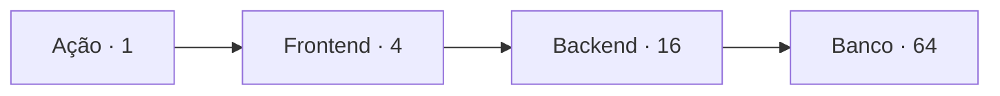
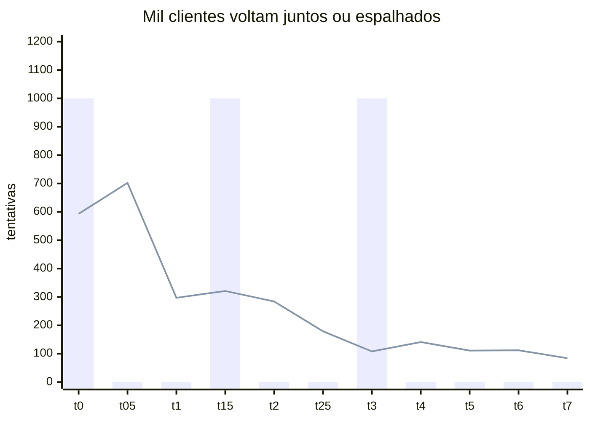
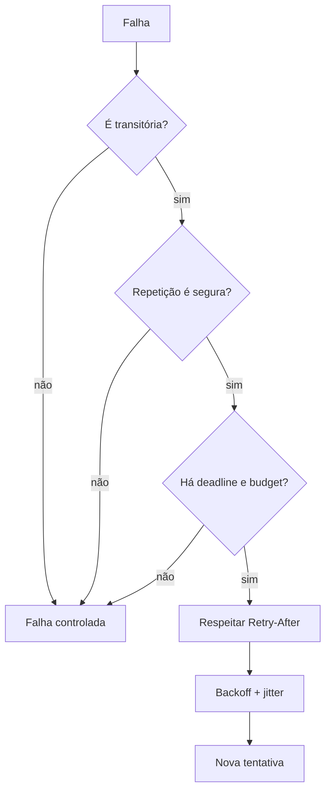

Você chama o garçom, ele não escuta, você chama de novo e, em poucos segundos, todas as mesas fazem a mesma coisa porque a cozinha está demorando. Como recuperar o atendimento sem criar uma fila ainda maior? Repetir um pedido pode resolver uma falha momentânea, mas também pode sobrecarregar ainda mais o restaurante. Em sistemas distribuídos, retries são novas requisições que consomem conexões, CPU e capacidade da dependência. Backoff cria espaço entre as tentativas, jitter evita que todos repitam ao mesmo tempo e um orçamento de retries impede que a tentativa de recuperação se transforme em uma nova tempestade.

**Retry é uma nova requisição, não uma viagem no tempo.** Ela consome conexão, CPU, memória, limite de concorrência e capacidade da dependência. Quando a falha é causada por sobrecarga, repetição descontrolada forma uma realimentação positiva: a lentidão gera retries, os retries geram mais carga e a carga prolonga a lentidão. Este guia constrói uma política completa: decidir *se* repetir, limitar *quanto*, espaçar *quando* e preservar a segurança da operação.

<nav class="fgs-toc" aria-label="Neste artigo"><strong>Neste guia</strong><ul><li><a href="#retry-problema">Falha transitória e amplificação</a></li><li><a href="#retry-seguranca">Idempotência e resultado desconhecido</a></li><li><a href="#retry-backoff">Backoff exponencial e jitter</a></li><li><a href="#retry-orcamentos">Deadlines e retry budgets</a></li><li><a href="#retry-implementacao">Implementação e protocolos</a></li><li><a href="#retry-operacao">Falhas, métricas e anti-padrões</a></li><li><a href="#retry-exercicios">Revisão e experimentos</a></li><li><a href="#retry-fontes">Fontes</a></li></ul></nav>

## 1. O retry resolve qual problema?

Retries são úteis para **falhas transitórias**: condições que provavelmente desaparecerão dentro do tempo útil da operação. Exemplos incluem uma conexão interrompida antes de ser estabelecida, um replica momentaneamente indisponível, uma troca de líder ou uma resposta explícita de throttling com orientação para tentar depois. Eles não corrigem credenciais inválidas, payload malformado, recurso inexistente por contrato ou capacidade permanentemente insuficiente.

<section class="signal-card">

<h3>Transitório</h3>

A causa pode desaparecer dentro do deadline. Uma repetição limitada tem chance razoável de sucesso.

</section>

<section class="signal-card">

<h3>Permanente</h3>

A mesma entrada tende a produzir a mesma falha. Repetir desperdiça capacidade e atrasa o diagnóstico.

</section>

<section class="signal-card">

<h3>Ambíguo</h3>

O cliente perdeu a resposta e não sabe se o servidor aplicou a operação. Aqui, segurança é tão importante quanto disponibilidade.

</section>

A classificação não pode depender apenas do código de status. Um `503` pode indicar poucos segundos de drenagem ou uma indisponibilidade prolongada; um timeout pode ocorrer antes do envio, durante o processamento ou depois do commit. O contrato da API, o estágio da chamada e um sinal do servidor importam.

<strong>Regra operacional:</strong> só repita quando a falha for classificada como recuperável, a operação puder ser repetida com segurança e ainda houver orçamento de tempo e de carga.

<h2>2. Retry é multiplicação de carga</h2>

Defina `aᵢ` como o máximo de tentativas — chamada inicial incluída — na camada `i`. No pior caso, uma única ação pode produzir:

<pre><code>A_folha = a₁ × a₂ × ... × aₙ</code></pre>

Se navegador, frontend e backend permitem quatro tentativas cada, uma ação pode chegar ao banco como `4³ = 64` tentativas. Esse exemplo é usado pelo capítulo [Addressing Cascading Failures, do Google SRE](<https://sre.google/sre-book/addressing-cascading-failures/>), para mostrar por que cada camada não deveria repetir de forma independente.

<!-- tech-topics:mermaid {"label":"Uma ação pode se multiplicar em quatro tentativas no frontend, dezesseis no backend e sessenta e quatro no banco."} -->

<figcaption>Amplificação máxima calculada com quatro tentativas em três camadas: 1 → 4 → 16 → 64. O desenho mostra contagem, não volume medido.</figcaption>

Ver o código Mermaid
<pre class="code-block">flowchart LR
  A[Ação · 1] --&gt; F[Frontend · 4]
  F --&gt; B[Backend · 16]
  B --&gt; D[Banco · 64]</pre>

Uma política melhor escolhe **um ponto responsável**, normalmente a camada imediatamente acima de quem rejeita ou falha. Camadas superiores mantêm o deadline e a intenção de negócio; a camada responsável entende o transporte e os sinais do servidor. Duplicar a política nos dois lugares combina os custos sem combinar o conhecimento.

<h3>Valor esperado em um modelo simples</h3>

Suponha, apenas como exercício matemático, tentativas independentes com probabilidade de sucesso `p` e no máximo `A` tentativas. A quantidade esperada de tentativas é:

<pre><code>E[T] = Σ(k=0 até A−1) (1−p)^k = [1−(1−p)^A] / p</code></pre>

Com `p = 0,7` e `A = 4`, temos `1 + 0,3 + 0,09 + 0,027 = 1,417`. O cliente gera em média 41,7% mais tentativas do que chamadas lógicas. Isso **não é uma previsão de produção**: falhas distribuídas são frequentemente correlacionadas, e justamente durante incidentes o valor de `p` muda entre tentativas. O cálculo serve para revelar que até uma política pequena tem custo mensurável.

## 3. O resultado desconhecido

Considere um pagamento. O servidor confirma a transação no banco, mas a resposta se perde. Para o cliente, a chamada terminou em timeout; para o negócio, ela terminou em sucesso. Repetir um `POST` ingênuo pode cobrar duas vezes.

<pre><code>cliente             serviço              banco
   | POST /cobrar       |                   |
   |-------------------&gt;| commit            |
   |                    |------------------&gt;|
   |       X resposta perdida               |
   | POST /cobrar novamente                 |
   |-------------------&gt;| segundo commit?   |</code></pre>

A semântica HTTP define um método idempotente como aquele em que múltiplas requisições idênticas têm o mesmo efeito pretendido no servidor que uma única requisição. O [RFC 9110, seção 9.2.2](<https://datatracker.ietf.org/doc/html/rfc9110#section-9.2.2>), permite repetição automática de métodos idempotentes após falha de comunicação e alerta que clientes não devem repetir automaticamente métodos não idempotentes, salvo quando sabem que a semântica é idempotente ou que a primeira tentativa não foi aplicada.

Idempotência não significa resposta byte a byte igual nem ausência de logs, métricas ou efeitos auxiliares. Significa controlar o efeito pretendido. Para comandos como criar pedido ou cobrar, um desenho comum usa uma **chave de idempotência** estável para a operação lógica:

<pre><code>Idempotency-Key: checkout-7f1d...

mesma chave + mesmo comando → mesmo resultado lógico
mesma chave + payload diferente → conflito
chave nova → nova operação</code></pre>

O servidor precisa armazenar a decisão de maneira atômica com o efeito ou usar um protocolo que reconcilie estados ambíguos. Apenas adicionar um UUID no cliente, sem unicidade e persistência no lado que aplica o efeito, não cria idempotência. O artigo sobre [Transactional Outbox](<article.html?slug=transactional-outbox>) explora a fronteira relacionada entre commit local e publicação de eventos.

## 4. Backoff exponencial: dar espaço para recuperar

Repetir imediatamente é apropriado em poucos casos transparentes, como quando o transporte sabe que a chamada não saiu. Para falhas visíveis da aplicação, o atraso reduz contenção e dá tempo para eleição, autoscaling ou drenagem. Uma forma usual é o backoff exponencial limitado:

<pre><code>bᵢ = min(cap, base × multiplicadorⁱ)</code></pre>

Com base de 100 ms, multiplicador 2 e teto de 2 s, os limites são 100, 200, 400, 800, 1.600 e depois 2.000 ms. O teto impede esperas indefinidamente crescentes, mas cria outro problema: clientes que começaram juntos continuam acordando juntos, especialmente depois que todos encostam no mesmo limite.

A documentação atual de comportamento de retry dos [AWS SDKs](<https://docs.aws.amazon.com/sdkref/latest/guide/feature-retry-behavior.html>) descreve uma variante de backoff exponencial com *full jitter*, teto de 20 segundos e bases diferentes para erros gerais e throttling. Esses números são decisões daquele ecossistema, não constantes universais.

<h2>5. Jitter quebra a sincronização</h2>

**Jitter** adiciona aleatoriedade ao momento da próxima tentativa. Em *full jitter*, sorteamos uniformemente entre zero e o limite calculado:

<pre><code>esperaᵢ ~ Uniforme(0, bᵢ)
E[esperaᵢ] = bᵢ / 2</code></pre>

Marc Brooker mostrou em <a lang="en-US" href="https://aws.amazon.com/blogs/architecture/exponential-backoff-and-jitter/">Exponential Backoff and Jitter</a> que backoff exponencial sem jitter ainda produz grupos de chamadas; no modelo publicado, *full jitter* reduziu o trabalho total em mais da metade para cem contendores. O resultado pertence àquela simulação. A conclusão geral é que espalhar tentativas reduz picos sincronizados, não que exista uma porcentagem garantida para qualquer sistema.

<!-- tech-topics:mermaid {"label":"Comparação entre ondas sincronizadas de retry e uma distribuição com full jitter."} -->

<figcaption>Simulação própria, determinística pela semente 20260915: 1.000 clientes e três retries, com limites acumulados de 1, 2 e 4 segundos. Sem jitter, o pico é 1.000; com full jitter, 702 tentativas por 500 ms. São dados calculados, não medição real.</figcaption>

Ver o código Mermaid
<pre class="code-block">xychart-beta
  title "Mil clientes voltam juntos ou espalhados"
  x-axis [0, 05, 1, 15, 2, 25, 3, 4, 5, 6, 7]
  y-axis "tentativas" 0 --&gt; 1200
  bar [1000, 0, 0, 1000, 0, 0, 1000, 0, 0, 0, 0]
  line [593, 702, 297, 321, 284, 179, 108, 141, 111, 112, 84]</pre>

Há outras famílias. *Equal jitter* preserva metade do atraso e sorteia a outra metade; *decorrelated jitter* calcula o próximo limite a partir do atraso anterior. Elas mudam cauda, ocupação e convergência. Não escolha pela sonoridade: simule com sua concorrência, deadline e distribuição de recuperação. A recomendação estável é evitar um relógio determinístico compartilhado por uma multidão.

<h3>Por que jitter não basta</h3>

Se a dependência suporta 500 requisições/s e recebe continuamente 5.000 chamadas lógicas/s, distribuir retries apenas suaviza a curva. Não cria capacidade. Backpressure, rate limiting, load shedding, redução de concorrência ou escala precisam encerrar a pressão em algum ponto. Da mesma forma, jitter não torna segura uma operação não idempotente.

## 6. Deadline: o relógio da operação lógica

Timeout por tentativa e deadline global respondem a perguntas distintas. O timeout limita quanto uma tentativa pode ocupar; o deadline limita quanto a intenção inteira ainda vale. Reiniciar um timeout de 2 s a cada uma de quatro tentativas pode transformar uma expectativa de 2 s em mais de 8 s, sem contar esperas.

<pre><code>restanteᵢ = deadline − relógio_monotônico_agora

só iniciar se:
esperaᵢ + timeout_da_tentativa + margem &lt; restanteᵢ</code></pre>

O guia oficial de [deadlines do gRPC](<https://grpc.io/docs/guides/deadlines/>) recomenda definir um limite explícito; por padrão, um cliente pode esperar indefinidamente. O framework também suporta propagação do deadline, descontando o tempo já consumido para evitar que cada serviço reinicie o relógio. Servidores devem observar cancelamento, porque o cliente desistir não interrompe magicamente trabalho já iniciado.

<strong>Deadline é semântica:</strong> se a resposta já não tem valor para o usuário ou para o workflow, uma tentativa tecnicamente possível ainda é trabalho inútil.

<h2>7. Retry budget: limitar carga, não só cada requisição</h2>

`maxAttempts = 3` limita uma chamada lógica, mas não limita uma frota inteira. Durante um incidente, milhões de chamadas podem usar todas as três tentativas. Um **retry budget** limita a proporção ou o volume de retries aceitos em uma janela.

O capítulo <a lang="en-US" href="https://sre.google/sre-book/handling-overload/">Handling Overload</a> descreve uma política operacional em que clientes mantêm retries abaixo de 10% das requisições. Isso aproxima a amplificação de 1,1× em vez do pior caso de 3× de uma política com três tentativas. Dez por cento é o exemplo daquele sistema, não um padrão universal.

<section class="signal-card">

<h3>Por chamada</h3>

Máximo de tentativas e deadline. Impede que uma operação individual viva para sempre.

</section>

<section class="signal-card">

<h3>Por processo</h3>

Tokens ou razão de retries em uma janela. Impede que a frota use o máximo simultaneamente.

</section>

<section class="signal-card">

<h3>Por dependência</h3>

Concorrência, rate limit e circuit breaker. Protegem uma fronteira compartilhada.

</section>

Uma implementação comum mantém tokens: sucessos ou chamadas normais repõem o balde; cada retry consome um token; sem token, a chamada falha sem repetir. O [gRPC](<https://grpc.io/docs/guides/retry/>) chama esse mecanismo de *retry throttling*. Ele ajuda clientes a recuar quando muitos RPCs falham, mas não substitui limites no servidor.

## 8. Uma decisão em cinco portas

<!-- tech-topics:mermaid {"label":"Decisão de retry: falha transitória, segurança, deadline, orçamento, backoff e jitter."} -->

<figcaption>A tentativa só avança quando quatro condições se mantêm: classificação retryable, segurança do efeito, tempo restante e orçamento de carga. Qualquer resposta negativa encerra ou degrada a operação.</figcaption>

Ver o código Mermaid
<pre class="code-block">flowchart TD
  F[Falha] --&gt; T{É transitória?}
  T --&gt;|não| X[Falha controlada]
  T --&gt;|sim| I{Repetição é segura?}
  I --&gt;|não| X
  I --&gt;|sim| D{Há deadline e budget?}
  D --&gt;|não| X
  D --&gt;|sim| H[Respeitar Retry-After]
  H --&gt; B[Backoff + jitter]
  B --&gt; R[Nova tentativa]</pre>

Essa ordem evita um erro frequente: calcular um backoff elegante antes de perguntar se a chamada deveria ser repetida. Um algoritmo conceitual é:

<pre><code>deadline = monotonic() + 0.8

for attempt in range(max_attempts):
    remaining = deadline - monotonic()
    if remaining &lt;= safety_margin:
        raise DeadlineExceeded

    try:
        return call(timeout=min(per_attempt_timeout, remaining))
    except Error as err:
        if not retryable(err) or not repetition_is_safe():
            raise
        if attempt + 1 == max_attempts or not retry_budget.take():
            raise

        limit = min(max_delay, base * multiplier ** attempt)
        local_delay = random.uniform(0, limit)
        delay = max(server_retry_after(err) or 0, local_delay)
        if delay + safety_margin &gt;= deadline - monotonic():
            raise DeadlineExceeded
        sleep(delay)</code></pre>

É pseudocódigo, não uma biblioteca pronta. Em produção, preserve a causa final, respeite cancelamento, use relógio monotônico para intervalos, limite o valor aceito de cabeçalhos externos e teste a política com tempo controlável.

<h2>9. HTTP: método, status e Retry-After</h2>

O RFC 9110 permite que uma resposta `Retry-After` informe quanto esperar antes de uma nova requisição, usando segundos ou uma data HTTP. O campo aparece tipicamente com `503` e também pode acompanhar redirecionamentos. Respeitá-lo coordena o cliente com conhecimento que só o servidor possui; aplicar jitter adicional evita que todos acordem exatamente no fim do mesmo intervalo.

Não trate “todo 5xx” nem “todo timeout” como retryable. Considere se o request body pode ser reenviado, se a conexão permite saber que nada foi aplicado, se o método é idempotente e se o servidor documenta aquela condição. `429 Too Many Requests` costuma pedir recuo, não uma rajada de repetições imediatas.

<h2>10. gRPC: política explícita e pushback</h2>

O gRPC suporta política declarativa com máximo de tentativas, backoff inicial e máximo, multiplicador e códigos retryable. A [documentação oficial](<https://grpc.io/docs/guides/retry/>), atualizada em 26 de novembro de 2025, informa que o mecanismo existe, mas não há uma política geral de retries configurada por padrão. O exemplo oficial usa `maxAttempts: 4`, começa em 0,1 s, dobra até 1 s e aceita `UNAVAILABLE`; atrasos recebem jitter de aproximadamente ±20%.

Há também retries transparentes em casos restritos nos quais a biblioteca conhece o estágio do RPC. Isso não autoriza a aplicação a classificar qualquer `UNAVAILABLE` como inofensivo. Após os metadados iniciais da resposta, o RPC é considerado comprometido e uma nova tentativa já não é transparente.

## 11. Cenário de falha: recuperação que provoca recaída

1. Às 10:00:00, uma dependência satura e rejeita 20 mil clientes.
2. Todos usam backoff fixo de um segundo.
3. Às 10:00:01, a dependência já começou a recuperar, mas recebe 20 mil retries simultâneos.
4. A fila volta a saturar; a latência cruza timeouts; surge uma nova geração de retries.
5. Instâncias novas entram, mas também recebem a onda sincronizada.

Backoff exponencial reduz a frequência das ondas; o teto impede crescimento infinito; jitter dissolve a fase comum; deadline elimina trabalho vencido; budget limita a energia total; load shedding preserva capacidade útil. É a combinação, não uma opção isolada, que muda a dinâmica.

<h2>12. Como observar em produção</h2>

<table><thead><tr><th>Métrica ou atributo</th><th>Pergunta respondida</th></tr></thead><tbody><tr><td>Tentativas por chamada lógica</td><td>A política está ampliando carga? Observe distribuição, não só média.</td></tr><tr><td>Razão retry/chamada inicial</td><td>Quanto do tráfego é trabalho repetido?</td></tr><tr><td>Motivo e código</td><td>Quais condições acionam repetição?</td></tr><tr><td>Sucesso após retry</td><td>As repetições recuperam valor ou apenas atrasam a falha?</td></tr><tr><td>Retries esgotados ou bloqueados</td><td>Deadline, max attempts ou budget encerrou a operação?</td></tr><tr><td>Distribuição do atraso</td><td>Jitter está espalhando chamadas ou há picos sincronizados?</td></tr><tr><td>Deadline restante</td><td>Quanto orçamento chega a cada camada?</td></tr><tr><td>Pushback/Retry-After</td><td>O cliente está respeitando o sinal do servidor?</td></tr><tr><td>Saturação downstream</td><td>Retry é reação a um problema ou parte dele?</td></tr></tbody></table>

No tracing, uma chamada lógica deve permanecer reconhecível enquanto cada tentativa recebe seu próprio span ou evento. Sem essa relação, dashboards contam tentativas como usuários distintos e escondem amplificação. Correlacione com latência, erros, tráfego e saturação, os [Four Golden Signals](<article.html?slug=four-golden-signals>).

<h2>13. Anti-padrões</h2>

<table><thead><tr><th>Anti-padrão</th><th>Consequência</th></tr></thead><tbody><tr><td>Retry imediato em loop</td><td>Consome o restante da capacidade durante overload.</td></tr><tr><td>Backoff determinístico</td><td>Mantém clientes em fase e cria ondas periódicas.</td></tr><tr><td>Retry em todas as camadas</td><td>Amplificação multiplicativa e comportamento difícil de atribuir.</td></tr><tr><td>Timeout reiniciado por tentativa</td><td>Viola a latência esperada da operação lógica.</td></tr><tr><td>Retry de erro permanente</td><td>Transforma falha rápida em falha lenta e cara.</td></tr><tr><td>Repetir comando não idempotente</td><td>Pode duplicar cobrança, pedido ou mensagem.</td></tr><tr><td>Ignorar Retry-After ou pushback</td><td>Descarta a melhor informação disponível sobre recuperação.</td></tr><tr><td>Max attempts sem budget global</td><td>Protege uma chamada, mas não protege a frota.</td></tr><tr><td>Jitter sem limite de concorrência</td><td>Espalha uma carga que talvez continue excessiva.</td></tr><tr><td>Servidor ignora cancelamento</td><td>Continua trabalho cujo cliente já abandonou.</td></tr></tbody></table>

<h2>14. Quando não repetir</h2>

Não repita quando o erro é permanente; o deadline expirou; o usuário cancelou; a operação tem efeito ambíguo sem idempotência; o circuit breaker está aberto; o retry budget acabou; o trabalho é tão caro que exige reconciliação assíncrona; ou a dependência sinaliza que não deve receber novas tentativas. Em sobrecarga persistente, falhar rápido ou degradar funcionalidade pode preservar mais respostas úteis.

Retries se relacionam a outros controles, mas não são sinônimos. **Circuit breaker** interrompe chamadas para uma dependência aparentemente doente. **Backpressure** propaga capacidade disponível. **Rate limiting** impõe uma taxa. **Bulkhead** isola recursos. **Load shedding** recusa trabalho. Retry ocupa a pequena janela em que uma nova tentativa ainda é segura, provável e valiosa.

<h2>15. Contexto histórico</h2>

A ideia de esperar um intervalo aleatório diante de contenção antecede serviços web. O artigo de Robert Metcalfe e David Boggs, <a lang="en-US" href="https://doi.org/10.1145/360248.360253"><em>Ethernet: Distributed Packet Switching for Local Computer Networks</em></a>, publicado em 1976, descreveu retransmissão após colisões com atraso aleatório. Protocolos e parâmetros modernos são diferentes; a continuidade conceitual é evitar que contendores sincronizados repitam juntos.

No contexto atual de serviços distribuídos, as formulações da Amazon Builders' Library, do Google SRE, dos AWS SDKs e do gRPC transformam essa intuição em políticas que combinam backoff, jitter, deadlines, limitação de tentativas e throttling. O fato histórico é a origem antiga do recuo aleatório; a interpretação moderna é tratá-lo como uma malha de controle de carga de ponta a ponta.

## Resumo mental

<strong>Antes de repetir, passe por quatro perguntas:</strong> a falha pode desaparecer? O efeito é seguro? Ainda há tempo? Ainda há orçamento de carga? Se todas forem “sim”, espere um intervalo aleatorizado e preserve o mesmo deadline e a mesma identidade lógica.

<pre><code>RETRY RESPONSÁVEL

classificar → provar segurança → conferir deadline/budget
           → respeitar servidor → backoff + jitter
           → observar resultado

nunca: repetir por reflexo</code></pre>

<h2>Perguntas de revisão</h2>

1. Por que retry pode ser parte da falha que tenta resolver?
2. Qual é a diferença entre três retries e três tentativas totais?
3. Por que backoff exponencial sem jitter ainda produz picos?
4. O que torna uma repetição segura quando a resposta original se perdeu?
5. Como deadline por operação difere de timeout por tentativa?
6. Por que `maxAttempts` não substitui um retry budget?

<h2>Experimentos</h2>

<h3>1. Reproduza as ondas</h3>

<a href="../../assets/retries-backoff-jitter/retries-backoff-jitter-experimento.py" download="">Baixe o experimento Python</a> e execute `python3 retries-backoff-jitter-experimento.py`. Ele usa apenas a biblioteca padrão e uma semente fixa. Altere clientes, limites e tamanho dos buckets; compare pico, cauda e trabalho total.

<h3>2. Calcule a amplificação</h3>

Modele quatro camadas com no máximo três tentativas cada. Calcule `3⁴`. Depois concentre retries em uma única camada e compare. Discuta o que se perde e o que se ganha ao mover a decisão.

<h3>3. Teste o deadline mentalmente</h3>

Você tem 800 ms. A primeira tentativa consome 300 ms; o jitter sorteia 250 ms; cada nova tentativa precisa de até 400 ms e a margem é 50 ms. Deve iniciar a segunda? Some espera, timeout e margem, compare ao restante e explique por que “ainda cabe começar” não significa “ainda cabe terminar”.

## Fontes e leituras

Fontes consultadas em 15 de setembro de 2026. Fórmulas, diagramas e simulação são materiais didáticos próprios; seus pressupostos estão declarados nas respectivas legendas.

<ol class="fgs-references"><li>Amazon Builders' Library — <a lang="en-US" href="https://builder.aws.com/content/3EumjoZascWd1oZiEgL8ORlv3qE/timeouts-retries-and-backoff-with-jitter">Timeouts, retries, and backoff with jitter</a>. Motivação operacional, falhas transitórias, idempotência e risco de overload.</li><li>Marc Brooker — <a lang="en-US" href="https://aws.amazon.com/blogs/architecture/exponential-backoff-and-jitter/">Exponential Backoff and Jitter</a>, AWS Architecture Blog, 2015; atualizado em maio de 2023. Comparação simulada entre backoff sem jitter, full, equal e decorrelated jitter.</li><li>Google SRE — <a lang="en-US" href="https://sre.google/sre-book/addressing-cascading-failures/">Addressing Cascading Failures</a>. Retry como feedback positivo, deadlines, budgets e amplificação entre camadas.</li><li>Google SRE — <a lang="en-US" href="https://sre.google/sre-book/handling-overload/">Handling Overload</a>. Limites de tentativas, retry ratio e decisões no ponto imediatamente acima da rejeição.</li><li>IETF — <a href="https://datatracker.ietf.org/doc/html/rfc9110">RFC 9110: HTTP Semantics</a>, 2022. Idempotência, repetição automática e campo Retry-After.</li><li>gRPC — <a href="https://grpc.io/docs/guides/retry/">Retry</a> e <a href="https://grpc.io/docs/guides/deadlines/">Deadlines</a>. Políticas, jitter, retries transparentes, throttling, cancelamento e propagação.</li><li>AWS SDKs and Tools — <a lang="en-US" href="https://docs.aws.amazon.com/sdkref/latest/guide/feature-retry-behavior.html">Retry behavior</a>. Modos atuais, token buckets e fórmula de backoff com full jitter.</li><li>Robert M. Metcalfe e David R. Boggs — <a lang="en-US" href="https://doi.org/10.1145/360248.360253"><em>Ethernet: Distributed Packet Switching for Local Computer Networks</em></a>, Communications of the ACM, 1976. Referência histórica para retransmissão com atraso aleatório após contenção.</li></ol>

<a class="article-back" href="index.html#recent-posts">← Todos os artigos</a>

