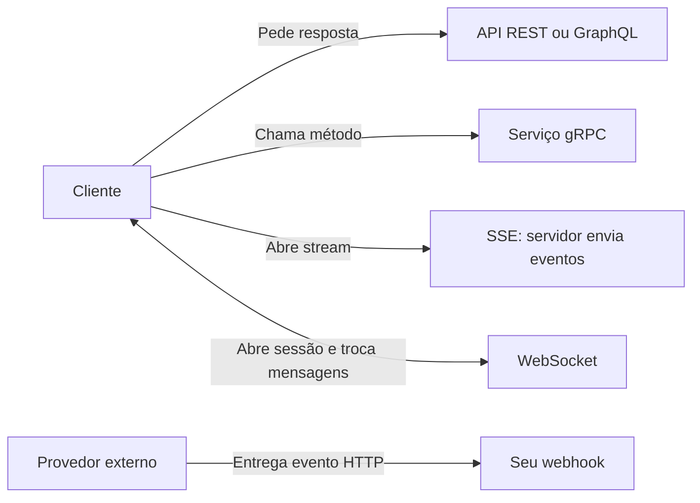

No balcão de uma pequena central de encomendas, um cliente pergunta se deve buscar cada pacote ou esperar que a entrega chegue à sua porta; a atendente lhe entrega uma caixa e aponta para o mensageiro que sai com outra. Então ele pergunta como poderia dar novas instruções ao mensageiro sem voltar ao balcão, e ela explica que, nesse caso, os dois precisariam manter um canal aberto. Em APIs, a diferença entre pedir dados, receber avisos e trocar mensagens continuamente ajuda a escolher entre REST, GraphQL, gRPC, webhooks, SSE e WebSockets — antes que uma decisão inadequada obrigue a refazer a camada de integração.

**Ideia central:** não são seis degraus de evolução nem seis concorrentes diretos. Eles resolvem problemas parcialmente diferentes. Pergunte **quem abre a conexão**, **quem envia dados depois**, **quem é o consumidor** e **qual garantia o negócio exige**. REST é uma escolha inicial frequentemente econômica, não uma regra universal.

<nav aria-label="Neste artigo"><strong>Neste guia</strong><ul><li><a href="#api-perguntas">Duas perguntas e uma distinção</a></li><li><a href="#api-rest">REST</a></li><li><a href="#api-graphql">GraphQL</a></li><li><a href="#api-grpc">gRPC</a></li><li><a href="#api-webhooks">Webhooks</a></li><li><a href="#api-sse">SSE</a></li><li><a href="#api-websocket">WebSockets</a></li><li><a href="#api-matriz">Matriz e decisões</a></li><li><a href="#api-falhas">Custos, falhas e migração</a></li><li><a href="#api-fontes">Fontes</a></li></ul></nav>

## 1. As perguntas que separam mecanismos de modismos

A primeira pergunta é **quem inicia a conexão ou a requisição?** Em REST, GraphQL e chamadas gRPC, normalmente é o consumidor. Em SSE e WebSockets no navegador, *também é o cliente* que estabelece a conexão; só então o servidor pode enviar eventos por ela. No webhook, um provedor externo abre uma nova requisição HTTP para um endpoint seu quando ocorre um evento. Confundir início da conexão com direção das mensagens produz comparações ruins.

A segunda pergunta é **quem está na outra ponta e que tipo de interação é necessário?** Um navegador, um app móvel, outro serviço sob seu controle e uma plataforma terceirizada não impõem as mesmas restrições de CORS, proxies, contratos, autenticação, evolução e reconexão. O consumidor pode precisar de uma resposta pontual, de muitos campos relacionados, de streaming unidirecional ou de troca simultânea de mensagens.

<!-- tech-topics:mermaid {"label":"REST, GraphQL e gRPC começam com pedido do cliente; SSE e WebSockets mantêm uma conexão aberta pelo cliente; webhook é entregue em uma nova requisição pelo provedor externo."} -->

<figcaption>O sentido das setas indica como uma interação começa e como os dados fluem. No SSE o cliente abre o fluxo; no webhook o provedor efetivamente inicia a entrega.</figcaption>

Ver o código Mermaid
<pre class="code-block">flowchart LR
  C[Cliente] --&gt;|Pede resposta| A[API REST ou GraphQL]
  C --&gt;|Chama método| R[Serviço gRPC]
  C --&gt;|Abre stream| S[SSE: servidor envia eventos]
  C &lt;--&gt;|Abre sessão e troca mensagens| W[WebSocket]
  P[Provedor externo] --&gt;|Entrega evento HTTP| H[Seu webhook]</pre>

O levantamento [State of the API 2025, da Postman](<https://www.postman.com/state-of-api/2025/>) coletou respostas de mais de 5.700 profissionais. No conjunto pesquisado, REST aparece em 93%, webhooks em 50%, WebSockets em 35%, GraphQL em 33%, gRPC em 14% e SSE em 12%. **São proporções de uso autorrelatado, não uma classificação de desempenho nem fatias exclusivas de mercado:** uma mesma equipe pode empregar vários estilos.

## 2. REST: recursos, semântica HTTP e cache previsível

Representational State Transfer é um estilo arquitetural descrito por Roy Fielding, não sinônimo de JSON sobre HTTP ou de CRUD. Em sistemas RESTful, recursos têm identificadores, representações são transferidas através de uma interface uniforme e as requisições são autossuficientes. Na prática, APIs HTTP costumam usar `GET /orders/42` para leitura e `POST /orders` para criação, respeitando a semântica dos métodos.

A vantagem específica do ecossistema HTTP é que caches de navegador, proxy ou CDN entendem `GET`, `Cache-Control`, `ETag` e respostas condicionais. Isso não significa que toda resposta REST seja cacheável: autenticação, personalização, privacidade e cabeçalhos alteram as regras. O [RFC 9110](<https://www.rfc-editor.org/rfc/rfc9110.html>) documenta a semântica dos métodos e de cache; o [RFC 9111](<https://www.rfc-editor.org/rfc/rfc9111.html>) aprofunda caching HTTP.

<pre class="code-block"><code>GET /catalog/products/42 HTTP/1.1
Accept: application/json

HTTP/1.1 200 OK
Cache-Control: public, max-age=60
ETag: "product-42-v7"
Content-Type: application/json

{"id":42,"name":"Caderno"}</code></pre>

O cache público acima só faria sentido se a representação fosse realmente compartilhável. Em aplicações com Spring Security, os headers padrão incluem `Cache-Control: no-cache, no-store, max-age=0, must-revalidate` para proteger conteúdo sensível. Revise a política explicitamente para recursos públicos em vez de desativar a proteção globalmente; veja a [documentação do Spring Security](<https://docs.spring.io/spring-security/reference/servlet/exploits/headers.html>).

**Escolha REST** para recursos e operações compreensíveis, clientes heterogêneos, APIs públicas, cache HTTP e manutenção simples. **Reconsidere** se telas precisam sempre encadear muitas chamadas de composição de dados ou se a exigência central é uma conversa bidirecional contínua. Evolua por contratos, paginação, validação, autorização e versão; uma coleção de endpoints não garante boa arquitetura por si só.

## 3. GraphQL: o cliente descreve a forma da resposta

GraphQL nasceu no Facebook em 2012 para aplicações cliente-servidor, particularmente necessidades de dados em interfaces, e seu desenvolvimento como padrão aberto começou em 2015. Não foi criado para resolver especificamente a API REST do GitHub; o GitHub viria a adotá-lo. A [especificação GraphQL de setembro de 2025](<https://spec.graphql.org/September2025/>) descreve seleção tipada de campos, execução e validação de consultas.

<pre class="code-block"><code>query OrderDetails($id: ID!) {
  order(id: $id) {
    id
    total
    items { quantity product { name } }
  }
}</code></pre>

O frontend pode pedir precisamente os campos usados na tela e reunir relações em uma única operação. Isso reduz over-fetching e under-fetching na fronteira de rede, mas **não garante** menos consultas ao banco. Se cada um de 100 itens dispara individualmente uma consulta de produto, uma operação GraphQL pode resultar em 101 consultas ao banco: o clássico problema N+1. Um DataLoader com batching, cache por requisição e consultas bem desenhadas pode reduzir o número; a [documentação de Spring GraphQL](<https://docs.spring.io/spring-graphql/reference/request-execution.html>) detalha o mecanismo.

O cache é mais complexo, **não impossível**. Consultas GraphQL enviadas via `POST` com corpo variável não usam facilmente uma chave simples de URL em CDN. Consultas seguras via `GET`, operações persistidas, chaves por hash, cache normalizado no cliente e regras de invalidação recuperam parte dessa capacidade, ao custo de desenho adicional. Também é necessário limitar profundidade, complexidade e custo de consultas para evitar abuso.

**Escolha GraphQL** quando múltiplos clientes têm necessidades muito diferentes de dados relacionados e a equipe consegue governar o schema, os resolvers e o custo das queries. Não escolha apenas para reduzir o número aparente de endpoints: o custo pode migrar para o grafo de execução, o cache e a observabilidade.

## 4. gRPC: contratos tipados para chamadas entre serviços

O gRPC surgiu no Google a partir da experiência com RPC interno e popularizou contratos definidos em arquivos `.proto`, com Protocol Buffers como linguagem e formato padrão. Em sua implementação usual sobre HTTP/2, usa payloads binários, multiplexação e permite gerar clientes tipados para diferentes linguagens. Não é correto afirmar que será sempre mais rápido: latência depende também do tamanho das mensagens, execução no servidor, rede, carga e instrumentação.

<pre class="code-block"><code>syntax = "proto3";

service Inventory {
  rpc Reserve(ReserveRequest) returns (ReserveReply);
  rpc WatchStock(StockQuery) returns (stream StockEvent);
}
message ReserveRequest { string sku = 1; int32 amount = 2; }
message ReserveReply { bool accepted = 1; }
message StockQuery { string sku = 1; }
message StockEvent { int32 available = 1; }</code></pre>

Há quatro formas de chamada: unária, streaming do servidor, streaming do cliente e streaming bidirecional. Todas começam com uma chamada do cliente. Em backend controlado pela mesma organização, o contrato estrito, o codegen e o streaming favorecem serviços de alta frequência; em fronteiras públicas, proxies, debugging, compatibilidade e suporte de clientes podem pesar mais. A documentação oficial de [conceitos do gRPC](<https://grpc.io/docs/what-is-grpc/core-concepts/>) descreve esses fluxos.

Navegadores não expõem todas as primitivas do gRPC nativo. gRPC-Web costuma usar um proxy como Envoy e tem restrições de streaming em relação ao gRPC completo. Consulte o [tutorial oficial de gRPC-Web](<https://grpc.io/docs/platforms/web/basics/>). Em um contrato `.proto`, preserve números de campos, evite reutilizar tags removidas e planeje evolução de schema: ter tipos fortes não elimina migrações incompatíveis.

**Escolha gRPC** para comunicação interna entre serviços sob governança comum quando contratos e streaming são requisitos objetivos. REST pode continuar sendo a borda pública e gRPC a borda interna, sem necessidade de eleger um vencedor único.

## 5. Webhooks: o outro sistema faz a requisição

Ao integrar um provedor de pagamentos, um repositório ou uma plataforma externa, consultar seu status repetidamente desperdiça requisições. Em um webhook, você publica um endpoint HTTPS e o provedor envia um `POST` quando o evento acontece. O modelo é orientado a eventos, mas a entrega normalmente continua sendo uma requisição HTTP curta, não uma conexão de streaming.

Uma assinatura do payload deve ser validada com os bytes originais e o segredo configurado, com atenção a timestamp e janela contra replay. O evento pode chegar repetido, atrasado ou fora de ordem; se houve timeout após gravar no banco, o emissor pode tentar de novo sem saber que o efeito ocorreu. Por isso, crie uma chave única de evento, persista-a em transação com o efeito quando possível e trate redeliveries como operações idempotentes. As orientações de [Stripe Webhooks](<https://docs.stripe.com/webhooks>) e [GitHub Webhooks](<https://docs.github.com/en/webhooks/using-webhooks/best-practices-for-using-webhooks>) cobrem assinatura, entregas e processamento.

<pre class="code-block"><code>POST /integrations/payments/events
verifySignature(rawBody, signature, sharedSecret)
event = parse(rawBody)
if eventIdAlreadyProcessed(event.id): respond(200)
else:
    transaction:
        recordEventId(event.id)
        applyBusinessTransition(event)
respond(200)</code></pre>

Este pseudocódigo é conceitual: a deduplicação deve persistir em armazenamento compartilhado, e a transição precisa levar em conta a versão ou o estado atual do objeto. Para trabalho demorado, confirme recebimento dentro do prazo do provedor após persistência segura e processe por fila. No GitHub, por exemplo, o endpoint deve responder com 2xx em até 10 segundos. Falha permanente pede monitoramento e reconciliação por consulta à API de origem.

**Escolha webhooks** quando o provedor controla o evento e você precisa ser notificado sem polling. Não os use como substitutos de uma interface de consulta consistente: eventos perdidos e estados reconstruídos exigem mecanismos de recuperação.

## 6. SSE: uma assinatura de eventos de mão única

Server-Sent Events usa uma resposta HTTP duradoura, com `Content-Type: text/event-stream`. O navegador inicia o pedido e o servidor envia eventos textuais com campos como `data`, `id`, `event` e `retry`. O objeto `EventSource` gerencia reconexões; o servidor pode usar `Last-Event-ID` para retomar a partir de um cursor *se* houver histórico e lógica de replay. SSE, sozinho, não garante entrega exatamente uma vez.

<pre class="code-block"><code>HTTP/1.1 200 OK
Content-Type: text/event-stream
Cache-Control: no-cache

id: 41
event: progress
data: {"status":"processing"}

id: 42
event: progress
data: {"status":"done"}</code></pre>

É uma boa opção para progresso de tarefas, feed de notificações e streaming de chunks de respostas de IA. Nem todo token corresponde necessariamente a um evento. Em HTTP/1.x, navegadores podem limitar SSE a aproximadamente seis conexões abertas por navegador e domínio; no HTTP/2, o limite passa a ser negociado em termos de streams concorrentes. Intermediários que fazem buffering também podem atrasar a visualização. A [MDN](<https://developer.mozilla.org/en-US/docs/Web/API/Server-sent_events/Using_server-sent_events>) documenta essas características.

**Escolha SSE** quando o servidor envia atualizações frequentes ao navegador e o cliente não precisa falar continuamente sobre o mesmo canal. Para envio do navegador ao backend, use requisições HTTP separadas. Avalie autenticação, reconexão, heartbeats no formato de comentário, proxies, retenção e descarte de consumidores lentos.

## 7. WebSockets: troca bidirecional em conexão persistente

Um navegador inicia um handshake HTTP e, após a negociação, cliente e servidor enviam mensagens independentemente pela mesma conexão. WebSockets fazem sentido em chat, edição colaborativa, jogos e interfaces nas quais ambos os lados produzem mensagens frequentes. O protocolo fornece enquadramento de mensagens e controles como ping/pong, mas **não fornece automaticamente** histórico, persistência, ordem global entre nós, autenticação de negócio nem reentrega após quedas.

Uma conexão persistente ocupa descritores, memória e outros recursos por cliente. Em cenário puramente ilustrativo, 50.000 conexões com 20 KiB de estado de aplicação por conexão significam aproximadamente 977 MiB apenas desse estado, sem incluir pilha de rede, buffers, TLS e overhead de runtime. É um orçamento, não uma previsão de consumo de biblioteca. Meça o seu servidor e imponha limites de buffer, frequência e conexões.

Em múltiplas instâncias, um cliente conectado ao nó A talvez precise receber evento produzido no nó B. Um barramento de mensagens, Redis Pub/Sub ou RabbitMQ pode ajudar no fan-out, mas **RabbitMQ não é obrigatório** para WebSockets. Planeje afinidade de sessão apenas se necessária, reconexão exponencial com jitter, autenticação no handshake, renovação de autorização, heartbeat e recuperação por cursor ou snapshot. A [MDN WebSocket API](<https://developer.mozilla.org/en-US/docs/Web/API/WebSockets_API>) destaca que a interface tradicional não aplica backpressure automaticamente.

STOMP pode estruturar mensagens, destinos e assinaturas sobre WebSocket; é uma escolha de camada de aplicação, não parte obrigatória do protocolo. **Escolha WebSockets** quando interação bidirecional de baixa latência for requisito recorrente. Para atualizações apenas do servidor, SSE costuma reduzir bastante o trabalho operacional.

## 8. Matriz de decisão sob as mesmas premissas

A matriz abaixo considera aplicações web e microsserviços típicos, não garantias universais de latência. Cache, segurança e escalabilidade dependem da implementação e do ambiente.

<table><thead><tr><th scope="col">Estilo</th><th scope="col">Quem inicia</th><th scope="col">Fluxo dominante</th><th scope="col">Bom encaixe</th><th scope="col">Principal custo</th></tr></thead><tbody><tr><th scope="row">REST</th><td>Cliente</td><td>Pedido e resposta</td><td>API pública, recursos e cache HTTP</td><td>Composição de dados e versionamento</td></tr><tr><th scope="row">GraphQL</th><td>Cliente</td><td>Consulta seleciona campos</td><td>Clientes com consultas divergentes</td><td>N+1, governança e cache personalizado</td></tr><tr><th scope="row">gRPC</th><td>Cliente</td><td>RPC unário ou streams</td><td>Microsserviços sob controle comum</td><td>Tooling, proxies e compatibilidade</td></tr><tr><th scope="row">Webhooks</th><td>Provedor externo</td><td>Entrega de evento por HTTP</td><td>Integrações assíncronas de terceiros</td><td>Assinatura, duplicatas e reconciliação</td></tr><tr><th scope="row">SSE</th><td>Cliente abre fluxo</td><td>Servidor para cliente</td><td>Progresso e notificações ao navegador</td><td>Conexões longas, buffering e replay</td></tr><tr><th scope="row">WebSockets</th><td>Cliente abre sessão</td><td>Ambos os sentidos</td><td>Chat, jogos e colaboração</td><td>Sessões, fan-out e backpressure</td></tr></tbody></table>

<h3>Uma heurística prática</h3>

1. **Precisa expor recursos e operações previsíveis?** Comece avaliando REST e HTTP bem especificado.
2. **Vários clientes precisam compor grafos muito distintos?** Considere GraphQL e estabeleça limites de complexidade antes da adoção.
3. **Chamadas tipadas e streaming entre serviços próprios?** Considere gRPC e uma política de evolução de schemas.
4. **O fato nasce em uma plataforma externa?** Receba webhooks e mantenha reconciliação.
5. **O navegador só escuta atualizações?** Prefira testar SSE.
6. **Ambos precisam enviar mensagens ao longo de uma sessão?** Avalie WebSockets.

Essas decisões podem coexistir: uma loja expõe REST para pedidos, GraphQL como agregador de interfaces, gRPC entre catálogo e estoque, recebe webhook de pagamentos e mostra acompanhamento por SSE. WebSockets seriam adicionados apenas se surgisse comunicação bidirecional real. Não há necessidade de reescrever a camada inteira para usar a tecnologia certa em um limite específico.

## 9. Falhas e custos que aparecem depois do protótipo

<h3>Semântica de entrega e idempotência</h3>

Uma resposta HTTP perdida não prova que a operação falhou; um webhook repetido não significa novo pagamento; um WebSocket reconectado não sabe sozinho quais mensagens perdeu. Decida onde ficam as chaves idempotentes, os offsets, a fonte de verdade e as rotas de reconciliação. Não confunda o ordenamento dentro de um stream com ordenamento global entre conexões.

<h3>Backpressure e limites de recursos</h3>

O produtor pode enviar mais rápido do que o consumidor processa. Com SSE e WebSocket, buffers crescentes precisam de limites, desacoplamento, coalescência ou desconexão controlada. Em gRPC, mecanismos de controle de fluxo ajudam, mas não substituem prazos e capacidade da aplicação. Em GraphQL, limites de custo e profundidade previnem queries excessivamente caras.

<h3>Segurança nas fronteiras</h3>

REST e GraphQL precisam de autorização por recurso ou campo, não apenas autenticação. gRPC exige políticas de identidade, mTLS quando adequado e propagação de deadline. Webhooks precisam de assinatura verificada sobre corpo bruto, replay protection e segregação de segredos. SSE e WebSockets exigem revisão de cookies, origem, autorização da assinatura e isolamento entre usuários.

<h3>Operação e observabilidade</h3>

Meça `request rate`, latência p95/p99, erros e cache hit em REST; custo de resolvers e consultas reais no GraphQL; deadlines e status nos métodos gRPC; atraso, duplicatas e falhas de entrega em webhooks; assinantes, conexões abertas, reconexões, lag e buffers em SSE/WebSockets. Instrumente limites concretos do serviço, não apenas throughput de benchmark.

<h3>Migre por necessidade, não por moda</h3>

Antes de substituir REST, registre o gargalo: por exemplo, 12 round trips para montar uma tela, eventos de terceiro detectados minutos depois, ou necessidade de colaboração simultânea. Compare uma solução incremental — agregação no backend, endpoints orientados a uso, caching, paginação, SSE ou webhook — com o custo total de uma nova tecnologia. Faça rollout por endpoint ou fronteira, com métricas, compatibilidade e rollback.

<h2>10. Resumo mental</h2>

- **REST:** recursos e semântica HTTP; bom padrão inicial, com cache sob regras explícitas.
- **GraphQL:** cliente escolhe campos; flexibilidade exige governança, limites e resolução eficiente.
- **gRPC:** contrato tipado e streaming entre serviços; compatibilidade e ecossistema de clientes importam.
- **Webhooks:** provedor entrega eventos; assinatura, deduplicação e reconciliação são parte do produto.
- **SSE:** cliente abre, servidor publica; simples para fluxo unidirecional em HTTP.
- **WebSockets:** cliente abre, ambos enviam; estado de conexão, fan-out e recuperação custam.
- **Não existe vencedor absoluto:** escolha a menor arquitetura que resolve o requisito verificável.

<h2>11. Perguntas de revisão</h2>

1. Por que dizer que o servidor inicia SSE e WebSockets é tecnicamente impreciso?
2. Por que 93% de adoção no relatório da Postman não prova que REST seja mais rápido?
3. Como uma única query GraphQL pode produzir 101 consultas SQL?
4. Por que usar gRPC-Web em um navegador pode exigir um proxy e ter streaming diferente do gRPC nativo?
5. Por que verificar uma assinatura de webhook não elimina a necessidade de idempotência?
6. Que tipo de infraestrutura extra só se torna necessária quando há múltiplas instâncias WebSocket?

<h2>12. Exercícios verificáveis</h2>

1. **Escolha arquitetural.** Desenhe três casos: catálogo público, confirmação de pagamento externo e progresso de geração de relatório. Para cada um identifique iniciador, fluxo, cliente, requisitos de replay, cache e opção inicial. Depois descreva uma condição que mudaria sua decisão.
2. **Conte consultas.** Considere uma query GraphQL que busca 100 pedidos e seu cliente. Conte 1 consulta para pedidos mais 100 buscas individuais de cliente; proponha um carregamento em lote e explique por que o resultado pode cair para duas consultas sem alterar o contrato da query.
3. **Teste de reconexão.** Modele eventos com IDs 101, 102 e 103. Interrompa SSE após o ID 101 ou desconecte WebSocket no mesmo ponto. Especifique onde os eventos restantes ficam armazenados, como o cliente informa seu cursor e o que acontece se o histórico expirou.

## 13. Fontes e leituras recomendadas

- [Postman — State of the API Report 2025](<https://www.postman.com/state-of-api/2025/>): amostra e adoção dos estilos.
- [Roy Fielding — Architectural Styles and the Design of Network-based Software Architectures (2000)](<https://www.ics.uci.edu/~fielding/pubs/dissertation/top.htm>): fundamentos de REST.
- [RFC 9110 — HTTP Semantics](<https://www.rfc-editor.org/rfc/rfc9110.html>) e [RFC 9111 — HTTP Caching](<https://www.rfc-editor.org/rfc/rfc9111.html>): métodos e cache.
- [Spring Security — Security HTTP Response Headers](<https://docs.spring.io/spring-security/reference/servlet/exploits/headers.html>): cache defaults.
- [GraphQL Specification (September 2025)](<https://spec.graphql.org/September2025/>) e [Spring GraphQL — Batch Loading](<https://docs.spring.io/spring-graphql/reference/request-execution.html>): contrato e N+1.
- [gRPC — Core Concepts](<https://grpc.io/docs/what-is-grpc/core-concepts/>) e [gRPC-Web — Basics](<https://grpc.io/docs/platforms/web/basics/>): RPC e suporte ao browser.
- [Stripe — Webhooks](<https://docs.stripe.com/webhooks>) e [GitHub — Webhook Best Practices](<https://docs.github.com/en/webhooks/using-webhooks/best-practices-for-using-webhooks>): recebimento seguro e reentrega.
- [MDN — Using Server-Sent Events](<https://developer.mozilla.org/en-US/docs/Web/API/Server-sent_events/Using_server-sent_events>) e [MDN — WebSocket API](<https://developer.mozilla.org/en-US/docs/Web/API/WebSockets_API>): streaming e conexão bidirecional.
- [Amigoscode — busca pelo vídeo de referência](<https://www.youtube.com/results?search_query=Amigoscode+API+Mistakes+You+Need+to+STOP+Before+the+Rewrite>): ponto de partida para a comparação, com nuances técnicas conferidas nas fontes primárias acima.
