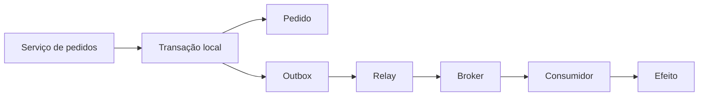
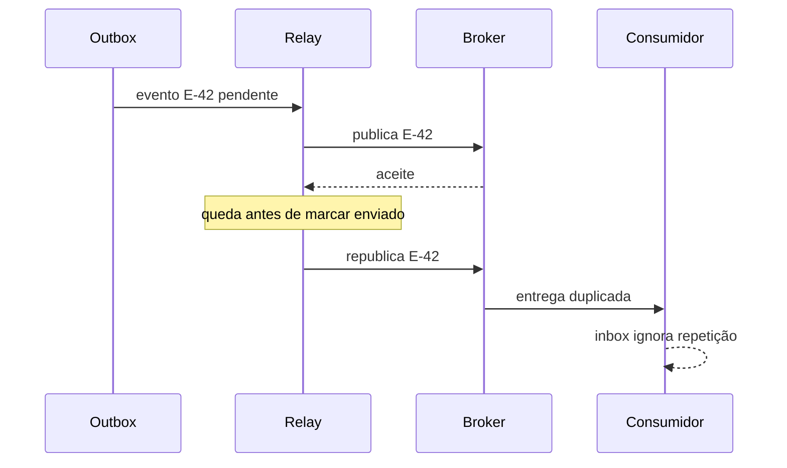
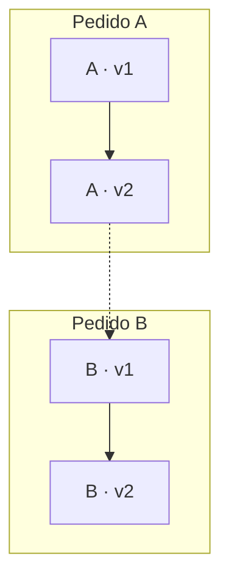
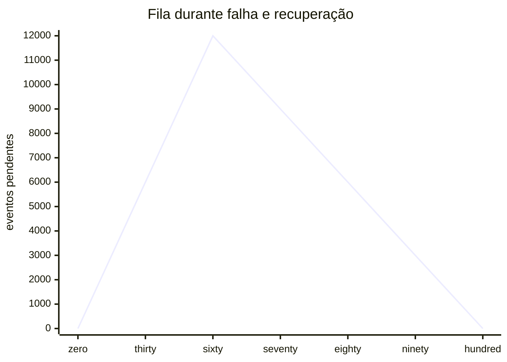

Pense num garçom que anota o pedido no caderno, mas também precisa avisar a cozinha. Se uma dessas ações falha, como garantir que a informação não desapareça? Esse é o risco da escrita dupla: o sistema salva a mudança em um banco, mas falha antes de publicar o evento que deveria avisar outro serviço. O padrão Transactional Outbox resolve isso registrando, na mesma transação local, tanto o pedido quanto a mensagem que precisa ser entregue. Depois, um processo separado leva essa mensagem até o broker, permitindo recuperar tentativas após falhas sem fingir que a entrega será exatamente uma vez.

O **Transactional Outbox**, ou caixa de saída transacional, registra o evento junto da mudança de negócio em uma única transação local. Um processo separado faz a entrega depois. A ideia central é transformar “preciso publicar” em um fato persistido, recuperável após falhas. O [catálogo de Chris Richardson](<https://microservices.io/patterns/data/transactional-outbox.html>) descreve esse padrão e sua divisão entre emissor, banco, outbox e relay.

**Contrato essencial:** a mudança e a intenção de envio são atômicas no banco. A publicação e o efeito no consumidor acontecem depois. Entrega eventual depende de recuperação, retenção e repetição; duplicatas continuam possíveis.

<h2>1. Por que trocar a ordem das escritas não resolve</h2>

Imagine um checkout que precisa salvar o pedido e publicar <code data-tts-say="pedido criado">PedidoCriado</code>. Se primeiro fizer <code lang="en-US" data-tts-say="commit">COMMIT</code> e depois enviar ao broker, uma queda entre essas etapas deixa um pedido sem evento. Se publicar primeiro e depois salvar, um rollback produz um evento sobre um pedido que nunca existiu.

<section class="signal-card">

<h3>Banco → broker</h3>

O pedido existe, mas a mensagem pode faltar. Um consumidor esperando o evento não tem como descobrir sozinho a omissão.

</section>

<section class="signal-card">

<h3>Broker → banco</h3>

A mensagem existe, mas o pedido pode faltar. Um consumidor pode iniciar um trabalho baseado em um estado que não foi confirmado.

</section>

Um bloco <code lang="en-US" data-tts-say="try catch">try/catch</code> não fecha essa janela: o processo pode terminar antes de executar o tratamento. Repetir toda a requisição também não basta; isso exige controlar a duplicação do comando de negócio. Uma transação do banco não inclui automaticamente uma chamada HTTP ou uma publicação em um broker externo.

<h2>2. Contexto histórico: mensageria e transações</h2>

Mensageria transacional antecede a popularização dos microsserviços. Gregor Hohpe e Bobby Woolf sistematizaram esse campo em *Enterprise Integration Patterns*; o padrão <a lang="en-US" href="https://www.enterpriseintegrationpatterns.com/patterns/messaging/TransactionalClient.html">Transactional Client</a> discute o controle transacional de envios e recebimentos. Ele fornece contexto para o problema, sem ser idêntico à outbox.

Chris Richardson apresenta a outbox em seu catálogo e em <a lang="en-US" href="https://www.manning.com/books/microservices-patterns"><em>Microservices Patterns</em></a>. Isso é uma referência de divulgação e organização do padrão, não uma atribuição de invenção ou de uma data de origem única.

A interpretação moderna combina transações locais, eventos de domínio e captura de mudanças. O projeto Debezium fornece um <a lang="en-US" href="https://debezium.io/documentation/reference/stable/transformations/outbox-event-router.html">Outbox Event Router</a>; a AWS também documenta o padrão em sua [orientação de arquitetura](<https://docs.aws.amazon.com/prescriptive-guidance/latest/cloud-design-patterns/transactional-outbox.html>). O princípio não exige um produto específico nem que a aplicação seja dividida em microsserviços.

<h2>3. O limite de atomicidade</h2>

Uma **transação local** confirma ou desfaz conjuntamente alterações dentro do limite suportado pelo banco. A tabela de pedidos e a outbox precisam participar da mesma transação efetiva: duas conexões com commits independentes não oferecem essa propriedade.

<!-- tech-topics:mermaid {"label":"Pedido e evento são gravados na mesma transação local antes da entrega assíncrona."} -->

<figcaption>Arquitetura conceitual. A borda tracejada delimita a transação local; as etapas de entrega ficam fora dela. O fluxo do broker para o consumidor representa outra fronteira de falha.</figcaption>

Ver o código Mermaid
<pre class="code-block">flowchart LR
  S[Serviço de pedidos] --&gt; T[Transação local]
  T --&gt; O[Pedido]
  T --&gt; X[Outbox]
  X --&gt; R[Relay]
  R --&gt; B[Broker]
  B --&gt; C[Consumidor]
  C --&gt; E[Efeito]</pre>

Para uma operação que gera um evento, denote por **C** a confirmação da transação, por **B** a mudança de negócio e por **O** o registro na outbox. A propriedade desejada é: <code data-tts-say="se a transação confirma, a mudança de negócio e o registro da outbox confirmam juntos">C ⇒ (B ∧ O)</code>; no rollback dessa operação, nem B nem O se tornam alterações confirmadas. Isso pressupõe que o código grave os dois corretamente e que as garantias de durabilidade do banco estejam configuradas para o risco aceito.

Há duas propriedades diferentes. **Segurança:** o relay não deve publicar eventos de transações abortadas. **Vivacidade:** todo evento confirmado deve progredir até a entrega. A primeira vem do desenho transacional e da leitura de commits; a segunda exige relay ativo, broker recuperável, armazenamento preservado e uma política de retries que não abandone silenciosamente o evento.

Portanto, “o commit garante o envio” é uma abreviação condicionada. Um disco perdido sem recuperação, um evento apagado cedo demais ou uma mensagem rejeitada indefinidamente quebram o caminho até a entrega. O padrão não cria disponibilidade infinita.

<h2>4. Um modelo de evento e uma gravação concreta</h2>

Um evento deve carregar sua identidade e o contexto suficiente para interpretação posterior. No exemplo abaixo, <code lang="en-US" data-tts-say="event id">event_id</code> identifica uma ocorrência; <code lang="en-US" data-tts-say="aggregate id">aggregate_id</code> identifica o pedido; <code lang="en-US" data-tts-say="aggregate version">aggregate_version</code> expressa a sequência desse pedido; <code lang="en-US" data-tts-say="schema version">schema_version</code> descreve o formato. São responsabilidades distintas.

<pre class="code-block"><code>-- PostgreSQL: modelo didático para relay por polling.
CREATE TABLE orders (
  id text PRIMARY KEY,
  status text NOT NULL,
  version bigint NOT NULL
);
CREATE TABLE outbox (
  event_id uuid PRIMARY KEY,
  aggregate_id text NOT NULL,
  aggregate_version bigint NOT NULL,
  event_type text NOT NULL,
  schema_version integer NOT NULL,
  payload jsonb NOT NULL,
  created_at timestamptz NOT NULL DEFAULT now(),
  published_at timestamptz,
  UNIQUE (aggregate_id, aggregate_version)
);
CREATE INDEX outbox_pending ON outbox(created_at)
  WHERE published_at IS NULL;

BEGIN;
INSERT INTO orders VALUES ('P-42', 'created', 1);
INSERT INTO outbox VALUES (
  '04a1c50e-0c90-4f4e-a917-68b94f13c4a1',
  'P-42', 1, 'PedidoCriado', 1,
  '{"pedidoId":"P-42","totalCentavos":12900}',
  now(), NULL
);
COMMIT;</code></pre>

O exemplo pressupõe um evento por versão do agregado; se uma mudança produzir vários eventos, acrescente uma posição dentro da versão. Para atualizações concorrentes, serialize a alteração do pedido com bloqueio apropriado ou controle otimista de versão. Uma restrição única detecta conflitos; ela não decide sozinha qual mudança deve vencer.

O payload é uma fotografia do fato ocorrido. Reconstruí-lo depois lendo o estado atual pode transformar um evento antigo em uma descrição do presente. Evite dados pessoais desnecessários e planeje evolução compatível de schema. O modelo acima é próprio para o exemplo de polling: não corresponde diretamente aos nomes e à configuração padrão do Debezium.

<h2>5. Como o relay funciona</h2>

<h3>Polling: consultar eventos pendentes</h3>

Um relay consulta a outbox periodicamente, publica e registra a confirmação. A [implementação de referência da AWS](<https://docs.aws.amazon.com/prescriptive-guidance/latest/cloud-design-patterns/transactional-outbox.html>) exemplifica leitura em lotes. Em um desenho com vários workers, cada lote também precisa de uma política explícita de posse.

1. Selecione eventos confirmados e elegíveis para tentativa.
2. Reserve o trabalho em uma transação curta, por exemplo com estado e prazo de posse persistidos.
3. Publique fora dessa transação e aguarde o aceite previsto pelo contrato do broker.
4. Marque como enviado somente após esse aceite, verificando se a posse continua válida.
5. Em falha ou resposta ambígua, preserve o evento para nova tentativa com o mesmo identificador.

No PostgreSQL, <code lang="en-US" data-tts-say="for update skip locked">FOR UPDATE SKIP LOCKED</code> permite ignorar linhas bloqueadas e é útil para workers sobre uma tabela semelhante a fila, conforme a [documentação de SELECT](<https://www.postgresql.org/docs/current/sql-select.html>). O bloqueio termina com a transação: selecionar, dar commit e publicar sem uma reserva persistida permite que outro worker selecione a mesma linha.

Manter a transação aberta durante a chamada ao broker é mais simples, mas prolonga locks e ocupa conexões durante problemas de rede. Reservas com prazo reduzem esse custo; em troca, exigem recuperação de reservas expiradas e proteção contra workers atrasados. Duplicatas ainda precisam ser toleradas. Este roteiro é arquitetura ilustrativa, não um relay de produção completo.

<h3>CDC: acompanhar mudanças confirmadas</h3>

Em vez de varrer a tabela, um relay pode acompanhar o log de transações. No PostgreSQL, a [decodificação lógica](<https://www.postgresql.org/docs/current/logicaldecoding-explanation.html>) extrai mudanças do WAL. O Outbox Event Router do Debezium transforma registros capturados em mensagens, usando campos de identidade, agregado e payload; sua [documentação oficial](<https://debezium.io/documentation/reference/stable/transformations/outbox-event-router.html>) detalha roteamento e seleção da transformação.

<section class="signal-card">

<h3>Polling</h3>

Facilita começar com SQL e um worker. Exige consulta, índice, reserva e limpeza; o intervalo influencia o atraso e a carga no banco.

</section>

<section class="signal-card">

<h3>CDC</h3>

Aproveita o fluxo de commits. Exige operar conectores, offsets, snapshots, retenção de log e recuperação compatível com o banco.

</section>

A escolha depende da carga e da capacidade operacional da equipe. CDC sobre tabelas de negócio expõe mudanças de armazenamento; CDC sobre uma outbox permite publicar um contrato de evento desenhado pela aplicação. Um “update de coluna” nem sempre equivale a um fato de domínio compreensível por outros serviços.

<h2>6. A falha inevitável entre publicar e registrar</h2>

<!-- tech-topics:mermaid {"label":"O relay cai depois do aceite do broker e republica o mesmo evento; a inbox deduplica."} -->

<figcaption>Sequência ilustrativa de falha, sem medição real. O aceite do broker não confirma a atualização da outbox nem o efeito no consumidor.</figcaption>

Ver o código Mermaid
<pre class="code-block">sequenceDiagram
  participant O as Outbox
  participant R as Relay
  participant B as Broker
  participant C as Consumidor
  O-&gt;&gt;R: evento E-42 pendente
  R-&gt;&gt;B: publica E-42
  B--&gt;&gt;R: aceite
  Note over R: queda antes de marcar enviado
  R-&gt;&gt;B: republica E-42
  B-&gt;&gt;C: entrega duplicada
  C--&gt;&gt;C: inbox ignora repetição</pre>

O relay não consegue tornar atômicos o aceite remoto e sua marca local usando apenas a transação do banco. Se marcar antes, pode perder o envio. Se marcar depois, pode repetir. A outbox normalmente escolhe a segunda opção: **entrega ao menos uma vez**, sob as condições de recuperação já descritas.

Isso também vale quando uma publicação termina em timeout: a mensagem pode ter sido aceita e sua confirmação ter se perdido. Reenvie a mesma identidade. O [catálogo do padrão](<https://microservices.io/patterns/data/transactional-outbox.html>) explicita essa janela; o PostgreSQL documenta que [slots lógicos podem reenviar mudanças após um crash](<https://www.postgresql.org/docs/current/logicaldecoding-explanation.html>). CDC não torna toda a cadeia automaticamente “exactly once”.

<h3>Inbox: deduplicar junto com o efeito</h3>

No consumidor, grave o ID recebido em uma tabela com chave única e aplique o efeito **na mesma transação local**. Se a inserção do ID indicar uma duplicata, não repita o efeito. Se o efeito falhar, desfaça também o registro do ID; a próxima entrega poderá tentar novamente.

<pre class="code-block"><code>BEGIN;
-- (consumer_name, event_id) deve ser uma chave unica.
INSERT INTO inbox (consumer_name, event_id)
VALUES ('estoque', :event_id)
ON CONFLICT DO NOTHING
RETURNING event_id;

-- A aplicacao executa o efeito SOMENTE se RETURNING trouxe uma linha.
-- Se qualquer parte falhar, ROLLBACK de inbox e efeito juntos.
-- Caso contrario, COMMIT e depois ACK no broker.
COMMIT;</code></pre>

Esse trecho é pseudocódigo SQL com parâmetro, não um comando autossuficiente. A demonstração Python ao final implementa essa condição de forma executável. A chave inclui o consumidor porque consumidores independentes podem precisar aplicar efeitos diferentes para o mesmo evento.

Se o consumidor cair após o commit e antes do ACK, a reentrega encontra o ID e não repete a alteração local. Mas enviar um e-mail ou cobrar por uma API externa fica fora dessa atomicidade. Para esses efeitos, use a idempotência oferecida pelo destino, outra outbox ou reconciliação. Não trate a inbox como proteção universal.

A retenção da inbox precisa cobrir o horizonte de reentrega e replay suportado. Apagar os IDs enquanto mensagens antigas ainda podem voltar reabre a possibilidade de efeito duplicado. A idempotência do comando recebido pela API é outro controle: repetir o checkout pode gerar um novo pedido e um novo evento, ambos perfeitamente válidos para a outbox.

<h2>7. Ordenação: a chave é necessária, mas insuficiente</h2>

Em muitos domínios, importa que <code data-tts-say="pedido criado versão um">PedidoCriado(v1)</code> anteceda <code data-tts-say="pedido cancelado versão dois">PedidoCancelado(v2)</code> para o mesmo pedido. Não é necessário ordenar todos os pedidos do mundo. O [Debezium usa o identificador do agregado como chave](<https://debezium.io/documentation/reference/stable/transformations/outbox-event-router.html>), importante para encaminhar sua sequência às partições Kafka.

<!-- tech-topics:mermaid {"label":"Eventos do mesmo pedido mantêm sequência própria, sem ordenar pedidos diferentes globalmente."} -->

<figcaption>Esquema de duas partições, ilustrativo. A separação pressupõe roteamento estável; na prática, pedidos diferentes também podem compartilhar uma partição.</figcaption>

Ver o código Mermaid
<pre class="code-block">flowchart TB
  subgraph A[Pedido A]
    A1[A · v1] --&gt; A2[A · v2]
  end
  subgraph B[Pedido B]
    B1[B · v1] --&gt; B2[B · v2]
  end
  A2 -. sem ordem global .- B1</pre>

A chave não conserta uma ordem já invertida no relay. Dois workers podem reservar v1 e v2 e publicar v2 primeiro. Um timestamp ou ID crescente também não prova ordem de commit entre transações concorrentes.

Para uma exigência forte, serialize as versões do mesmo agregado no produtor e preserve essa ordem no relay e no consumo. Uma estratégia é processar agregados por worker e impedir que v2 ultrapasse v1 pendente. Isso introduz bloqueio de progresso: um evento inválido de A pode parar os seguintes de A. O consumidor pode manter a última versão aplicada para detectar lacunas, mas precisa decidir se espera, reconcilia ou aceita uma semântica de atualização diferente.

<h2>8. Quanto backlog cabe em uma falha?</h2>

Uma outbox absorve uma indisponibilidade do broker enquanto houver capacidade no banco. Modele a entrada como **λ** eventos/s e a saída efetiva como **μ** eventos/s. Enquanto a fila não está vazia, sua variação é `dQ/dt = λ − μ`. Em zero, Q não pode ficar negativa. É um modelo fluido calculado, com taxas constantes por intervalo; não representa rajadas ou medições deste site.

Se o broker ficar indisponível por T segundos, com fila inicialmente vazia, `Q = λT`. Para λ = 200 eventos/s e T = 60 s, acumulam-se **12.000 eventos**. Após recuperar uma saída de 500 eventos/s, ainda entram 200/s: a drenagem líquida é 300/s, e `T_drenagem = 12.000/(500 − 200) = 40 s`.

<!-- tech-topics:mermaid {"label":"Backlog cresce durante a falha e drena depois da recuperação do broker."} -->

<figcaption>Dados calculados pelo modelo descrito no texto. Eixo horizontal: segundos desde a falha; eixo vertical: milhares de eventos pendentes. Linha contínua: broker indisponível. Linha tracejada: recuperação com saída de 500 eventos/s.</figcaption>

Ver o código Mermaid
<pre class="code-block">xychart-beta
  title "Fila durante falha e recuperação"
  x-axis [0s, 30s, 60s, 70s, 80s, 90s, 100s]
  y-axis "eventos pendentes" 0 --&gt; 12000
  line [0, 6000, 12000, 9000, 6000, 3000, 0]</pre>

Se μ = λ, a fila acumulada permanece; se μ < λ, continua crescendo. Dimensionar só para a taxa normal não permite recuperar o atraso. Se cada registro ocupar em média 2 KiB, 12.000 registros representam aproximadamente 23,4 MiB de dados, antes de índices, WAL, réplicas e overhead. O tamanho por evento é uma hipótese ilustrativa.

No polling periódico de intervalo Δ, uma chegada uniformemente distribuída no intervalo tem espera média de detecção Δ/2. Com Δ = 1 s, são 0,5 s antes de publicar, além do tempo de consulta, fila e rede. Essa conta pressupõe varredura capaz de acompanhar a entrada e agendamento regular; não é um percentil de latência.

<h2>9. Operação, recuperação e anti-padrões</h2>

O backlog total e a idade do evento pendente mais antigo respondem perguntas diferentes. Dez eventos presos há uma hora podem ser mais graves do que milhares acumulados durante um pico curto. Meça também tentativas, rejeições, tempo entre commit e aceite do broker, tempo até o efeito e deduplicações. Evite usar IDs de pedidos como labels de métricas; coloque-os nos logs ou traces.

Uma política útil de recuperação mantém identidade estável, limita pressão de retries com espera progressiva e registra a causa de rejeições. Mensagens inválidas precisam de quarentena visível e caminho de correção e reprocessamento. Removê-las silenciosamente troca uma falha operacional por perda de informação. Quarentenar v1 e deixar v2 seguir exige rever o contrato de ordem.

Em CDC, acompanhe também o atraso do conector e o log retido. A [documentação do PostgreSQL alerta que slots preservam recursos necessários mesmo sem cliente conectado](<https://www.postgresql.org/docs/current/logicaldecoding-explanation.html>). Um conector parado pode transformar uma pane de entrega em pressão de disco no banco.

- **Enviar dentro da transação e chamar isso de atômico:** prolonga a transação, mas não inclui o broker no commit local.
- **Gerar outro event\_id em cada retry:** faz a duplicata parecer uma nova ocorrência.
- **Marcar enviado antes do aceite:** deixa uma janela de perda; um aceite também precisa ter durabilidade compatível com o contrato.
- **Limpar sem considerar recuperação:** descarte prematuro da outbox, inbox ou log impede replays seguros.
- **Confiar só na biblioteca:** caminhos de escrita que esquecem a outbox continuam criando omissões.

<h2>10. Trade-offs e conceitos vizinhos</h2>

A outbox acrescenta escritas, armazenamento e componentes operacionais. Aceita atraso entre o estado local e as projeções externas; por isso, a interface pode precisar mostrar “pedido recebido, processamento pendente”. Um sucesso da API deve significar o que seu contrato realmente garante, e não que todas as integrações já terminaram.

Ela costuma fazer sentido quando uma mudança persistida exige notificação externa confiável. Se todo o trabalho cabe em uma transação do mesmo banco, uma transação local simples pode bastar. Para telemetria descartável, o custo de armazenar cada ocorrência pode ser excessivo. Para invariantes que exigem confirmação conjunta e imediata entre participantes, avalie transações distribuídas ou redesenhe a fronteira; a outbox não oferece essa confirmação conjunta.

<section class="signal-card">

<h3>Sagas e CQRS</h3>

Uma saga coordena etapas e compensações; a outbox pode transportar seus eventos. CQRS separa responsabilidades de leitura e escrita; a outbox pode alimentar projeções.

</section>

<section class="signal-card">

<h3>Event Sourcing e idempotência</h3>

Event Sourcing mantém eventos como fonte do estado. Uma outbox pode ser transitória e coexistir com tabelas comuns. Idempotência limita efeitos de repetições.

</section>

São relações arquiteturais, não sinônimos. Guardar mensagens em uma outbox não converte automaticamente uma aplicação em Event Sourcing; adicionar um broker não resolve a coordenação de uma saga.

<h2>11. Experimentos executáveis</h2>

A página apresenta estados e gráficos estáticos. O experimento abaixo roda localmente com **Python 3 e biblioteca padrão**; usa SQLite em memória e uma lista como broker. A falha é simulada no código, sem processo realmente encerrado, sem rede, CDC, concorrência ou persistência entre execuções.

<a href="../../assets/transactional-outbox/transactional-outbox-experimento.py" download="">Baixar o experimento Python completo</a>, salvar como `transactional-outbox-experimento.py` e executar:

<pre class="code-block"><code>python3 transactional-outbox-experimento.py</code></pre>

Ver o código completo

<pre class="code-block"><code>"""Tech Topics: experimento local de outbox; Python 3, somente biblioteca padrao.
Bancos em memoria e broker representado por lista. Falha simulada em codigo,
nao por queda real de processo. Nao implementa concorrencia, CDC ou rede.
"""
import sqlite3

producer = sqlite3.connect(":memory:")
consumer = sqlite3.connect(":memory:")
producer.executescript("""
CREATE TABLE orders (id TEXT PRIMARY KEY);
CREATE TABLE outbox (id TEXT PRIMARY KEY, order_id TEXT, sent INTEGER DEFAULT 0);
""")
consumer.executescript("""
CREATE TABLE inbox (event_id TEXT PRIMARY KEY);
CREATE TABLE effects (order_id TEXT PRIMARY KEY, applications INTEGER NOT NULL);
""")

def create_order(order_id, event_id, fail=False):
    with producer:
        producer.execute("INSERT INTO orders VALUES (?)", (order_id,))
        producer.execute("INSERT INTO outbox(id, order_id) VALUES (?, ?)",
                         (event_id, order_id))
        if fail:
            raise RuntimeError("falha antes do commit")

try:
    create_order("A", "E-A", fail=True)
except RuntimeError:
    pass
assert producer.execute("SELECT count(*) FROM orders").fetchone()[0] == 0
assert producer.execute("SELECT count(*) FROM outbox").fetchone()[0] == 0
print("Rollback: 0 pedidos, 0 eventos")

create_order("A", "E-A")
broker = []

def relay(fail_after_publish=False):
    for event_id, order_id in producer.execute(
            "SELECT id, order_id FROM outbox WHERE sent = 0").fetchall():
        broker.append((event_id, order_id))  # aceite simulado pelo broker
        if fail_after_publish:
            return  # simula queda antes de marcar; evento continua pendente
        with producer:
            producer.execute("UPDATE outbox SET sent = 1 WHERE id = ?", (event_id,))

relay(fail_after_publish=True)
relay()
assert broker == [("E-A", "A"), ("E-A", "A")]
print("Relay: 2 entregas do mesmo evento")

for event_id, order_id in broker:
    with consumer:
        inserted = consumer.execute(
            "INSERT OR IGNORE INTO inbox VALUES (?)", (event_id,)).rowcount
        if inserted:
            consumer.execute("INSERT INTO effects VALUES (?, 1)", (order_id,))

assert consumer.execute("SELECT applications FROM effects").fetchone()[0] == 1
assert consumer.execute("SELECT count(*) FROM inbox").fetchone()[0] == 1
print("Inbox: 1 efeito aplicado")
</code></pre>

<h3>Experimento 1 — provar o rollback conjunto</h3>

Execute o arquivo e confira `Rollback: 0 pedidos, 0 eventos`. Depois mova a inserção da outbox para depois do bloco transacional e provoque a falha antes dela. Observe que uma confirmação separada pode deixar um pedido sem evento. Faça essa alteração apenas na cópia local.

<h3>Experimento 2 — reproduzir a janela de duplicação</h3>

O relay simula uma queda depois do aceite e antes da marca de envio. A saída deve mostrar `Relay: 2 entregas do mesmo evento` e `Inbox: 1 efeito aplicado`. Como variação mental, pergunte o que ocorreria se o efeito e o ID fossem gravados em commits distintos e houvesse uma queda entre eles.

<h3>Experimento 3 — planejar a recuperação</h3>

Calcule uma entrada de 300 eventos/s, falha de 120 s e recuperação com saída de 450/s. Qual a fila máxima e o tempo de drenagem, mantendo a entrada? Repita com saída de 300/s.

Conferir o resultado calculado

Q = 300 × 120 = 36.000 eventos. A drenagem líquida de 150/s exige 240 s após a recuperação. Com saída de 300/s, não há drenagem líquida: o backlog permanece enquanto a entrada continuar nessa taxa.

<h2>12. Resumo mental e revisão</h2>

**Persistir primeiro a obrigação:** pedido e evento nascem juntos no commit local. O relay tenta entregar até obter aceite. O consumidor tolera repetição e aplica sua alteração junto com a deduplicação. Ordem, retenção e recuperação precisam de contratos explícitos.

1. Por que inverter a ordem entre banco e broker troca o tipo de falha, sem eliminar a escrita dupla?
2. Qual propriedade vem da transação local e qual depende de progresso operacional?
3. Em que ponto o relay pode produzir uma duplicata mesmo com um broker saudável?
4. Por que inbox e efeito precisam compartilhar a transação? Qual efeito externo continua desprotegido?
5. Por que a chave do agregado não garante sozinha a ordem entre dois workers?
6. Se a saída após recuperação igualar a entrada, o que acontece com o backlog acumulado?

<h2>Fontes e leituras</h2>

Fontes consultadas em 12 de setembro de 2026. Documentações nos caminhos `current` e `stable` podem evoluir. Os cenários, o código SQLite e os cálculos deste artigo são exemplos didáticos próprios, não benchmarks nem resultados publicados pelas fontes.

- Chris Richardson — [Transactional Outbox](<https://microservices.io/patterns/data/transactional-outbox.html>). Definição do padrão, participantes e janela de duplicação.
- Chris Richardson — <a lang="en-US" href="https://www.manning.com/books/microservices-patterns"><em>Microservices Patterns</em></a>, Manning. Livro para aprofundar padrões de comunicação e gestão de dados.
- Gregor Hohpe e Bobby Woolf — [Transactional Client, em *Enterprise Integration Patterns*](<https://www.enterpriseintegrationpatterns.com/patterns/messaging/TransactionalClient.html>). Contexto clássico de mensageria transacional.
- AWS Prescriptive Guidance — <a lang="en-US" href="https://docs.aws.amazon.com/prescriptive-guidance/latest/cloud-design-patterns/transactional-outbox.html">Transactional outbox pattern</a>. Escrita dupla e exemplos de implementação.
- Debezium — <a lang="en-US" href="https://debezium.io/documentation/reference/stable/transformations/outbox-event-router.html">Outbox Event Router</a>. Modelo de tabela, identidade, chave e roteamento.
- PostgreSQL — <a lang="en-US" href="https://www.postgresql.org/docs/current/logicaldecoding-explanation.html">Logical Decoding Concepts</a>. WAL, reenvio após falha e retenção por slots.
- PostgreSQL — [SELECT: cláusulas de bloqueio](<https://www.postgresql.org/docs/current/sql-select.html>). Comportamento e limites de `SKIP LOCKED`.

<a class="article-back" href="index.html#recent-posts">← Voltar para o arquivo</a>
