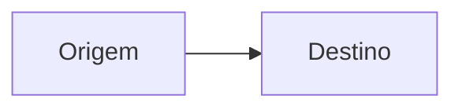

# Compilador Markdown de artigos (M04)

Este módulo isolado oferece um limite Node para compilar uma fonte editorial em slots HTML em memória. A integração com build, carregador, catálogo e áudio pertence à task #93.

## API

```js
const compiled = await compileMarkdownArticle({
  source,
  sourcePath: "content/articles/exemplo.md",
  rootPath,
  knownTags,
  knownSlugs,
  assetExists
});
const legacy = fromLegacyArticle(existingRecord, { rootPath, assetExists });
const html = renderArticleEnvelope(compiled, { buildId });
```

`compileMarkdownArticle` retorna `{ metadata, slots: { heading, dek, body } }`. `fromLegacyArticle` adapta um registro JSON antigo em memória e aceita ausência de `tags` durante a transição, sem classificar o artigo. Nenhuma função serializa um artigo completo intermediário. `renderArticleEnvelope` monta o envelope `html-v1` usado na fronteira de integração; ele não repete o título, dek ou corpo fora dos três slots.

O chamador injeta obrigatoriamente o registry `knownTags`; `knownSlugs` também é obrigatório quando o artigo declara prerequisites. `assetExists` pode ser injetado pelo build; sem callback, o compilador exige arquivo regular existente e verifica `realpath` confinado ao `rootPath` para capas e recursos locais. O módulo não cria taxonomia nem tenta deduzir slugs ou arquivos ausentes. `sourcePath` é sempre `content/articles/<slug>.md`; imagens do frontmatter usam `assets/<slug>/<slug>-cover.jpg`. URLs Markdown relativas são resolvidas desde o diretório do `.md`, confinadas à raiz e mapeadas para os URLs do shell. Recursos locais precisam existir. URLs externas são aceitas somente em links HTTP(S), `mailto:` e `tel:`; imagens remotas são recusadas.

## Frontmatter e estrutura

YAML é interpretado com YAML 1.2 Core. A data ISO é uma string e precisa ser uma data real. O contrato rejeita chaves duplicadas/desconhecidas, tipos de tag personalizados, anchors/aliases, merge keys e limites acima de 128 KiB, 10 mil nós ou 40 níveis. `tags` é obrigatório no Markdown e composto por IDs únicos kebab-case ASCII. `updatedAt`, `level`, `series`/`seriesOrder` e `prerequisites` são opcionais; prerequisites são validados contra os slugs injetados quando presentes. `fromLegacyArticle` não inventa tags.

Título e dek usam runs de `speechMarkup` que concatenam exatamente ao texto visível. `lang` e `data-tts-say`/`data-tts-mode` do corpo sobrevivem como atributos semânticos; conflitos e valores inválidos falham. A primeira unidade de conteúdo deve ser prosa num único `<p>`, sem imagem antes ou dentro dela. Âncoras legadas são a única forma de IDs explícitos:

```html
<a name="id-estavel"></a>

## Título da seção
```

O compilador associa `id-estavel` ao heading seguinte, sem criar um parágrafo narrável adicional. Títulos de seção começam em `##`; o envelope fornece o único `h1`, inclusive quando o corpo contém HTML bruto aninhado. Unicode e links de fragmento são mantidos. IDs duplicados após normalização NFKC e case-folding falham. Os namespaces `article-`, `recording-`, `speech-`, `tts-`, `header-`, `listen-` e `inline-recording-` são reservados para que controles atuais e futuros do shell não sejam sequestrados por fragmentos; a reserva é aplicada também a âncoras legadas e atributos HTML brutos.

## Mermaid

O fence continua legível para o preview Markdown do GitHub. Um comentário HTML declarativo imediatamente antes guarda JSON com exatamente `label`, `caption` e `fallback` não vazios:

```html
<!-- diagram: {"label":"Fluxo acessível","caption":"A origem chega ao destino.","fallback":"flowchart LR\n  A --> B"} -->

```

Metadados órfãos, duplicados, JSON duplicado/inválido ou texto entre comentário e fence falham. A saída cria `figure.mermaid-figure`, `div[data-mermaid][data-mermaid-label]`, `pre.mermaid-source`, `figcaption` e `details.mermaid-fallback`. Para não habilitar opções permissivas da engine no navegador, o código rejeita diretivas Mermaid `%%{...}%%`, comandos `click` no início de linha ou após separador de instrução, HTML executável e esquemas JavaScript. Texto de label que apenas contenha a palavra `click` permanece válido. Diagrama técnico não precisa de HTML inline nem de uma saída SVG.

## Tabelas e `srcset`

Tabelas GFM são envolvidas em `div.article-table-scroll` com `tabindex="0"`, `role="region"` e `aria-label`. Tabelas HTML existentes podem declarar seus próprios wrappers.

O parser local de `srcset` aceita a gramática restrita `URL [descritor]`, com um descritor positivo `x` ou `w` por candidato; não mistura densidade e largura, nem aceita descritores repetidos. Várias candidatas exigem descritores. URL, path, protocolo e existência são validados separadamente para cada candidata. Vírgulas dentro da URL devem ser percent-encoded, evitando ambiguidade com o separador GFM/HTML.

## Segurança e diagnóstico

Markdown GFM vira AST no Node. HTML controlado é convertido por `rehype-raw`, depois inspecionado antes de passar por `rehype-sanitize`; uma comparação de snapshots falha se o sanitizer removesse ou alterasse conteúdo que já passou pelo allowlist. O HTML final é analisado novamente pelo parse5 para verificar tags, atributos, IDs, imagens, URLs e `srcset`. Nenhum script ou handler é permitido. Mensagens incluem o `sourcePath` para localizar a falha. O browser e o Python não recebem renderer Markdown.

A lista de elementos, atributos e classes é uma allowlist explícita focada no contrato editorial existente e no simulador *Four Golden Signals*. Não há remoção por regex do HTML. Quando o allowlist não cobre um componente legítimo, o compilador falha com diagnóstico para a regra ser revista.

## Dependências fixadas

As versões abaixo estão fixadas exatamente em `package.json` e `package-lock.json`; `npm ci` é necessário para reproduzir o conjunto:

| Pacote | Versão |
|---|---:|
| `parse5` | `8.0.1` |
| `rehype-raw` | `7.0.0` |
| `rehype-sanitize` | `6.0.0` |
| `rehype-stringify` | `10.0.1` |
| `remark-frontmatter` | `5.0.0` |
| `remark-gfm` | `4.0.1` |
| `remark-parse` | `11.0.0` |
| `remark-rehype` | `11.1.2` |
| `unified` | `11.0.5` |
| `yaml` | `2.8.3` |

As versões foram resolvidas do registry npm em 25/10/2026, travadas no lockfile e instaladas com Node 22. `yaml@2.8.3` inclui a correção do advisory oficial [GHSA-48c2-rrv3-qjmp](https://github.com/eemeli/yaml/security/advisories/GHSA-48c2-rrv3-qjmp), que afeta versões anteriores a 2.8.3 por recursão profunda. `remark-gfm` implementa tabelas, autolinks, footnotes, strikethrough e task lists conforme a extensão GFM e documenta suporte a Node 16+ no [projeto oficial](https://github.com/remarkjs/remark-gfm). Os projetos Unified explicam que HTML de autoria só deve ser processado para conteúdo não confiável com `rehype-raw` seguido de `rehype-sanitize` ([remark-rehype](https://github.com/remarkjs/remark-rehype), [rehype-sanitize](https://github.com/rehypejs/rehype-sanitize)). `parse5` é parser HTML5 compatível com o WHATWG ([projeto oficial](https://github.com/inikulin/parse5)). O relatório `npm audit` da instalação inicial indicou 0 vulnerabilidades; isso não substitui revisão de alterações e política de segurança do upstream.

Teste focado: `npm run test:markdown-article` (Node 22). A suite usa fixture complexa e negativos; não executa navegador, build de produção, geração de áudio ou publicação.
