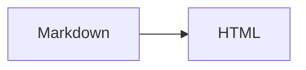

Uma conversa começa com uma observação cotidiana e apresenta o conceito sem depender de outro bloco.

## Uma seção

| item | explicação |
| --- | --- |
| AST | árvore |

Markdown seguro.

[Outro artigo](../../content/articles/outro.md?modo=leitura#intro)

<!-- diagram: {"label":"Fluxo de compilação","caption":"O fluxo separa fonte e HTML.","fallback":"flowchart LR\n A --> B"} -->

[Ir para a âncora preservada](#âncora-antiga)

