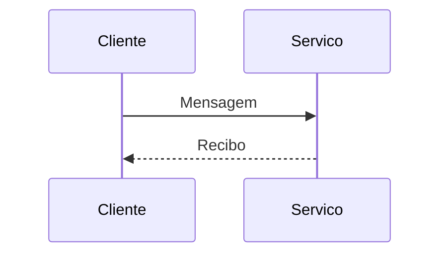

Uma pessoa entrega uma mensagem e verifica o recibo. Este primeiro parágrafo é a abertura.

<a name="recibo"></a>

## Recibo

O <span lang="en-US">acknowledgement</span> mantém o idioma. O código <code data-tts-say="xis é igual a um">x = 1</code> preserva o alias.

<!-- tech-topics:mermaid {"label":"Entrega e recibo"} -->



<figcaption>O <span lang="pt-BR">recibo</span> confirma a entrega.</figcaption>

<details class="mermaid-fallback">
<summary>Descrição textual do fluxo</summary>
Cliente envia mensagem ao serviço; o serviço responde com recibo.
</details>

<!-- tech-topics:table {"label":"Mensagem e confirmação"} -->

| Etapa | Resultado |
| --- | --- |
| Enviar | Mensagem entregue |
| Confirmar | Recibo recebido |

Baixe o [experimento existente](../../assets/hedged-requests/hedged-requests-experimento.py) e consulte [Four Golden Signals](four-golden-signals.md).

<div class="article-callout"><p>Um componente especial continua legível sem JavaScript.</p></div>

```python
print("fixture sem efeitos externos")
```

Esta fixture define sintaxe para M04, não é artigo publicável: a capa é deliberadamente ausente, não está no inventário e o compilador/preview ainda precisam de validação. Um teste futuro deve fornecer assets em repositório temporário e não relaxar validações para publicá-la.
